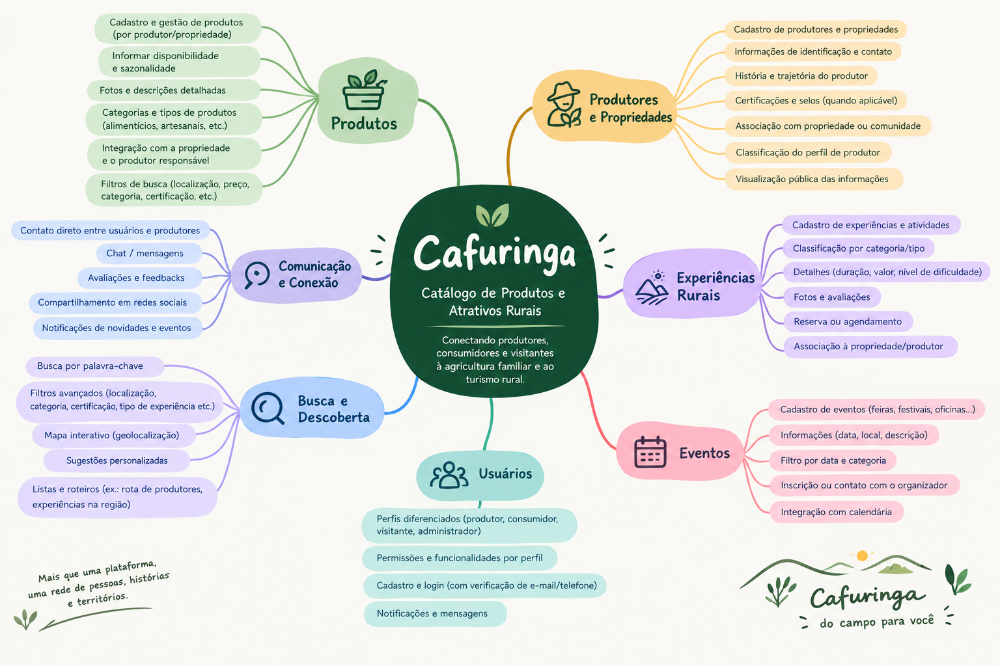
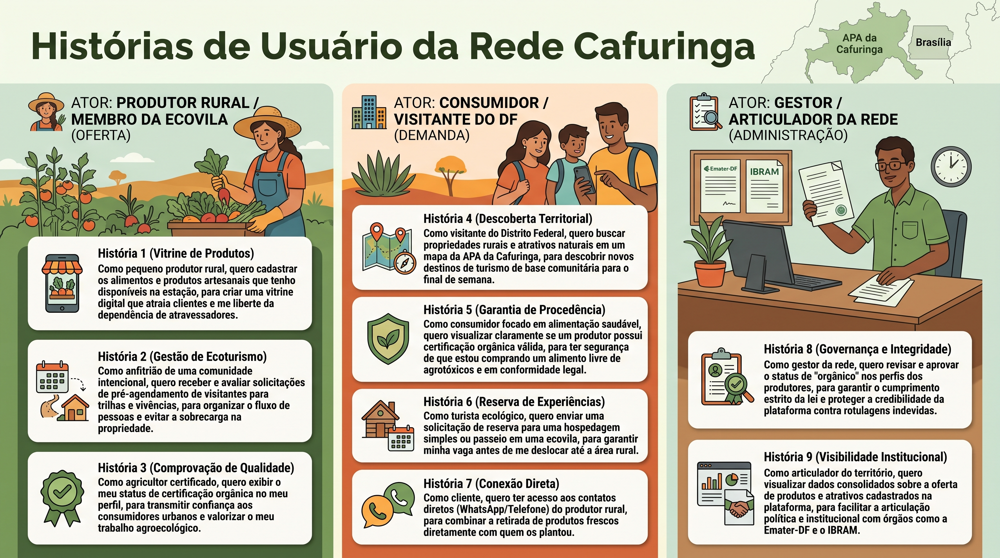

# Evidências da Iteração 1

[Voltar para o Cronograma](../cronograma.md)

## Descrição das Atividades Realizadas

Durante a Iteração 1, correspondente à fase de Concepção do processo AUP, foram realizadas atividades iniciais de Engenharia de Requisitos com o objetivo de compreender o contexto da Rede Cafuringa, identificar as principais necessidades do cliente e estabelecer uma visão preliminar do produto a ser desenvolvido.

O trabalho começou com uma entrevista semiestruturada com o representante da Rede Cafuringa, realizada em 19/08/2026, permitindo levantar informações sobre o ecossistema local, os desafios enfrentados pelos produtores e comunidades, bem como as oportunidades de melhoria na divulgação e comercialização de produtos e experiências rurais. Como complemento, foram realizadas sessões internas e presenciais de brainstorming colaborativo, nas quais a equipe discutiu, levantou e organizou ideias relacionadas às funcionalidades e possibilidades da plataforma.

A partir das informações coletadas, iniciou-se a declaração dos requisitos de negócio por meio de narrativas descritivas em texto livre, registrando as necessidades identificadas e a visão inicial do cliente. Também foram elaboradas histórias de usuário preliminares, orientadas à identificação dos principais atores, suas necessidades e os valores esperados com a solução.

As atividades dessa iteração resultaram na construção de uma compreensão compartilhada sobre o problema, no registro das primeiras expectativas do cliente e no estabelecimento de uma direção inicial para o desenvolvimento do produto. Por se tratar da etapa de concepção, ainda não foi realizada a especificação formal dos requisitos na perspectiva de produto, que seria aprofundada nas etapas seguintes do projeto.

Dessa forma, a Iteração 1 cumpriu seu propósito de estabelecer a base de conhecimento necessária para orientar a continuidade da Engenharia de Requisitos e o planejamento das próximas atividades de desenvolvimento da plataforma Rede Cafuringa.

---

## Evidências

### Elicitação e Descoberta 

??? info "Entrevista Semiestruturada com o Cliente"
    Aplicação de roteiro flexível de perguntas na reunião de primeiro contato com o representante da Rede Cafuringa para capturar dores e necessidades do ecossistema local.

    <iframe src="https://docs.google.com/document/d/e/2PACX-1vSF8vmcZ9juMR85HEIJlfVyiSbRlb6bEb1Vn-3Ubt46kvFhTWpMyIHut7hzVBAhQZt6Orvpa0u9UBVV/pub?embedded=true"width="100%" height="500" frameborder="0"></iframe>

??? info "Brainstorming Colaborativo"
    Reuniões internas da equipe para geração livre e agrupamento de ideias sobre o catálogo de produtos e atrativos rurais.

    - 

### Declaração de Requisitos

??? info "Narrativas em Texto Livre"
    <iframe src="https://docs.google.com/document/d/e/2PACX-1vT69mXgAy-mJQmvIL2-lPRW2GcgfRSiu19RMG1jaiiAOcC-Uwq2z73ebVURO8qHmzyNj7m31yc8wP8t/pub?embedded=true"width="100%" height="500" frameborder="0"></iframe>

??? info "Histórias de Usuário Preliminar"
    - 

---

## Vídeos Comprobatórios

O vídeo abaixo registra a primeira reunião com os clientes do projeto, marco inicial realizado em 19/08/2026 para a plataforma da Cafuringa.

<iframe width="800" height="450" src="https://www.youtube.com/embed/8AxspPflXs8" title="Unidade 1" frameborder="0" allow="accelerometer; autoplay; clipboard-write; encrypted-media; gyroscope; picture-in-picture" allowfullscreen></iframe>

