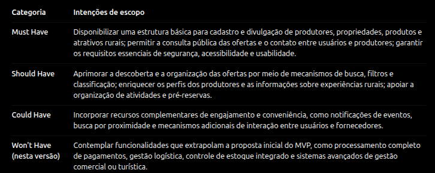

# Evidências da Iteração 2

[Voltar para o Cronograma](../cronograma.md)

## Descrição das Atividades Realizadas

Durante a Iteração 2, ainda correspondente à fase de Concepção do processo AUP, foram realizadas atividades de análise, negociação, validação e organização dos artefatos produzidos na iteração anterior, com o objetivo de consolidar o entendimento sobre o escopo do projeto e estabelecer uma base comum de decisões entre a equipe e o cliente.

Inicialmente, foi realizada a priorização das necessidades identificadas por meio da técnica MoSCoW, classificando as funcionalidades e intenções de escopo em quatro categorias: Must Have (indispensáveis), Should Have (importantes), Could Have (desejáveis) e Won't Have (não contempladas no escopo atual). Essa atividade permitiu organizar as expectativas, identificar as entregas prioritárias e orientar a definição do escopo inicial do produto de forma bem preliminar e inicial.

Em seguida, foram conduzidos alinhamentos e validações assíncronas com o cliente, nessas interações, foram compartilhadas as documentações produzidas, esclarecidas dúvidas, discutidas necessidades e realizadas adequações conforme os retornos recebidos. Esse processo possibilitou a construção de consenso sobre as decisões tomadas.

Paralelamente, foram estabelecidas práticas de organização, identificação de metadados e versionamento da documentação. Os artefatos do projeto passaram a ser centralizados no repositório oficial do GitHub e organizados em uma documentação navegável, publicada por meio do GitHub Pages. Essa estrutura foi adotada para assegurar a rastreabilidade das informações, facilitar o acompanhamento das alterações e manter uma fonte única de consulta para os integrantes da equipe e demais stakeholders.

Ao final da iteração, foi possível consolidar as decisões iniciais de escopo, validar os documentos produzidos com o cliente e estabelecer práticas de gestão e manutenção dos artefatos do projeto. Dessa maneira, a Iteração 2 contribuiu para o encerramento da etapa de Concepção, proporcionando maior clareza sobre o produto pretendido e preparando a equipe para as atividades das próximas fases do desenvolvimento.

---

## Evidências

### Análise e Consenso

??? info "Priorização MoSCoW"

    Classificação colaborativa das intenções de escopo nas categorias Must, Should, Could e Won't.

    - 

??? info "Validação Assíncrona com o Cliente"

    Alinhamento, validação de escopo e aprovação das documentações da primeira entrega conduzidos de forma assíncrona por canal de mensagens instantâneas.

    - { width="300" }
    - { width="300" }
    - { width="300" }
    - { width="300" }

### Verifcação e Validação

??? info "Reuniões de Revisão de Entrega"
    Para garantir a transparência e o registro formal das aprovações, todos os registros audiovisuais das validações realizadas com o cliente nesta etapa encontram-se documentados na seção 'Vídeos Comprobatórios'.

## Organização e Atualização

??? info "Atribuição de Metadados e Versionamento"
    Para garantir transparência, organização e facilidade de acesso, toda a documentação gerada ao longo do projeto, desde os requisitos e histórias de usuário até manuais e decisões arquiteturais, é centralizada e rigorosamente versionada no repositório oficial da equipe.

    Em vez de arquivos dispersos ou desatualizados, esses artefatos são transformados em um site navegável e publicados no GitPages oficial do projeto.

    Essa abordagem estabelece uma "fonte única de verdade" contínua. Assim, desenvolvedores, engenheiros de requisitos e stakeholders têm a garantia de acessar sempre a versão oficial, rastreável e mais recente do projeto, de forma colaborativa e diretamente pelo navegador.

---

## Vídeos Comprobatórios

O vídeo abaixo registra uma das reuniões de revisão da entrega da unidade 1, contando com decisões acerca dos objetivos específicos, e objetivos gerais do projeto, realizado em 31/08/2026.

<iframe width="800" height="450" src="https://www.youtube.com/embed/EB3D3KIuMGs" title="Vídeo do YouTube" frameborder="0" allow="accelerometer; autoplay; clipboard-write; encrypted-media; gyroscope; picture-in-picture" allowfullscreen></iframe>

---

O vídeo abaixo registra decisões acerca da abordagem, ciclo de vida e processo de software, além de registros oficiais da documentação no pages do projeto, realizado em 03/09/2026.

<iframe width="800" height="450" src="https://www.youtube.com/embed/qv9w89JXDFo" title="Vídeo do YouTube" frameborder="0" allow="accelerometer; autoplay; clipboard-write; encrypted-media; gyroscope; picture-in-picture" allowfullscreen></iframe>

