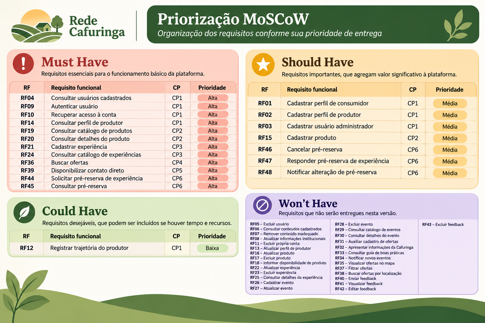
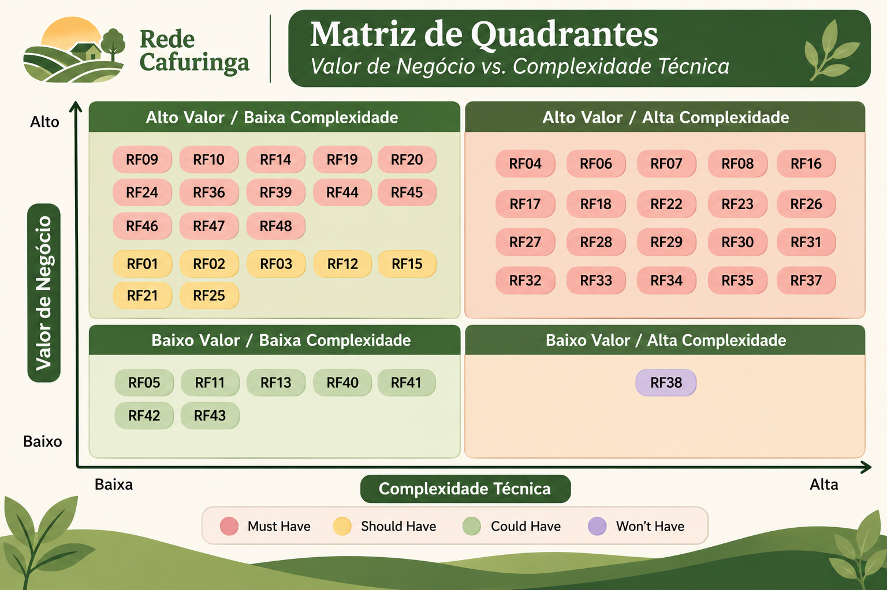

# Evidências da Iteração 3

[Voltar para o Cronograma](../cronograma.md)

## Descrição das Atividades Realizadas

Durante a Iteração 3, já na fase de Elaboração do processo AUP, foram intensificadas as atividades de Engenharia de Requisitos, com foco no aprofundamento da compreensão do negócio, na especificação dos requisitos do produto e na definição de um escopo viável para o Produto Mínimo Viável (MVP) da Rede Cafuringa.

Inicialmente, a equipe realizou uma revisão das informações e dos artefatos produzidos nas etapas anteriores, incorporando feedbacks recebidos e promovendo ajustes nos objetivos específicos, nas características do produto e nas definições iniciais de escopo. Também foram realizadas atividades de elicitação complementares, incluindo reuniões de alinhamento com o cliente e uma visita técnica presencial à APA de Cafuringa, em 21/09/2026. Essa experiência permitiu conhecer melhor a realidade local, compreender o contexto dos produtores e das comunidades envolvidas e aprofundar a identificação de necessidades que poderiam não ser percebidas apenas por meio de interações remotas.

A partir das informações coletadas, foram refinados e estruturados os requisitos funcionais (RFs) e não funcionais (RNFs), buscando representar de maneira mais precisa as funcionalidades esperadas, as restrições técnicas e os atributos de qualidade da solução. Paralelamente, foram elaboradas e organizadas histórias de usuário oficiais, acompanhadas de seus respectivos critérios de aceitação, de modo a traduzir os requisitos em necessidades concretas dos diferentes perfis de usuários e estabelecer condições verificáveis para a futura validação das funcionalidades.

Outra atividade importante foi a negociação e priorização dos requisitos por meio da técnica MoSCoW, classificando-os conforme sua criticidade para o produto: Must Have, Should Have, Could Have e Won't Have. Esse processo foi complementado pela construção de uma matriz de quadrantes que relaciona o valor de negócio de cada requisito à sua complexidade técnica. A análise conjunta desses critérios permitiu avaliar a relevância das funcionalidades, o esforço necessário para implementá-las e suas contribuições para os objetivos do projeto.

As decisões de priorização foram discutidas coletivamente e alinhadas com o cliente, buscando equilibrar as expectativas dos stakeholders com a capacidade de desenvolvimento da equipe. Como resultado, foi possível delimitar o conjunto de funcionalidades essenciais para o MVP, estabelecendo uma referência mais objetiva para o planejamento das atividades de construção.

Ao longo da iteração, também foram realizadas revisões internas dos requisitos, considerando feedbacks acadêmicos e contribuições de outros grupos, com o propósito de melhorar a clareza, a consistência e a viabilidade das especificações. Essas revisões contribuíram para reduzir ambiguidades, corrigir inconsistências e fortalecer a qualidade dos artefatos produzidos.

Dessa forma, a Iteração 3 representou um avanço significativo na maturidade da Engenharia de Requisitos da Rede Cafuringa. As atividades realizadas permitiram transformar as necessidades inicialmente levantadas em requisitos mais estruturados, priorizados e verificáveis, consolidando a definição do MVP e estabelecendo uma base mais consistente para as próximas atividades de desenvolvimento.

---

## Evidências

### Declaração de Requisitos

??? info "Priorização MoScoW"
    Reunião de negociação para classificar os requisitos do sistema em quatro níveis de criticidade (Must Have, Should Have, Could Have, Won't Have), visando alinhar as expectativas e definir o escopo do Produto Mínimo Viável.

    - 

??? info "Histórias de Usuário"
    

        <a href="/visao/historias_usuario/" class="hu-button">
            Consultar histórias de usuário
            →
        </a>
    

??? info "Critérios de Aceitação"
    

        <a href="/visao/historias_usuario/" class="hu-button">
            Consultar critérios de aceitação
            →
        </a>
    

### Análise e Consenso

??? info "Matriz de Quadrantes (Valor de Negócio vs. Complexidade Técnica)"
    
    Ponderação entre o valor para os usuários e o esforço de engenharia para delimitar o escopo do MVP.

    - 

---

## Vídeos Comprobatórios

O vídeo abaixo registra a primeira visita presencial na Cafuringa, experiência realizada em 21/09/2026 com objetivo de conhecer o lugar, o próprio Jefferson Sooma e discutir os requisitos do projeto.

<video width="100%" controls>
    <source src="../../img/aup-elaboracao/visitacao.mp4" type="video/mp4">
</video>

---

A reunião do dia 14/09 tratou da análise de feedbacks do professor, estruturação das "Lições Aprendidas" no GitHub Pages e atribuição de tarefas com prazos internos. A equipe também estabeleceu um fluxo de comunicação quinzenal e assíncrono com o cliente e alinhou a leitura obrigatória para a aula seguinte.

<iframe width="800" height="450" src="https://www.youtube.com/embed/mUdEDCeGR3I" title="Vídeo do YouTube" frameborder="0" allow="accelerometer; autoplay; clipboard-write; encrypted-media; gyroscope; picture-in-picture" allowfullscreen></iframe>

---

A primeira reunião do dia 17/09 focou no feedback do cliente, que elogiou a organização lógica do projeto e recomendou embasar os requisitos em fontes de dados governamentais e científicas. Foi agendada uma visita imersiva à comunidade para a próxima segunda-feira com o intuito de vivenciar a realidade local e aprimorar a coleta de requisitos.

<iframe width="800" height="450" src="https://www.youtube.com/embed/u3eJDboLs5Y" title="Vídeo do YouTube" frameborder="0" allow="accelerometer; autoplay; clipboard-write; encrypted-media; gyroscope; picture-in-picture" allowfullscreen></iframe>

---

A segunda reunião do dia 17/09 abordou o planejamento da visita à Cafuringa, incluindo transporte, horários e materiais necessários. A visita terá como foco a elicitação de requisitos por meio de uma conversa com o cliente Jefferson, além da definição de uma validação contínua do produto e de testes de usabilidade com outros stakeholders.

<iframe width="800" height="450" src="https://www.youtube.com/embed/jTixlIvh25s" title="Vídeo do YouTube" frameborder="0" allow="accelerometer; autoplay; clipboard-write; encrypted-media; gyroscope; picture-in-picture" allowfullscreen></iframe>

---

Após visita técnica, no dia 22/09 foi feita a sintese das informações e lista primaria de Requisitos:
Refatoração de Requisitos e Escopo: O grupo reviu e ajustou em tempo real os Objetivos Específicos, as Características de Produto, os Requisitos Funcionais (RFs) e Não Funcionais (RNFs).   

<iframe width="800" height="450" src="https://www.youtube.com/embed/qyUcVkX_vVA" title="Vídeo do YouTube" frameborder="0" allow="accelerometer; autoplay; clipboard-write; encrypted-media; gyroscope; picture-in-picture" allowfullscreen></iframe>

---

A reunião do dia 26/09 teve como objetivo principal rever, corrigir e ajustar os Requisitos Funcionais (RF) e Requisitos Não Funcionais (RNF) do projeto, tendo como base o feedback recebido de outro grupo (o grupo "Gollhorse").   

<iframe width="800" height="450" src="https://www.youtube.com/embed/m3EmETUI4fg" title="Vídeo do YouTube" frameborder="0" allow="accelerometer; autoplay; clipboard-write; encrypted-media; gyroscope; picture-in-picture" allowfullscreen></iframe>

---

A equipe esteve reunida no dia 27/09 durante 3 horas e 28 minutos com o foco de discutir e classificar os requisitos de um projeto de software e realizar a priorização.

<iframe width="800" height="450" src="https://www.youtube.com/embed/ONDMaovegGc" title="Vídeo do YouTube" frameborder="0" allow="accelerometer; autoplay; clipboard-write; encrypted-media; gyroscope; picture-in-picture" allowfullscreen></iframe>

---

A reunião de equipe do dia 28/09 focada na Avaliação do Valor de Negócio e na definição do MVP (Produto Mínimo Viável) para uma plataforma chamada "Rede Cafunaga" juntamente com o Cliente. A equipa passa em revista um documento detalhado que classifica os requisitos do sistema.

<iframe width="800" height="450" src="https://www.youtube.com/embed/1u7z0z3EA-Q" title="Vídeo do YouTube" frameborder="0" allow="accelerometer; autoplay; clipboard-write; encrypted-media; gyroscope; picture-in-picture" allowfullscreen></iframe>

