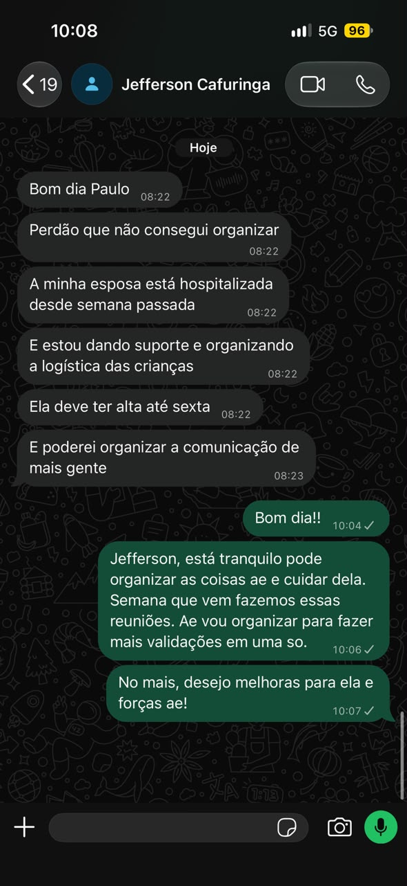

# Evidências da Iteração 5

[Voltar para o Cronograma](../cronograma.md)

<!-- ISSUE10_AUP_INICIO -->
**Controle do marco AUP:** a dependência da validação do protótipo descrita acima é um impedimento real da passagem para Construção. A [matriz de evidências dos marcos](marcos_aup.md) registra os artefatos existentes e o que ainda exige aprovação; nenhuma aprovação retroativa foi presumida.
<!-- ISSUE10_AUP_FIM -->

## Descrição das Atividades Realizadas

Durante a Iteração 5, a equipe enfrentou dificuldades que impactaram o andamento das atividades planejadas para a fase de Construção do processo AUP. O principal fator de impedimento foi a dependência da aprovação do protótipo da plataforma Rede Cafuringa por parte do cliente, etapa necessária para dar continuidade ao desenvolvimento com maior segurança quanto ao alinhamento das soluções propostas às suas expectativas.

Embora a equipe tenha buscado dar continuidade ao processo de validação, duas reuniões previstas com o cliente foram canceladas. Posteriormente, a equipe foi informada de que o afastamento temporário do cliente e a dificuldade de comunicação ocorreram em razão de uma situação familiar delicada, envolvendo a hospitalização de sua esposa. Diante dessa circunstância, a equipe compreendeu a necessidade de respeitar o momento enfrentado pelo cliente, embora a ausência de retorno tenha ocasionado atrasos no processo de validação e impossibilitado a obtenção da aprovação necessária dentro do período planejado.

Dessa forma, optou-se por não avançar significativamente na implementação das funcionalidades, evitando desenvolver soluções sem a devida validação das representações e dos fluxos apresentados no protótipo.

Além disso, a equipe enfrentou uma sobrecarga de atividades acadêmicas relacionadas às demais disciplinas do semestre, o que reduziu a disponibilidade dos integrantes para dedicação ao projeto. Esse cenário também contribuiu para a limitação do progresso durante a iteração.

Assim, o período foi marcado principalmente pela espera do retorno do cliente e pela reorganização interna da equipe diante dos impedimentos identificados. Não foram realizados novos refinamentos nos requisitos, uma vez que as especificações existentes permaneceram inalteradas e a continuidade das atividades dependia, prioritariamente, da validação pendente.

Apesar de não apresentar avanços significativos na construção do produto, a iteração permitiu evidenciar dependências externas e limitações de capacidade que afetaram o planejamento. Esses fatores foram considerados pela equipe para reorganizar as atividades subsequentes, ajustar as expectativas de entrega e retomar o desenvolvimento assim que houvesse condições adequadas para prosseguir.

---

<!-- ISSUE_17_BACKLOG_INICIO -->
## Rastreabilidade do replanejamento (Issue #17)

A revisão do professor mencionou uma seleção anterior de HUs para esta iteração. Os identificadores e suas atribuições mudaram nas revisões subsequentes, por isso esse conjunto histórico **não deve ser interpretado com a numeração atual**. Esta iteração não registra HUs do MVP entregues: o avanço foi limitado pelos impedimentos descritos acima. O cronograma vigente distribui as HUs selecionadas entre as Iterações 6, 7 e 8, e suas dependências propostas podem ser consultadas no [Backlog](../historias_usuario.md).
<!-- ISSUE_17_BACKLOG_FIM -->

## Evidências

