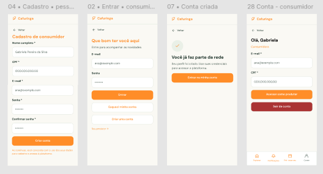

# HU01 — Cadastrar perfil de consumidor

## 1. Identificação

| Campo | Informação |
|---|---|
| **ID da História** | HU01 |
| **Requisito Funcional** | [RF01 — Cadastrar perfil de consumidor](../requisitos_software.md#71-requisitos-funcionais) |
| **Requisito Não Funcional** | [RNF03, RNF04, RNF05, RNF07, RNF08, RNF10, RNF11, RNF12, RNF15](../requisitos_software.md#72-requisitos-nao-funcionais) |
| **Regra de Negócio** | [RN01, RN02, RN05, RN08 ](../requisitos_software.md#74-lista-de-regras-de-negocio) |
| **Característica de Produto** | [CP1 ](../solucao.md/#23-caracteristicas-do-produto) |
| **Objetivos Específicos** | [OE2 ](../solucao.md/#22-objetivos-especificos-oe-do-produto) |
| **Prioridade** | Média |

---

## 2. História de Usuário

*Como consumidor ou visitante, quero cadastrar meu perfil na plataforma, para acessar funcionalidades e interagir com produtores e experiências.*

---

## 3. Critérios de Aceitação

**CA01 — Cadastro com dados válidos**

- **Dado** que estou na tela de cadastro de consumidor, **quando** informar nome completo, CPF, e-mail e senha válidos, **então** o sistema deve permitir a criação do perfil.

**CA02 — Validação de campos obrigatórios**

- **Dado** que existam campos obrigatórios vazios ou inválidos, **quando** eu tentar concluir o cadastro, **então** o sistema deve impedir a criação do perfil e informar os campos que precisam ser corrigidos.

**CA03 — E-mail já cadastrado**

- **Dado** que o e-mail informado já esteja cadastrado, **quando** eu tentar criar uma nova conta com esse endereço, **então** o sistema deve impedir o cadastro duplicado e informar o problema.

**CA04 — CPF já cadastrado**

- **Dado** que o CPF informado já esteja associado a uma conta, **quando** eu tentar concluir o cadastro, **então** o sistema deve impedir o cadastro duplicado, conforme as regras de unicidade definidas para o sistema.

**CA05 — Cadastro concluído**

- **Dado** que todos os dados obrigatórios sejam válidos e não existam duplicidades, **quando** o cadastro for concluído, **então** o sistema deve registrar o perfil e informar que a operação foi realizada com sucesso.

---

## 4. Relação com os Requisitos Não Funcionais

**RNF03 — Prevenção e Recuperação de Erros**

- Relação com a HU: Garante que o consumidor consiga corrigir erros no preenchimento do formulário e concluir o cadastro sem dificuldades desnecessárias.

**RNF04 — Acessibilidade Digital**

- Relação com a HU: Permite que pessoas com diferentes necessidades de acesso utilizem o formulário de cadastro, incluindo usuários que navegam por teclado ou utilizam tecnologias assistivas.

**RNF05 — Responsividade da Interface**

- Relação com a HU: Permite que consumidores realizem o cadastro tanto em computadores quanto em dispositivos móveis, incluindo celulares utilizados em regiões rurais.

**RNF07 — Resiliência à Perda de Conexão**

- Relação com a HU: Evita que o consumidor precise preencher novamente todos os campos caso a conexão com a internet seja interrompida durante o cadastro.

**RNF08 — Controle de Acesso por Perfil**

- Relação com a HU: Garante que a conta criada seja identificada como perfil de consumidor e que suas permissões sejam aplicadas corretamente, sem conceder privilégios exclusivos de produtores ou administradores.

**RNF10 — Proteção da Comunicação**

- Relação com a HU: Protege os dados transmitidos durante o cadastro, especialmente informações pessoais como CPF, e-mail e senha.

**RNF11 — Proteção de Dados Pessoais**

- Relação com a HU: Exige que a coleta de nome, CPF, e-mail e senha tenha finalidade definida, que os dados sejam tratados de forma adequada e que informações privadas do consumidor não sejam expostas publicamente.

**RNF12 — Compatibilidade entre Navegadores**

- Relação com a HU: Garante que o formulário de cadastro e seu fluxo de conclusão funcionem nos navegadores e ambientes previstos para utilização da plataforma.

**RNF15 — Proteção de Crianças e Adolescentes**

- Relação com a HU: O cadastro deve observar as medidas de proteção de dados e de verificação de idade aplicáveis ao público atendido pela plataforma, sem expor informações pessoais de menores.

---

## 5. Relação com as Regras de Negócio 

**RN01 — Perfis e permissões**

- Relação com a HU: O cadastro deve criar uma conta identificada como consumidor, garantindo que as permissões atribuídas correspondam a esse perfil.

**RN02 — Dados de cadastro**

- Relação com a HU: Define os dados necessários para a criação do perfil de consumidor, correspondentes aos campos previstos no RF01: nome completo, CPF, e-mail e senha.

**RN05 — Autenticação e recuperação de acesso**

- Relação com a HU: Estabelece que o e-mail e a senha cadastrados serão utilizados para acesso à conta e que o CPF será um dado de identificação, não uma credencial de autenticação.

**RN08 — Proteção de dados de menores**

- Relação com a HU: O fluxo de cadastro deve considerar as medidas de proteção aplicáveis caso crianças ou adolescentes possam utilizar o serviço, incluindo os requisitos legais pertinentes ao tratamento de seus dados.

---

## 6. Relaçao com as Características de Produto 

**CP1 — Perfis**

- Relação com a HU: O cadastro de consumidores contribui para a formação da base de usuários que acessará os perfis de produtores, propriedades, associações e comunidades disponíveis na Rede Cafuringa. Dessa forma, possibilita que consumidores e visitantes utilizem a plataforma para conhecer os responsáveis pelas ofertas e interagir com as iniciativas locais.

---

## 7. Relação com os Objetivos Específicos 

**OE2 — Visibilidade e oferta local**

- Relação com a HU: O cadastro de consumidores contribui para formar a base de usuários da Rede Cafuringa, permitindo que mais pessoas acessem os produtos, produtores e experiências divulgados pela plataforma. Assim, favorece a descoberta e a visibilidade das ofertas locais.

---

## 8. Protótipo

---

## 9. Atividades Relacionadas

| ID | Atividade | Descrição |
|---|---|---|
| AT01 | Definir os campos do cadastro | Identificar e disponibilizar os campos obrigatórios: nome completo, CPF, e-mail e senha. |
| AT02 | Implementar o formulário de cadastro | Desenvolver a interface para preenchimento e envio dos dados do consumidor. |
| AT03 | Implementar validação dos campos | Validar o preenchimento obrigatório, o formato do CPF, o formato do e-mail e os critérios definidos para a senha. |
| AT04 | Verificar duplicidade de dados | Impedir o cadastro quando o e-mail ou CPF já estiver associado a uma conta, conforme as regras de unicidade adotadas. |
| AT05 | Registrar o perfil de consumidor | Implementar o processamento e o armazenamento dos dados válidos, associando a conta ao perfil de consumidor. |
| AT06 | Implementar mensagens de retorno | Informar o usuário sobre erros de preenchimento, duplicidades e conclusão bem-sucedida do cadastro. |
| AT07 | Aplicar medidas de segurança e privacidade | Proteger os dados pessoais, utilizar comunicação HTTPS em produção e impedir a exposição pública de informações privadas. |
| AT08 | Aplicar permissões do perfil | Garantir que a conta criada receba somente as permissões correspondentes ao perfil de consumidor. |
| AT09 | Verificar acessibilidade e responsividade | Avaliar a navegação por teclado, a identificação dos campos, o contraste e a adaptação do formulário a diferentes telas. |
| AT10 | Tratar interrupções de conexão | Garantir que os dados já preenchidos não sejam apagados automaticamente durante uma interrupção temporária da conexão, antes de uma nova tentativa de envio. |
| AT11 | Verificar as medidas de proteção de menores | Avaliar as medidas de proteção de dados, privacidade e aferição de idade aplicáveis ao fluxo de cadastro, conforme as regras definidas para a plataforma. |
| AT12 | Executar testes do cadastro | Testar o fluxo com dados válidos, campos vazios ou inválidos, e-mail duplicado, CPF duplicado e conclusão bem-sucedida. |
| AT13 | Validar compatibilidade entre navegadores | Verificar o funcionamento do cadastro nos navegadores e ambientes definidos no RNF12. |
| AT14 | Documentar e revisar a funcionalidade | Registrar o comportamento implementado, os resultados dos testes e eventuais pendências para revisão pela equipe. |

---

## 10. Checklist do Definition of Ready (DoR)

Marque os itens conforme a história atender a cada condição.

- [x] A HU possui definição clara e informação necessária para ser trabalhada?
- [x] O requisito está representado por uma história de usuário?
- [x] A HU está rastreada aos requisitos de origem?
- [x] A HU faz parte do escopo do MVP?
- [x] A HU está coberta por critérios de aceite?
- [x] Os RNFs e as restrições legais aplicáveis estão identificados?
- [x] A HU está mapeada para uma interface, quando necessário?
- [x] A HU cabe em uma iteração?
- [x] As dependências estão mapeadas?
- [x] Os responsáveis estão definidos?
- [x] O requisito está implementado no protótipo e validado?

---

## 11. Checklist do Definition of Done (DoD)

Marque os itens após a verificação da entrega.

- [ ] Entrega um incremento do produto?
- [ ] Contempla os critérios de aceite estabelecidos?
- [ ] O desenvolvimento foi concluído integralmente?
- [ ] Os testes foram executados e aprovados?
- [ ] Está aderente aos padrões de codificação?
- [ ] A funcionalidade foi revisada pela equipe?
- [ ] Mantém os índices de performance do produto?
- [ ] Atende aos requisitos de acessibilidade e responsividade?
- [ ] Preserva a segurança e a privacidade dos dados?
- [ ] Trata os erros do usuário?
- [ ] Está livre de defeitos críticos?
- [ ] Está documentado?
