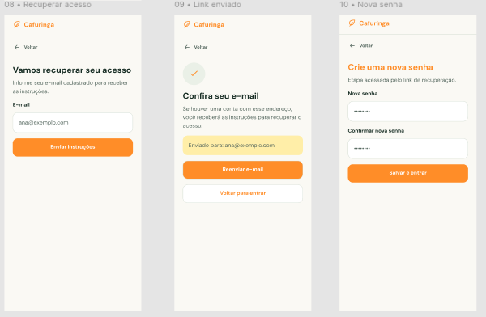

# HU10 — Recuperar acesso à conta

## 1. Identificação

| Campo | Informação |
|---|---|
| **ID da História** | HU10 |
| **Requisito Funcional** | [RF10 — Recuperar acesso à conta](../requisitos_software.md#71-requisitos-funcionais) |
| **Requisito Não Funcional** | [RNF03, RNF08, RNF10, RNF11](../requisitos_software.md#72-requisitos-nao-funcionais) |
| **Regra de Negócio** | [RN05](../requisitos_software.md#74-lista-de-regras-de-negocio) |
| **Característica de Produto** | [CP1](../solucao.md#23-caracteristicas-do-produto) |
| **Objetivos Específicos** | [OE1](../solucao.md#22-objetivos-especificos-oe-do-produto) |
| **Prioridade** | Alta |

---

## 2. História de Usuário

*Como usuário cadastrado, quero recuperar o acesso à minha conta, para voltar a utilizar a plataforma caso esqueça minha senha.*

---

## 3. Critérios de Aceitação

**CA01 — Acesso à recuperação de conta**

- **Dado** que sou um usuário cadastrado e não consigo acessar minha conta, **quando** estiver na tela de autenticação, **então** o sistema deve disponibilizar a opção de recuperação de acesso.

**CA02 — Solicitação de recuperação**

- **Dado** que acessei a funcionalidade de recuperação, **quando** informar o meio de contato associado à minha conta, **então** o sistema deve permitir o envio da solicitação de recuperação.

**CA03 — Validação da solicitação**

- **Dado** que solicitei a recuperação de acesso, **quando** o sistema validar a solicitação, **então** deve utilizar o meio de contato cadastrado para permitir a continuidade do processo.

**CA04 — Definição de nova senha**

- **Dado** que minha solicitação de recuperação tenha sido validada, **quando** acessar a etapa de redefinição, **então** o sistema deve permitir que eu defina uma nova senha.

**CA05 — Conclusão da recuperação**

- **Dado** que informei uma nova senha válida, **quando** confirmar a redefinição, **então** o sistema deve atualizar a credencial da minha conta e informar que a recuperação foi concluída.

**CA06 — Solicitação inválida**

- **Dado** que informei dados que não permitem validar a solicitação de recuperação, **quando** tentar prosseguir, **então** o sistema deve impedir a redefinição e apresentar uma mensagem orientativa.

---

## 4. Relação com os Requisitos Não Funcionais

**RNF03 — Prevenção e Recuperação de Erros**

- Relação com a HU: Garante que o usuário receba orientações claras quando ocorrerem erros no preenchimento ou na validação da solicitação de recuperação, permitindo corrigir as informações necessárias.

**RNF08 — Controle de Acesso por Perfil**

- Relação com a HU: Contribui para que a recuperação seja realizada sobre a conta correspondente ao usuário solicitante, preservando as restrições de acesso definidas para os perfis da plataforma.

**RNF10 — Proteção da Comunicação**

- Relação com a HU: Garante que os dados transmitidos durante a solicitação de recuperação e a definição de uma nova senha sejam protegidos por meio de HTTPS em ambiente de produção.

**RNF11 — Proteção de Dados Pessoais**

- Relação com a HU: Garante que os dados pessoais e os meios de contato utilizados na recuperação sejam tratados conforme sua finalidade, evitando exposição indevida.

---

## 5. Relação com as Regras de Negócio

**RN05 — Autenticação e recuperação de acesso**

- Relação com a HU: Estabelece as condições para recuperação de acesso às contas cadastradas, incluindo a utilização do meio de contato associado ao usuário e a possibilidade de definição de uma nova credencial após a validação da solicitação.

---

## 6. Relação com as Características de Produto

**CP1 — Gestão de usuários e perfis**

- Relação com a HU: A recuperação de acesso permite que usuários cadastrados retomem a utilização de suas contas, preservando seus perfis e o acesso às funcionalidades correspondentes.

---

## 7. Relação com os Objetivos Específicos

**OE1 — Inclusão e acessibilidade digital**

- Relação com a HU: A possibilidade de recuperar o acesso reduz barreiras para a continuidade de utilização da plataforma, permitindo que usuários que esqueceram suas credenciais voltem a acessar os serviços digitais.

---

## 8. Protótipo

---

## 9. Atividades Relacionadas

| ID | Atividade | Descrição |
|---|---|---|
| AT01 | Disponibilizar a funcionalidade de recuperação | Implementar a opção de recuperação de acesso na interface de autenticação. |
| AT02 | Implementar solicitação de recuperação | Permitir que o usuário informe o meio de contato associado à conta. |
| AT03 | Implementar validação da solicitação | Desenvolver a verificação necessária para autorizar a redefinição da credencial. |
| AT04 | Implementar redefinição de senha | Permitir que o usuário informe e confirme uma nova senha após a validação. |
| AT05 | Implementar mensagens de retorno | Informar o usuário sobre o andamento, a conclusão ou a impossibilidade de realizar a recuperação. |
| AT06 | Aplicar proteção de dados | Proteger os dados pessoais e as credenciais envolvidos no processo. |
| AT07 | Executar testes de recuperação | Verificar solicitações válidas, inválidas e a definição de uma nova senha. |
| AT08 | Documentar e revisar a funcionalidade | Registrar o comportamento implementado e os resultados dos testes para revisão pela equipe. |

---

## 10. Checklist do Definition of Ready (DoR)

Marque os itens conforme a história atender a cada condição.

- [x] A HU possui definição clara e informação necessária para ser trabalhada?
- [x] O requisito está representado por uma história de usuário?
- [x] A HU está rastreada aos requisitos de origem?
- [x] A HU faz parte do escopo do MVP?
- [x] A HU está coberta por critérios de aceite?
- [x] Os RNFs e as restrições legais aplicáveis estão identificados?
- [x] A HU está mapeada para uma interface, quando necessário?
- [x] A HU cabe em uma iteração?
- [x] As dependências estão mapeadas?
- [x] Os responsáveis estão definidos?
- [x] O requisito está implementado no protótipo e validado?

---

## 11. Checklist do Definition of Done (DoD)

Marque os itens após a verificação da entrega.

- [ ] Entrega um incremento do produto?
- [ ] Contempla os critérios de aceite estabelecidos?
- [ ] O desenvolvimento foi concluído integralmente?
- [ ] Os testes foram executados e aprovados?
- [ ] Está aderente aos padrões de codificação?
- [ ] A funcionalidade foi revisada pela equipe?
- [ ] Mantém os índices de performance do produto?
- [ ] Atende aos requisitos de acessibilidade e responsividade?
- [ ] Preserva a segurança e a privacidade dos dados?
- [ ] Trata os erros do usuário?
- [ ] Está livre de defeitos críticos?
- [ ] Está documentado?

