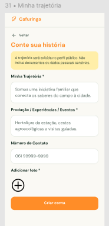

# HU12 — Registrar trajetória do produtor

## 1. Identificação

| Campo | Informação |
|---|---|
| **ID da História** | HU12 |
| **Requisito Funcional** | [RF12 — Registrar trajetória do produtor](../requisitos_software.md#71-requisitos-funcionais) |
| **Requisito Não Funcional** | [RNF03, RNF04, RNF05, RNF07, RNF08, RNF10, RNF11](../requisitos_software.md#72-requisitos-nao-funcionais) |
| **Regra de Negócio** | [RN01, RN02, RN07, RN09](../requisitos_software.md#74-lista-de-regras-de-negocio) |
| **Característica de Produto** | [CP1](../solucao.md#23-caracteristicas-do-produto) |
| **Objetivos Específicos** | [OE2](../solucao.md#22-objetivos-especificos-oe-do-produto) |
| **Prioridade** | Baixa |

---

## 2. História de Usuário

*Como produtor ou responsável por uma iniciativa, quero registrar minha trajetória e as atividades que desenvolvo, para apresentar minha história e forma de atuação aos consumidores e visitantes.*

---

## 3. Critérios de Aceitação

**CA01 — Acesso à funcionalidade de registro**

- **Dado** que estou autenticado na plataforma com perfil de produtor, **quando** acessar meu perfil, **então** o sistema deve disponibilizar a funcionalidade de registro da minha trajetória.

**CA02 — Preenchimento das informações**

- **Dado** que estou na funcionalidade de registro da trajetória, **quando** informar os dados sobre minha história e atuação, **então** o sistema deve permitir o preenchimento das informações correspondentes.

**CA03 — Validação das informações**

- **Dado** que preenchi as informações da minha trajetória, **quando** tentar salvá-las, **então** o sistema deve validar os dados informados conforme os campos e condições definidos para o registro.

**CA04 — Salvamento da trajetória**

- **Dado** que preenchi corretamente as informações solicitadas, **quando** confirmar o salvamento, **então** o sistema deve registrar as informações e associá-las ao meu perfil de produtor.

**CA05 — Apresentação da trajetória no perfil**

- **Dado** que registrei minha trajetória com sucesso, **quando** um consumidor ou visitante consultar meu perfil público, **então** o sistema deve apresentar as informações disponibilizadas conforme sua configuração de visibilidade.

**CA06 — Restrição de acesso à edição**

- **Dado** que estou autenticado com perfil diferente de produtor ou responsável autorizado, **quando** tentar registrar ou alterar a trajetória de outro produtor, **então** o sistema deve impedir a operação.

**CA07 — Falha durante o registro**

- **Dado** que estou preenchendo as informações da minha trajetória, **quando** ocorrer uma falha de conexão durante o preenchimento ou envio, **então** o sistema deve preservar os dados preenchidos sempre que possível e informar que o registro não foi concluído.

---

## 4. Relação com os Requisitos Não Funcionais

**RNF03 — Prevenção e Recuperação de Erros**

- Relação com a HU: Garante que o produtor receba mensagens claras quando ocorrerem erros no preenchimento ou salvamento das informações da trajetória, orientando a correção dos dados.

**RNF04 — Acessibilidade Digital**

- Relação com a HU: Garante que a interface de registro da trajetória siga as recomendações de acessibilidade, facilitando o preenchimento por produtores com diferentes necessidades e níveis de familiaridade tecnológica.

**RNF05 — Responsividade da Interface**

- Relação com a HU: Garante que o formulário de registro da trajetória permaneça utilizável em diferentes tamanhos de tela, incluindo dispositivos móveis.

**RNF07 — Resiliência à Perda de Conexão**

- Relação com a HU: Contribui para evitar que as informações preenchidas pelo produtor sejam automaticamente apagadas em caso de perda de conexão durante o registro.

**RNF08 — Controle de Acesso por Perfil**

- Relação com a HU: Garante que a funcionalidade de registro e gerenciamento da trajetória seja disponibilizada somente aos produtores ou responsáveis autorizados, conforme as permissões definidas.

**RNF10 — Proteção da Comunicação**

- Relação com a HU: Garante que os dados transmitidos durante o registro da trajetória sejam protegidos por meio de HTTPS em ambiente de produção.

**RNF11 — Proteção de Dados Pessoais**

- Relação com a HU: Garante que informações pessoais eventualmente associadas à trajetória sejam tratadas conforme sua finalidade e que dados privados não sejam expostos no perfil público.

---

## 5. Relação com as Regras de Negócio

**RN01 — Perfis e permissões**

- Relação com a HU: Determina que cada perfil acesse somente as funcionalidades compatíveis com suas permissões, garantindo que o produtor gerencie as informações da própria trajetória.

**RN02 — Dados de cadastro**

- Relação com a HU: Estabelece condições para o registro dos dados de cadastro dos usuários, orientando o tratamento das informações associadas ao perfil do produtor.

**RN07 — Informações públicas do produtor**

- Relação com a HU: Determina que somente informações definidas como públicas sejam apresentadas no perfil do produtor, impedindo a exposição de dados pessoais ou privados durante a divulgação de sua trajetória.

**RN09 — Responsabilidade pelas ofertas**

- Relação com a HU: Estabelece que produtos, experiências, atividades e eventos sejam vinculados a um produtor, propriedade ou responsável identificado, contribuindo para contextualizar a trajetória e a atuação apresentada no perfil.

---

## 6. Relação com as Características de Produto

**CP1 — Gestão de usuários e perfis**

- Relação com a HU: O registro da trajetória complementa as informações do perfil do produtor, permitindo apresentar sua história, identidade e forma de atuação aos consumidores e visitantes.

---

## 7. Relação com os Objetivos Específicos

**OE2 — Visibilidade e oferta local**

- Relação com a HU: O registro da trajetória permite dar visibilidade à história e à atuação dos produtores e iniciativas locais, aproximando consumidores e visitantes das pessoas responsáveis pela produção e pelas atividades divulgadas na Rede Cafuringa.

---

## 8. Protótipo

---

## 9. Atividades Relacionadas

| ID | Atividade | Descrição |
|---|---|---|
| AT01 | Disponibilizar a funcionalidade de registro | Implementar a opção de registro da trajetória na área do perfil do produtor. |
| AT02 | Implementar formulário de trajetória | Permitir que o produtor informe dados sobre sua história e atuação. |
| AT03 | Implementar validação das informações | Verificar os dados preenchidos antes de permitir o salvamento. |
| AT04 | Associar trajetória ao perfil | Garantir que as informações registradas sejam vinculadas ao produtor responsável. |
| AT05 | Implementar apresentação pública | Disponibilizar as informações de trajetória no perfil conforme as configurações de visibilidade. |
| AT06 | Aplicar controle de acesso | Garantir que somente o produtor ou responsável autorizado possa registrar e gerenciar sua trajetória. |
| AT07 | Aplicar proteção de dados pessoais | Impedir a exposição pública de informações privadas associadas ao produtor. |
| AT08 | Implementar tratamento de erros | Apresentar mensagens de validação e falha durante o preenchimento e salvamento. |
| AT09 | Executar testes de registro | Verificar o preenchimento, a validação, o salvamento e a apresentação das informações no perfil. |
| AT10 | Executar testes de autorização e privacidade | Verificar as permissões de acesso e a visibilidade das informações apresentadas. |
| AT11 | Documentar e revisar a funcionalidade | Registrar o comportamento implementado e os resultados dos testes para revisão pela equipe. |

---

## 10. Checklist do Definition of Ready (DoR)

Marque os itens conforme a história atender a cada condição.

- [x] A HU possui definição clara e informação necessária para ser trabalhada?
- [x] O requisito está representado por uma história de usuário?
- [x] A HU está rastreada aos requisitos de origem?
- [x] A HU faz parte do escopo do MVP?
- [x] A HU está coberta por critérios de aceite?
- [x] Os RNFs e as restrições legais aplicáveis estão identificados?
- [x] A HU está mapeada para uma interface, quando necessário?
- [x] A HU cabe em uma iteração?
- [x] As dependências estão mapeadas?
- [x] Os responsáveis estão definidos?
- [x] O requisito está implementado no protótipo e validado?

---

## 11. Checklist do Definition of Done (DoD)

Marque os itens após a verificação da entrega.

- [ ] Entrega um incremento do produto?
- [ ] Contempla os critérios de aceite estabelecidos?
- [ ] O desenvolvimento foi concluído integralmente?
- [ ] Os testes foram executados e aprovados?
- [ ] Está aderente aos padrões de codificação?
- [ ] A funcionalidade foi revisada pela equipe?
- [ ] Mantém os índices de performance do produto?
- [ ] Atende aos requisitos de acessibilidade e responsividade?
- [ ] Preserva a segurança e a privacidade dos dados?
- [ ] Trata os erros do usuário?
- [ ] Está livre de defeitos críticos?
- [ ] Está documentado?

