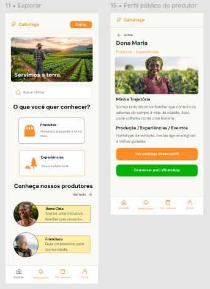

# HU14 — Consultar perfil de produtor

## 1. Identificação

| Campo | Informação |
|---|---|
| **ID da História** | HU14 |
| **Requisito Funcional** | [RF14 — Consultar perfil de produtor](../requisitos_software.md#71-requisitos-funcionais) |
| **Requisito Não Funcional** | [RNF01, RNF02, RNF03, RNF04, RNF06, RNF11](../requisitos_software.md#72-requisitos-nao-funcionais) |
| **Regra de Negócio** | [RN07, RN09, RN11, RN16](../requisitos_software.md#74-lista-de-regras-de-negocio) |
| **Característica de Produto** | [CP1](../solucao.md#23-caracteristicas-do-produto) |
| **Objetivos Específicos** | [OE2](../solucao.md#22-objetivos-especificos-oe-do-produto) |
| **Prioridade** | Alta |

---

## 2. História de Usuário

*Como consumidor ou visitante, quero consultar o perfil de um produtor, para conhecer sua trajetória e atuação antes de comprar ou solicitar experiência.*

---

## 3. Critérios de Aceitação

**CA01 — Acesso ao perfil público**

- **Dado** que estou acessando a plataforma como consumidor ou visitante, **quando** selecionar um produtor ou iniciativa cadastrada, **então** o sistema deve apresentar seu perfil público.

**CA02 — Apresentação das informações do produtor**

- **Dado** que estou consultando o perfil de um produtor, **quando** o sistema apresentar as informações cadastradas, **então** deve exibir o nome do produtor ou iniciativa, as categorias ofertadas, a trajetória e as atividades desenvolvidas.

**CA03 — Apresentação do contato disponibilizado**

- **Dado** que o produtor tenha optado por disponibilizar seu telefone de contato, **quando** um usuário consultar seu perfil público, **então** o sistema deve apresentar essa informação conforme a autorização concedida.

**CA04 — Proteção de dados privados**

- **Dado** que estou consultando o perfil público de um produtor, **quando** o sistema apresentar suas informações, **então** não deve disponibilizar publicamente CPF, CNPJ ou e-mail de acesso.

**CA05 — Perfil sem informações opcionais**

- **Dado** que o produtor não tenha informado determinado conteúdo opcional, **quando** um usuário consultar seu perfil, **então** o sistema deve apresentar as demais informações disponíveis sem exibir dados não cadastrados.

**CA06 — Acesso à oferta do produtor**

- **Dado** que estou consultando o perfil de um produtor, **quando** existirem ofertas associadas a ele, **então** o sistema deve permitir a visualização das ofertas vinculadas ao perfil.

**CA07 — Perfil inexistente ou indisponível**

- **Dado** que o perfil selecionado não esteja disponível para consulta, **quando** tentar acessá-lo, **então** o sistema deve informar que não foi possível localizar ou apresentar o perfil.

---

## 4. Relação com os Requisitos Não Funcionais

**RNF01 — Eficiência de Navegação**

- Relação com a HU: Garante que o usuário consiga acessar o perfil de um produtor por meio de uma navegação simples, respeitando o limite de até cinco cliques ou toques a partir da tela inicial.

**RNF02 — Desempenho na Execução de Tarefas**

- Relação com a HU: Contribui para que o usuário consiga localizar um produtor e acessar seu perfil de forma rápida, reduzindo o tempo necessário para compreender as informações disponibilizadas.

**RNF03 — Prevenção e Recuperação de Erros**

- Relação com a HU: Garante que o sistema apresente mensagens claras quando um perfil não puder ser localizado ou quando ocorrer alguma falha durante a consulta.

**RNF04 — Acessibilidade Digital**

- Relação com a HU: Garante que a apresentação do perfil e suas informações siga as recomendações de acessibilidade, permitindo a consulta por usuários com diferentes necessidades.

**RNF06 — Desempenho em Conectividade Limitada**

- Relação com a HU: Garante que as informações principais do perfil sejam apresentadas adequadamente mesmo em condições de conectividade limitada, considerando o contexto de utilização rural.

**RNF11 — Proteção de Dados Pessoais**

- Relação com a HU: Garante que os dados pessoais privados do produtor, como CPF, CNPJ e e-mail de acesso, não sejam expostos durante a consulta pública do perfil.

---

## 5. Relação com as Regras de Negócio

**RN07 — Informações públicas do produtor**

- Relação com a HU: Determina quais informações podem ser apresentadas publicamente no perfil do produtor, preservando dados privados e permitindo a divulgação somente das informações autorizadas.

**RN09 — Responsabilidade pelas ofertas**

- Relação com a HU: Estabelece que os produtos, experiências, atividades e eventos sejam associados a um produtor, propriedade ou responsável identificado, permitindo que o usuário conheça quem está por trás das ofertas.

**RN11 — Informações mínimas das ofertas**

- Relação com a HU: Contribui para que as informações das ofertas associadas ao perfil apresentem os dados necessários para que consumidores e visitantes compreendam o que está sendo disponibilizado.

**RN16 — Localização**

- Relação com a HU: Orienta a apresentação de informações de localização do produtor ou propriedade conforme os dados cadastrados, sem presumir informações geográficas que não tenham sido fornecidas.

---

## 6. Relação com as Características de Produto

**CP1 — Gestão de usuários e perfis**

- Relação com a HU: A consulta pública do perfil permite que consumidores e visitantes conheçam os produtores e iniciativas cadastradas, suas trajetórias e informações de apresentação, fortalecendo a identificação dos responsáveis pela oferta local.

---

## 7. Relação com os Objetivos Específicos

**OE2 — Visibilidade e oferta local**

- Relação com a HU: A consulta ao perfil permite que consumidores e visitantes conheçam os produtores, suas trajetórias e atividades, contribuindo para dar visibilidade às iniciativas locais e aproximar os usuários de quem oferece produtos e experiências na região.

---

## 8. Protótipo

---

## 9. Atividades Relacionadas

| ID | Atividade | Descrição |
|---|---|---|
| AT01 | Disponibilizar consulta pública de perfil | Implementar o acesso aos perfis públicos dos produtores cadastrados. |
| AT02 | Implementar apresentação das informações | Exibir nome, categorias ofertadas, trajetória e atividades desenvolvidas pelo produtor. |
| AT03 | Implementar apresentação de contato autorizado | Apresentar o telefone de contato somente quando o produtor tiver optado por divulgá-lo. |
| AT04 | Aplicar proteção de dados privados | Impedir a exibição pública de CPF, CNPJ e e-mail de acesso. |
| AT05 | Implementar associação com ofertas | Permitir a visualização dos produtos e demais ofertas vinculadas ao produtor. |
| AT06 | Implementar tratamento de perfis indisponíveis | Apresentar mensagens adequadas quando um perfil não puder ser localizado ou consultado. |
| AT07 | Aplicar requisitos de acessibilidade | Garantir que a apresentação do perfil siga as recomendações aplicáveis de acessibilidade. |
| AT08 | Otimizar a consulta em conectividade limitada | Desenvolver a apresentação das informações principais considerando as condições de conectividade previstas. |
| AT09 | Executar testes de consulta | Verificar a apresentação das informações públicas e o acesso aos perfis cadastrados. |
| AT10 | Executar testes de privacidade | Verificar se dados privados permanecem protegidos durante a consulta pública. |
| AT11 | Documentar e revisar a funcionalidade | Registrar o comportamento implementado e os resultados dos testes para revisão pela equipe. |

---

## 10. Checklist do Definition of Ready (DoR)

Marque os itens conforme a história atender a cada condição.

- [x] A HU possui definição clara e informação necessária para ser trabalhada?
- [x] O requisito está representado por uma história de usuário?
- [x] A HU está rastreada aos requisitos de origem?
- [x] A HU faz parte do escopo do MVP?
- [x] A HU está coberta por critérios de aceite?
- [x] Os RNFs e as restrições legais aplicáveis estão identificados?
- [x] A HU está mapeada para uma interface, quando necessário?
- [x] A HU cabe em uma iteração?
- [x] As dependências estão mapeadas?
- [x] Os responsáveis estão definidos?
- [x] O requisito está implementado no protótipo e validado?

---

## 11. Checklist do Definition of Done (DoD)

Marque os itens após a verificação da entrega.

- [ ] Entrega um incremento do produto?
- [ ] Contempla os critérios de aceite estabelecidos?
- [ ] O desenvolvimento foi concluído integralmente?
- [ ] Os testes foram executados e aprovados?
- [ ] Está aderente aos padrões de codificação?
- [ ] A funcionalidade foi revisada pela equipe?
- [ ] Mantém os índices de performance do produto?
- [ ] Atende aos requisitos de acessibilidade e responsividade?
- [ ] Preserva a segurança e a privacidade dos dados?
- [ ] Trata os erros do usuário?
- [ ] Está livre de defeitos críticos?
- [ ] Está documentado?

