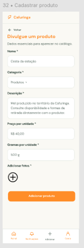

# HU15 — Cadastrar produto

## 1. Identificação

| Campo | Informação |
|---|---|
| **ID da História** | HU15 |
| **Requisito Funcional** | [RF15 — Cadastrar produto](../requisitos_software.md#71-requisitos-funcionais) |
| **Requisito Não Funcional** | [RNF03, RNF04, RNF07, RNF08, RNF15](../requisitos_software.md#72-requisitos-nao-funcionais) |
| **Regra de Negócio** | [RN01, RN02, RN09, RN11](../requisitos_software.md#74-lista-de-regras-de-negocio) |
| **Característica de Produto** | [CP2](../solucao.md#23-caracteristicas-do-produto) |
| **Objetivos Específicos** | [OE2](../solucao.md#22-objetivos-especificos-oe-do-produto) |
| **Prioridade** | Alta |

---

## 2. História de Usuário

*Como produtor cadastrado, quero cadastrar meus produtos, para divulgar minha produção e permitir consulta dos consumidores.*

---

## 3. Critérios de Aceitação

**CA01 — Acesso à funcionalidade de cadastro**

- **Dado** que estou autenticado na plataforma com perfil de produtor, **quando** acessar meu catálogo, **então** o sistema deve disponibilizar a funcionalidade de cadastro de produtos.

**CA02 — Preenchimento das informações do produto**

- **Dado** que estou na interface de cadastro de produto, **quando** informar os dados necessários para apresentar o produto, **então** o sistema deve permitir o preenchimento das informações correspondentes.

**CA03 — Associação ao produtor ou propriedade**

- **Dado** que estou cadastrando um produto, **quando** confirmar seu cadastro, **então** o sistema deve vinculá-lo ao meu perfil de produtor ou à propriedade associada.

**CA04 — Validação das informações**

- **Dado** que preenchi as informações do produto, **quando** tentar concluir o cadastro com dados obrigatórios ausentes ou inválidos, **então** o sistema deve impedir a operação e apresentar orientações para correção.

**CA05 — Cadastro concluído**

- **Dado** que preenchi corretamente as informações necessárias, **quando** confirmar o cadastro, **então** o sistema deve registrar o produto e informar que a operação foi concluída com sucesso.

**CA06 — Restrição de acesso**

- **Dado** que estou autenticado com perfil de consumidor ou visitante, **quando** tentar acessar a funcionalidade de cadastro de produtos, **então** o sistema deve impedir a operação.

**CA07 — Falha durante o cadastro**

- **Dado** que estou preenchendo as informações de um produto, **quando** ocorrer uma falha de conexão durante o cadastro, **então** o sistema deve preservar os dados preenchidos sempre que possível e informar que o cadastro não foi concluído.

**CA08 — Produto associado ao responsável**

- **Dado** que um produto foi cadastrado com sucesso, **quando** o sistema apresentar suas informações, **então** deve ser possível identificar o produtor ou a propriedade responsável pela oferta.

---

## 4. Relação com os Requisitos Não Funcionais

**RNF03 — Prevenção e Recuperação de Erros**

- Relação com a HU: Garante que o produtor receba mensagens claras durante o cadastro, incluindo orientações sobre campos obrigatórios, dados inválidos e falhas na operação.

**RNF04 — Acessibilidade Digital**

- Relação com a HU: Garante que o formulário de cadastro de produtos siga as recomendações de acessibilidade, permitindo que produtores com diferentes necessidades consigam utilizar a funcionalidade.

**RNF07 — Resiliência à Perda de Conexão**

- Relação com a HU: Reduz o risco de perda das informações preenchidas pelo produtor em caso de interrupção da conexão durante o cadastro do produto.

**RNF08 — Controle de Acesso por Perfil**

- Relação com a HU: Garante que somente usuários autenticados com perfil de produtor possam cadastrar produtos, impedindo que consumidores e visitantes executem essa operação.

**RNF15 — Proteção de Crianças e Adolescentes**

- Relação com a HU: Deve ser considerado caso o cadastro de produtos envolva informações ou conteúdos sujeitos às restrições de proteção de crianças e adolescentes previstas no requisito.

---

## 5. Relação com as Regras de Negócio

**RN01 — Perfis e permissões**

- Relação com a HU: Determina que cada perfil acesse somente as funcionalidades compatíveis com suas permissões, restringindo o cadastro de produtos aos produtores autorizados.

**RN02 — Dados de cadastro**

- Relação com a HU: Estabelece as condições para o tratamento das informações de cadastro dos usuários, orientando a identificação do produtor responsável pelo produto cadastrado.

**RN09 — Responsabilidade pelas ofertas**

- Relação com a HU: Determina que os produtos sejam vinculados a um produtor, propriedade ou responsável identificado, garantindo a identificação de quem responde pela oferta disponibilizada na plataforma.

**RN11 — Informações mínimas das ofertas**

- Relação com a HU: Estabelece que as ofertas apresentem informações necessárias para sua compreensão pelos usuários, orientando o preenchimento dos dados do produto no momento do cadastro.

---

## 6. Relação com as Características de Produto

**CP2 — Conteúdos**

- Relação com a HU: O cadastro de produtos permite que os produtores registrem os itens de sua produção na plataforma, estruturando o catálogo de ofertas e viabilizando sua divulgação aos consumidores.

---

## 7. Relação com os Objetivos Específicos

**OE2 — Visibilidade e oferta local**

- Relação com a HU: O cadastro de produtos permite que produtores e iniciativas locais divulguem sua produção na Rede Cafuringa, ampliando a visibilidade dos produtos da região e facilitando sua descoberta pelos consumidores.

---

## 8. Protótipo

---

## 8. Atividades Relacionadas

| ID | Atividade | Descrição |
|---|---|---|
| AT01 | Disponibilizar a funcionalidade de cadastro | Implementar a opção de cadastro de produtos na área do produtor. |
| AT02 | Implementar formulário de produto | Desenvolver os campos necessários para registrar as informações dos produtos. |
| AT03 | Implementar validação dos dados | Verificar o preenchimento das informações obrigatórias e a validade dos dados informados. |
| AT04 | Implementar associação ao produtor | Garantir que o produto cadastrado seja vinculado ao perfil do produtor ou à propriedade responsável. |
| AT05 | Implementar salvamento do produto | Desenvolver a operação responsável por registrar o produto no catálogo. |
| AT06 | Aplicar controle de acesso | Garantir que somente produtores autenticados possam cadastrar produtos. |
| AT07 | Aplicar tratamento de erros | Apresentar mensagens de validação e falha durante o processo de cadastro. |
| AT08 | Executar testes de cadastro | Verificar o preenchimento, a validação, o salvamento e a associação do produto ao responsável. |
| AT09 | Executar testes de autorização | Verificar se consumidores e visitantes são impedidos de cadastrar produtos. |
| AT10 | Documentar e revisar a funcionalidade | Registrar o comportamento implementado e os resultados dos testes para revisão pela equipe. |

---

## 9. Checklist do Definition of Ready (DoR)

Marque os itens conforme a história atender a cada condição.

- [x] A HU possui definição clara e informação necessária para ser trabalhada?
- [x] O requisito está representado por uma história de usuário?
- [x] A HU está rastreada aos requisitos de origem?
- [x] A HU faz parte do escopo do MVP?
- [x] A HU está coberta por critérios de aceite?
- [x] Os RNFs e as restrições legais aplicáveis estão identificados?
- [x] A HU está mapeada para uma interface, quando necessário?
- [x] A HU cabe em uma iteração?
- [x] As dependências estão mapeadas?
- [x] Os responsáveis estão definidos?
- [x] O requisito está implementado no protótipo e validado?

---

## 10. Checklist do Definition of Done (DoD)

Marque os itens após a verificação da entrega.

- [ ] Entrega um incremento do produto?
- [ ] Contempla os critérios de aceite estabelecidos?
- [ ] O desenvolvimento foi concluído integralmente?
- [ ] Os testes foram executados e aprovados?
- [ ] Está aderente aos padrões de codificação?
- [ ] A funcionalidade foi revisada pela equipe?
- [ ] Mantém os índices de performance do produto?
- [ ] Atende aos requisitos de acessibilidade e responsividade?
- [ ] Preserva a segurança e a privacidade dos dados?
- [ ] Trata os erros do usuário?
- [ ] Está livre de defeitos críticos?
- [ ] Está documentado?

