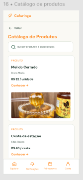

# HU19 — Consultar catálogo de produtos

## 1. Identificação

| Campo | Informação |
|---|---|
| **ID da História** | HU19 |
| **Requisito Funcional** | [RF19 — Consultar catálogo de produtos](../requisitos_software.md#71-requisitos-funcionais) |
| **Requisito Não Funcional** | [RNF01, RNF02, RNF04, RNF05, RNF06, RNF10](../requisitos_software.md#72-requisitos-nao-funcionais) |
| **Regra de Negócio** | [RN10, RN15](../requisitos_software.md#74-lista-de-regras-de-negocio) |
| **Característica de Produto** | [CP2](../solucao.md#23-caracteristicas-do-produto) |
| **Objetivos Específicos** | [OE2](../solucao.md#22-objetivos-especificos-oe-do-produto) |
| **Prioridade** | Alta |

---

## 2. História de Usuário

*Como consumidor ou visitante, quero consultar o catálogo de produtos da Rede Cafuringa, para conhecer as ofertas disponibilizadas pelos produtores locais.*

---

## 3. Critérios de Aceitação

**CA01 — Acesso ao catálogo**

- **Dado** que estou acessando a plataforma como consumidor ou visitante, **quando** selecionar a área de produtos, **então** o sistema deve apresentar o catálogo de produtos disponibilizados na Rede Cafuringa.

**CA02 — Apresentação dos produtos**

- **Dado** que acessei o catálogo de produtos, **quando** o sistema carregar as ofertas disponíveis, **então** deve apresentar os produtos cadastrados e disponibilizados pelos produtores.

**CA03 — Exibição das informações resumidas**

- **Dado** que o catálogo apresenta produtos disponíveis, **quando** visualizar os itens listados, **então** o sistema deve apresentar informações resumidas que permitam identificar cada produto.

**CA04 — Exibição de produtos indisponíveis**

- **Dado** que um produto foi retirado da oferta pública ou está indisponível, **quando** consultar o catálogo, **então** o sistema não deve apresentá-lo como uma oferta disponível para consulta.

**CA05 — Acesso aos detalhes do produto**

- **Dado** que estou consultando o catálogo, **quando** selecionar um produto, **então** o sistema deve permitir acessar a página com os detalhes correspondentes.

**CA06 — Catálogo sem produtos disponíveis**

- **Dado** que não existem produtos disponíveis para apresentação no catálogo, **quando** acessar a área de produtos, **então** o sistema deve informar que não há ofertas disponíveis no momento.

**CA07 — Consulta sem autenticação**

- **Dado** que não estou autenticado na plataforma, **quando** acessar a área pública de produtos, **então** o sistema deve permitir a consulta do catálogo sem exigir cadastro ou login.

**CA08 — Falha no carregamento do catálogo**

- **Dado** que estou acessando o catálogo de produtos, **quando** ocorrer uma falha no carregamento das informações, **então** o sistema deve apresentar uma mensagem clara informando que não foi possível carregar os produtos.

---

## 4. Relação com os Requisitos Não Funcionais

**RNF01 — Eficiência de Navegação**

- Relação com a HU: Garante que o catálogo possa ser acessado por meio de uma navegação simples, permitindo que o usuário encontre os produtos sem percorrer caminhos excessivamente longos a partir da página inicial.

**RNF02 — Tempo de Execução de Tarefas**

- Relação com a HU: Orienta o desempenho do fluxo de consulta, permitindo que o usuário encontre um produto e acesse suas informações dentro do tempo estabelecido pelo requisito.

**RNF04 — Acessibilidade Digital**

- Relação com a HU: Garante que a apresentação do catálogo e seus elementos de navegação sigam as recomendações de acessibilidade, permitindo a consulta por usuários com diferentes necessidades.

**RNF05 — Responsividade da Interface**

- Relação com a HU: Garante que o catálogo possa ser consultado em diferentes tamanhos de tela, incluindo dispositivos móveis, sem comprometer a utilização de suas funcionalidades.

**RNF06 — Desempenho em Conectividade Limitada**

- Relação com a HU: Orienta o carregamento do conteúdo principal do catálogo mesmo em condições de conexão limitada, facilitando o acesso dos usuários às ofertas.

**RNF10 — Proteção da Comunicação**

- Relação com a HU: Garante que a consulta ao catálogo e a transmissão das informações entre a plataforma e os usuários ocorram por meio de comunicação protegida.

---

## 5. Relação com as Regras de Negócio

**RN10 — Disponibilidade das ofertas**

- Relação com a HU: Determina que somente produtos disponibilizados pelo responsável sejam apresentados como ofertas públicas no catálogo, respeitando períodos de disponibilidade e sazonalidade.

**RN15 — Busca e descoberta**

- Relação com a HU: Orienta a organização e a consulta das ofertas, permitindo que os usuários encontrem produtos no catálogo conforme os recursos de busca e descoberta disponibilizados pela plataforma.

---

## 6. Relação com as Características de Produto

**CP2 — Conteúdos**

- Relação com a HU: A consulta ao catálogo permite que os produtos cadastrados pelos produtores sejam apresentados de forma organizada, estruturando a oferta local disponível na Rede Cafuringa.

---

## 7. Relação com os Objetivos Específicos

**OE2 — Visibilidade e oferta local**

- Relação com a HU: A disponibilização de um catálogo público amplia a visibilidade dos produtos da região e facilita a descoberta das ofertas pelos consumidores e visitantes.

---

## 8. Protótipo

---

## 9. Atividades Relacionadas

| ID | Atividade | Descrição |
|---|---|---|
| AT01 | Disponibilizar a área de catálogo | Implementar o acesso público à área de consulta dos produtos. |
| AT02 | Recuperar produtos disponíveis | Desenvolver a consulta dos produtos cadastrados e disponibilizados pelos produtores. |
| AT03 | Implementar apresentação do catálogo | Organizar a exibição dos produtos com informações resumidas para identificação. |
| AT04 | Considerar a disponibilidade dos produtos | Garantir que produtos retirados da oferta pública não sejam apresentados como disponíveis. |
| AT05 | Implementar acesso aos detalhes | Permitir que o usuário selecione um produto e acesse suas informações detalhadas. |
| AT06 | Implementar estado de catálogo vazio | Apresentar uma mensagem quando não houver produtos disponíveis. |
| AT07 | Implementar tratamento de falhas | Informar ao usuário quando não for possível carregar o catálogo. |
| AT08 | Aplicar requisitos de acessibilidade e responsividade | Adequar a interface do catálogo às recomendações de acessibilidade e aos diferentes tamanhos de tela. |
| AT09 | Executar testes de consulta | Verificar a apresentação dos produtos, a disponibilidade das ofertas e o acesso aos detalhes. |
| AT10 | Documentar e revisar a funcionalidade | Registrar o comportamento implementado e os resultados dos testes para revisão pela equipe. |

---

## 10. Checklist do Definition of Ready (DoR)

Marque os itens conforme a história atender a cada condição.

- [x] A HU possui definição clara e informação necessária para ser trabalhada?
- [x] O requisito está representado por uma história de usuário?
- [x] A HU está rastreada aos requisitos de origem?
- [x] A HU faz parte do escopo do MVP?
- [x] A HU está coberta por critérios de aceite?
- [x] Os RNFs e as restrições legais aplicáveis estão identificados?
- [x] A HU está mapeada para uma interface, quando necessário?
- [x] A HU cabe em uma iteração?
- [x] As dependências estão mapeadas?
- [x] Os responsáveis estão definidos?
- [x] O requisito está implementado no protótipo e validado?

---

## 11. Checklist do Definition of Done (DoD)

Marque os itens após a verificação da entrega.

- [ ] Entrega um incremento do produto?
- [ ] Contempla os critérios de aceite estabelecidos?
- [ ] O desenvolvimento foi concluído integralmente?
- [ ] Os testes foram executados e aprovados?
- [ ] Está aderente aos padrões de codificação?
- [ ] A funcionalidade foi revisada pela equipe?
- [ ] Mantém os índices de performance do produto?
- [ ] Atende aos requisitos de acessibilidade e responsividade?
- [ ] Preserva a segurança e a privacidade dos dados?
- [ ] Trata os erros do usuário?
- [ ] Está livre de defeitos críticos?
- [ ] Está documentado?

