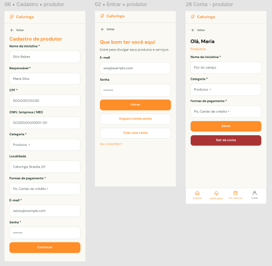

# HU02 — Cadastrar perfil de produtor

## 1. Identificação

| Campo | Informação |
|---|---|
| **ID da História** | HU02 |
| **Requisito Funcional** | [RF02 — Cadastrar perfil de produtor](../requisitos_software.md#71-requisitos-funcionais) |
| **Requisito Não Funcional** | [RNF03, RNF04, RNF07, RNF08, RNF11, RNF15](../requisitos_software.md#72-requisitos-nao-funcionais) |
| **Regra de Negócio** | [RN01, RN02, RN05, RN07, RN08, RN09](../requisitos_software.md#74-lista-de-regras-de-negocio) |
| **Característica de Produto** | [CP1](../solucao.md#23-caracteristicas-do-produto) |
| **Objetivos Específicos** | [OE2](../solucao.md#22-objetivos-especificos-oe-do-produto) |
| **Prioridade** | Média |

---

## 2. História de Usuário

*Como produtor ou responsável por uma iniciativa, quero cadastrar meu perfil de produtor, para divulgar minha produção, meus produtos e minhas experiências.*

---

## 3. Critérios de Aceitação

**CA01 — Cadastro com dados válidos**

- **Dado** que estou na tela de cadastro de produtor, **quando** informar os dados obrigatórios válidos, incluindo responsável, CPF, localidade, categorias ofertadas, formas de pagamento, e-mail e senha, **então** o sistema deve permitir a criação do perfil.

**CA02 — Identificação da iniciativa**

- **Dado** que estou preenchendo o cadastro de produtor, **quando** informar o nome da iniciativa ou propriedade, **então** o sistema deve registrar essa informação para identificação e apresentação do perfil na plataforma, quando aplicável.

**CA03 — Identificação jurídica da iniciativa**

- **Dado** que a iniciativa esteja enquadrada como MEI, **quando** realizar o cadastro, **então** o sistema deve permitir informar o CNPJ correspondente, conforme os campos e condições definidos para esse tipo de cadastro.

**CA04 — Validação de campos obrigatórios**

- **Dado** que existam campos obrigatórios vazios ou inválidos, **quando** eu tentar concluir o cadastro, **então** o sistema deve impedir a criação do perfil e informar os campos que precisam ser corrigidos.

**CA05 — Validação de CPF e CNPJ**

- **Dado** que o CPF ou CNPJ informado esteja em formato inválido, **quando** eu tentar concluir o cadastro, **então** o sistema deve impedir a criação do perfil e apresentar uma mensagem indicando a necessidade de correção.

**CA06 — E-mail já cadastrado**

- **Dado** que o e-mail informado já esteja associado a uma conta, **quando** eu tentar realizar o cadastro, **então** o sistema deve impedir o cadastro duplicado e informar o problema.

**CA07 — CPF ou CNPJ já cadastrado**

- **Dado** que o CPF ou CNPJ informado já esteja associado a outro cadastro, **quando** eu tentar concluir o cadastro, **então** o sistema deve impedir a duplicidade, conforme as regras de unicidade definidas para o sistema.

**CA08 — Seleção de categorias ofertadas**

- **Dado** que estou preenchendo o cadastro, **quando** selecionar as categorias correspondentes às atividades da minha iniciativa, **então** o sistema deve registrar essas informações para classificar o perfil e facilitar sua localização pelos consumidores.

**CA09 — Cadastro concluído**

- **Dado** que todos os dados obrigatórios sejam válidos e não existam duplicidades, **quando** o cadastro for concluído, **então** o sistema deve registrar o perfil de produtor e informar que a operação foi realizada com sucesso.

**CA10 — Permissões do perfil**

- **Dado** que o cadastro tenha sido concluído, **quando** o usuário acessar a plataforma com sua conta de produtor, **então** o sistema deve disponibilizar as funcionalidades compatíveis com esse perfil, respeitando as permissões estabelecidas.

---

## 4. Relação com os Requisitos Não Funcionais

**RNF03 — Prevenção e Recuperação de Erros**

- Relação com a HU: Garante que o produtor consiga identificar e corrigir erros no preenchimento do formulário, como campos obrigatórios vazios, CPF ou CNPJ inválidos e e-mail em formato incorreto, sem dificuldades desnecessárias.

**RNF04 — Acessibilidade Digital**

- Relação com a HU: Permite que produtores com diferentes necessidades de acesso utilizem o formulário de cadastro, incluindo usuários que navegam por teclado ou utilizam tecnologias assistivas.

**RNF07 — Resiliência à Perda de Conexão**

- Relação com a HU: Evita que o produtor precise preencher novamente todos os campos caso ocorra uma interrupção de conexão durante o cadastro, preservando os dados já preenchidos antes de uma nova tentativa de envio.

**RNF08 — Controle de Acesso por Perfil**

- Relação com a HU: Garante que a conta criada seja identificada como perfil de produtor e receba as permissões correspondentes, permitindo o acesso às funcionalidades de gerenciamento de produtos, experiências e demais ofertas.

**RNF11 — Proteção de Dados Pessoais**

- Relação com a HU: Exige que a coleta de dados como CPF, CNPJ, e-mail e demais informações de identificação tenha finalidade funcional definida, garantindo que informações cadastrais privadas não sejam expostas publicamente no perfil do produtor.

**RNF15 — Proteção de Crianças e Adolescentes**

- Relação com a HU: O cadastro e o tratamento de dados de produtores menores de idade, caso sejam permitidos pela plataforma, devem observar as medidas legais de proteção, privacidade e consentimento aplicáveis, sem exposição indevida de informações pessoais.

---

## 5. Relação com as Regras de Negócio

**RN01 — Perfis e permissões**

- Relação com a HU: O cadastro deve criar uma conta identificada como produtor, garantindo que as permissões atribuídas correspondam a esse perfil e permitam o gerenciamento das funcionalidades destinadas aos produtores.

**RN02 — Dados de cadastro**

- Relação com a HU: Define que os dados solicitados devem corresponder ao perfil de produtor, incluindo as informações necessárias à identificação e apresentação da iniciativa, como responsável, CPF, CNPJ quando aplicável, localidade e categorias ofertadas.

**RN05 — Autenticação e recuperação de acesso**

- Relação com a HU: Estabelece que o e-mail e a senha cadastrados serão utilizados para acesso à conta, enquanto CPF e CNPJ serão utilizados exclusivamente para identificação, não constituindo credenciais de autenticação.

**RN07 — Informações públicas do produtor**

- Relação com a HU: Determina que o perfil público apresente somente informações destinadas à divulgação da iniciativa, como nome, categoria ofertada e demais informações autorizadas, impedindo a exposição de dados cadastrais privados, como CPF e CNPJ.

**RN08 — Proteção de dados de menores**

- Relação com a HU: O fluxo de cadastro deve considerar as medidas de proteção aplicáveis caso crianças ou adolescentes possam atuar como responsáveis ou participar de iniciativas cadastradas, observando os requisitos legais pertinentes ao tratamento de seus dados.

**RN09 — Responsabilidade pelas ofertas**

- Relação com a HU: Garante que o perfil de produtor esteja vinculado a um responsável identificado, que será responsável pela manutenção das informações e das ofertas posteriormente cadastradas na plataforma.

---

## 6. Relação com as Características de Produto

**CP1 — Perfis**

- Relação com a HU: O cadastro de produtores possibilita a criação de perfis de identificação e apresentação das propriedades, associações, comunidades e demais iniciativas da região da Cafuringa. Esses perfis permitem organizar as informações dos responsáveis e estabelecer a identificação necessária para a divulgação de produtos e experiências na plataforma.

---

## 7. Relação com os Objetivos Específicos

**OE2 — Visibilidade e oferta local**

- Relação com a HU: O cadastro de produtores contribui diretamente para ampliar a visibilidade das iniciativas locais, permitindo que agricultores familiares, propriedades, associações e comunidades apresentem suas atividades e disponibilizem informações sobre sua produção. Dessa forma, fortalece a divulgação das ofertas da região da Cafuringa e facilita sua descoberta pelos consumidores e visitantes.

---

## 8. Protótipo

---

## 9. Atividades Relacionadas

| ID | Atividade | Descrição |
|---|---|---|
| AT01 | Definir os campos do cadastro | Identificar e disponibilizar os campos necessários ao cadastro: nome da iniciativa, responsável, CPF, CNPJ quando aplicável, localidade, categorias ofertadas, formas de pagamento, e-mail e senha. |
| AT02 | Implementar o formulário de cadastro | Desenvolver a interface para preenchimento e envio dos dados do produtor ou responsável pela iniciativa. |
| AT03 | Implementar identificação da iniciativa | Permitir o registro do nome da propriedade, associação, comunidade ou iniciativa, quando houver. |
| AT04 | Implementar identificação do responsável | Disponibilizar os campos necessários para identificar a pessoa responsável pelo perfil, incluindo CPF. |
| AT05 | Implementar identificação jurídica | Permitir o preenchimento do CNPJ quando aplicável, considerando as condições estabelecidas para iniciativas enquadradas como MEI. |
| AT06 | Implementar seleção de categorias | Disponibilizar opções para classificação das categorias de produtos e experiências oferecidas pela iniciativa. |
| AT07 | Registrar localidade e formas de pagamento | Implementar o preenchimento e armazenamento das informações de localização e das formas de pagamento disponibilizadas pelo produtor. |
| AT08 | Implementar validação dos campos | Validar o preenchimento obrigatório, os formatos de CPF, CNPJ e e-mail, além dos critérios definidos para a senha. |
| AT09 | Verificar duplicidade de dados | Impedir o cadastro quando o e-mail, CPF ou CNPJ já estiver associado a outro cadastro, conforme as regras de unicidade adotadas. |
| AT10 | Registrar o perfil de produtor | Implementar o processamento e armazenamento dos dados válidos, associando a conta ao perfil de produtor. |
| AT11 | Implementar mensagens de retorno | Informar o usuário sobre erros de preenchimento, duplicidades e conclusão bem-sucedida do cadastro. |
| AT12 | Aplicar medidas de segurança e privacidade | Proteger os dados pessoais e impedir a exposição pública de informações cadastrais privadas, como CPF e CNPJ. |
| AT13 | Aplicar permissões do perfil | Garantir que a conta criada receba as permissões correspondentes ao perfil de produtor. |
| AT14 | Verificar acessibilidade e responsividade | Avaliar a navegação por teclado, identificação dos campos, contraste e adaptação do formulário a diferentes telas. |
| AT15 | Tratar interrupções de conexão | Garantir que os dados já preenchidos não sejam apagados automaticamente durante uma interrupção temporária da conexão, antes de uma nova tentativa de envio. |
| AT16 | Verificar as medidas de proteção de menores | Avaliar as medidas de proteção de dados, privacidade e consentimento aplicáveis ao fluxo de cadastro, conforme as regras definidas para a plataforma. |
| AT17 | Executar testes do cadastro | Testar o fluxo com dados válidos, campos obrigatórios vazios ou inválidos, CPF e CNPJ inválidos, e-mail duplicado, documentos duplicados e conclusão bem-sucedida. |
| AT18 | Documentar e revisar a funcionalidade | Registrar o comportamento implementado, os resultados dos testes e eventuais pendências para revisão pela equipe. |

---

## 10. Checklist do Definition of Ready (DoR)

Marque os itens conforme a história atender a cada condição.

- [x] A HU possui definição clara e informação necessária para ser trabalhada?
- [x] O requisito está representado por uma história de usuário?
- [x] A HU está rastreada aos requisitos de origem?
- [x] A HU faz parte do escopo do MVP?
- [x] A HU está coberta por critérios de aceite?
- [x] Os RNFs e as restrições legais aplicáveis estão identificados?
- [x] A HU está mapeada para uma interface, quando necessário?
- [x] A HU cabe em uma iteração?
- [x] As dependências estão mapeadas?
- [x] Os responsáveis estão definidos?
- [x] O requisito está implementado no protótipo e validado?

---

## 11. Checklist do Definition of Done (DoD)

Marque os itens após a verificação da entrega.

- [ ] Entrega um incremento do produto?
- [ ] Contempla os critérios de aceite estabelecidos?
- [ ] O desenvolvimento foi concluído integralmente?
- [ ] Os testes foram executados e aprovados?
- [ ] Está aderente aos padrões de codificação?
- [ ] A funcionalidade foi revisada pela equipe?
- [ ] Mantém os índices de performance do produto?
- [ ] Atende aos requisitos de acessibilidade e responsividade?
- [ ] Preserva a segurança e a privacidade dos dados?
- [ ] Trata os erros do usuário?
- [ ] Está livre de defeitos críticos?
- [ ] Está documentado?