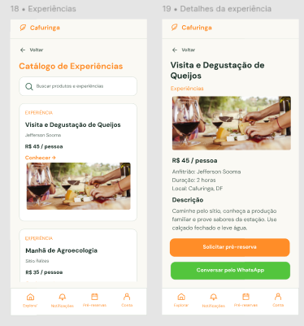

# HU24 — Consultar catálogo de experiências

## 1. Identificação
<!-- REQUISITOS_HU_META_AUTO_INICIO -->
| Campo | Informação |
|---|---|
| **ID da História** | HU24 |
| **Requisito Funcional** | [RF24 — Consultar catálogo de experiências](../requisitos_software.md#71-requisitos-funcionais) |
| **Requisito Não Funcional** | [RNF01](../requisitos_software.md#72-requisitos-nao-funcionais), [RNF02](../requisitos_software.md#72-requisitos-nao-funcionais), [RNF03](../requisitos_software.md#72-requisitos-nao-funcionais), [RNF04](../requisitos_software.md#72-requisitos-nao-funcionais), [RNF06](../requisitos_software.md#72-requisitos-nao-funcionais), [RNF15](../requisitos_software.md#72-requisitos-nao-funcionais) |
| **Regra de Negócio** | [RN10](../requisitos_software.md#73-lista-de-regras-de-negocio), [RN15](../requisitos_software.md#73-lista-de-regras-de-negocio) |
| **Característica de Produto** | [CP3](../solucao.md#23-caracteristicas-do-produto) |
| **Objetivos Específicos** | [OE2](../solucao.md#22-objetivos-especificos-oe-do-produto) |
| **Prioridade** | Alta |
| **Escopo** | MVP |
| **Iteração** | [Iteração 8](../evidencias/iteracao8.md) |
<!-- REQUISITOS_HU_META_AUTO_FIM -->

---

## 2. História de Usuário

*Como consumidor ou visitante, eu quero consultar um catálogo de experiências disponibilizadas pelos produtores cadastrados, para conhecer as atividades e vivências oferecidas na região da APA de Cafuringa.*

---

## 3. Critérios de Aceitação

**CA01 — Exibição do catálogo de experiências**

- **Dado** que existam experiências cadastradas e disponíveis na plataforma, **quando** o usuário acessar a seção de experiências, **então** o sistema deve apresentar o catálogo com as experiências disponibilizadas.

**CA02 — Informações apresentadas no catálogo**

- **Dado** que o catálogo de experiências esteja disponível, **quando** o sistema apresentar os resultados, **então** cada experiência deve exibir informações resumidas que permitam sua identificação.

**CA03 — Exibição das experiências disponíveis**

- **Dado** que existam experiências cadastradas com diferentes condições de disponibilidade, **quando** o usuário consultar o catálogo, **então** o sistema deve apresentar somente as experiências disponíveis para consulta.

**CA04 — Catálogo vazio**

- **Dado** que não existam experiências disponíveis cadastradas, **quando** o usuário acessar o catálogo, **então** o sistema deve apresentar uma mensagem informando que não há experiências disponíveis.

**CA05 — Acesso aos detalhes da experiência**

- **Dado** que o catálogo apresente experiências, **quando** o usuário selecionar uma experiência, **então** o sistema deve permitir o acesso à página com os detalhes da experiência selecionada.

**CA06 — Atualização do catálogo**

- **Dado** que uma experiência tenha sido cadastrada, atualizada ou removida, **quando** o usuário acessar ou atualizar o catálogo, **então** o sistema deve apresentar os resultados conforme as informações atualmente disponíveis na plataforma.

**CA07 — Identificação do produtor ou anfitrião**

- **Dado** que uma experiência esteja vinculada a um produtor ou anfitrião, **quando** ela for exibida no catálogo, **então** o sistema deve apresentar informações resumidas que permitam identificar o responsável pela experiência, quando disponíveis.

**CA08 — Navegação pelo catálogo**

- **Dado** que o usuário esteja consultando o catálogo, **quando** navegar entre as experiências apresentadas, **então** o sistema deve permitir a visualização dos resultados sem comprometer a compreensão e a utilização da interface.

---

## 4. Relação com os Requisitos Não Funcionais

**[RNF01 — Eficiência de Navegação](../requisitos_software.md#72-requisitos-nao-funcionais)**

O catálogo é aberto pela tela Explorar (categoria Experiências → "Ver mais experiências") e cada experiência abre seus detalhes direto do card, mantendo a navegação rasa para localizar uma experiência e acessar seus detalhes.

**[RNF02 — Tempo de Execução de Tarefas](../requisitos_software.md#72-requisitos-nao-funcionais)**

Os cards resumem o essencial (tipo, nome, responsável, valor por pessoa e foto) e a busca filtra o catálogo enquanto o usuário digita, para que ele encontre uma experiência e chegue aos detalhes em poucos segundos.

**[RNF03 — Prevenção e Recuperação de Erros](../requisitos_software.md#72-requisitos-nao-funcionais)**

Falha de comunicação ao carregar o catálogo é informada como problema do sistema, com a opção "Tentar novamente", e não é confundida com catálogo vazio, que tem mensagem própria.

**[RNF04 — Acessibilidade Digital](../requisitos_software.md#72-requisitos-nao-funcionais)**

Cards, busca e "Mostrar mais" funcionam por teclado, com foco visível; ao carregar mais experiências, o foco vai para a primeira experiência nova e a quantidade exibida é anunciada a leitores de tela (WCAG 2.1 AA).

**[RNF06 — Desempenho em Conectividade Limitada](../requisitos_software.md#72-requisitos-nao-funcionais)**

O catálogo mostra as experiências em partes, carrega as fotos sob demanda e revalida os dados com `ETag`: quando nada mudou, a API responde 304 sem corpo, economizando dados em conexões móveis e rurais.

**[RNF15 — Proteção de Crianças e Adolescentes](../requisitos_software.md#72-requisitos-nao-funcionais)**

A consulta é pública e expõe do responsável apenas dados de divulgação (nome da iniciativa e localidade), nunca e-mail, telefone ou documentos, de modo que dados pessoais não fiquem disponíveis publicamente em consultas da plataforma.

---

## 5. Relação com as Regras de Negócio

**[RN10 - Disponibilidade das Ofertas](../requisitos_software.md#73-lista-de-regras-de-negocio)**

As experiências apresentadas devem respeitar as condições de disponibilidade estabelecidas para sua divulgação.

**[RN15 - Busca e Descoberta](../requisitos_software.md#73-lista-de-regras-de-negocio)** 

A consulta às experiências deve respeitar as regras estabelecidas para a apresentação das informações cadastradas na plataforma.

---

## 6. Relação com as Características de Produto

**[CP3 — Divulgação de experiências e atividades](../solucao.md#23-caracteristicas-do-produto)**

Permite que consumidores e visitantes conheçam as experiências disponibilizadas pelos produtores e iniciativas locais.

---

## 7. Relação com os Objetivos Específicos

**[OE2 — Ampliar a visibilidade da oferta local](../solucao.md#22-objetivos-especificos-oe-do-produto)**

Amplia a divulgação das experiências oferecidas na APA de Cafuringa, facilitando seu conhecimento por consumidores e visitantes.

---

## 8. Protótipo

---

## 9. Atividades Relacionadas

| ID | Atividade | Descrição |
|---|---|---|
| AT01 | Levantar informações das experiências | Identificar quais informações devem ser apresentadas no catálogo. |
| AT02 | Definir estrutura do catálogo | Estabelecer a organização e a disposição das experiências na interface. |
| AT03 | Implementar consulta às experiências | Desenvolver a funcionalidade responsável por recuperar as experiências cadastradas. |
| AT04 | Implementar critérios de disponibilidade | Garantir que sejam apresentadas as experiências disponíveis para consulta. |
| AT05 | Implementar apresentação dos resultados | Exibir as experiências em formato organizado e compreensível. |
| AT06 | Implementar acesso aos detalhes | Permitir que o usuário selecione uma experiência e acesse suas informações detalhadas. |
| AT07 | Implementar estado de catálogo vazio | Apresentar mensagem adequada quando não houver experiências disponíveis. |
| AT08 | Adequar interface aos dispositivos | Garantir a responsividade e a acessibilidade da consulta ao catálogo. |
| AT09 | Realizar testes funcionais | Verificar a apresentação, a atualização e a navegação pelo catálogo. |
| AT10 | Validar critérios de aceitação | Confirmar o atendimento aos critérios definidos para a história. |

---

## 10. Checklist do Definition of Ready (DoR)

- [x] História de usuário identificada e documentada.
- [x] Requisito funcional associado e rastreável.
- [x] Objetivo da história compreendido pela equipe.
- [x] História priorizada para inclusão no MVP.
- [x] Critérios de aceitação definidos e verificáveis.
- [x] Requisitos não funcionais relacionados identificados.
- [x] Interface e fluxo de navegação mapeados.
- [x] História compatível com o escopo da iteração.
- [x] Dependências técnicas identificadas e resolvidas.
- [ ] Responsável pela implementação definido.
- [ ] Protótipo validado, quando aplicável.

---

## 11. Checklist do Definition of Done (DoD)

- [x] Funcionalidade implementada conforme a história de usuário.
- [x] Critérios de aceitação atendidos.
- [x] Testes funcionais executados e aprovados.
- [x] Requisitos não funcionais relacionados verificados.
- [ ] Código revisado e aprovado.
- [x] Documentação atualizada.
- [ ] Funcionalidade integrada à aplicação.
- [ ] Validação final realizada pela equipe.

---

## Evidências

Registre abaixo **uma linha por contribuição**. Cada integrante deve informar o que realizou e inserir um link verificável para a evidência (por exemplo: **Pull Request, commit, resultado de teste, imagem ou vídeo**). Não registre atividades como concluídas sem comprovação.

| Integrante | Atividade realizada | Evidência (link ou arquivo) | Data |
|---|---|---|---|
| Italo Alves | Catálogo de experiências com a API real: `GET /experiences` com `Cache-Control: no-cache` e ETag (304), carregamento em partes com "Mostrar mais", mensagem própria de catálogo vazio, responsável omitido quando ausente e primeira foto com prioridade (RNF06). Validação dos critérios no Docker em 375, 768 e 1280 px, com e sem login, axe sem violações e Lighthouse em 3G | [PR #78](https://github.com/mdsreq-fga-unb/REQ-2026.2-T02-RedeCafuringa/pull/78) · [commit 418ec23d](https://github.com/mdsreq-fga-unb/REQ-2026.2-T02-RedeCafuringa/commit/418ec23d) · [commit 40f40f65](https://github.com/mdsreq-fga-unb/REQ-2026.2-T02-RedeCafuringa/commit/40f40f65) · [catálogo](../../img/evidencias/iteracao8/hu24-ca01-ca02-ca07-catalogo.jpg) · [celular](../../img/evidencias/iteracao8/hu24-catalogo-mobile.jpg) · [vazio](../../img/evidencias/iteracao8/hu24-ca04-catalogo-vazio.jpg) · [detalhe](../../img/evidencias/iteracao8/hu24-ca05-detalhe-experiencia.jpg) · [experiência retirada](../../img/evidencias/iteracao8/hu24-ca06-experiencia-retirada.jpg) · [catálogo atualizado](../../img/evidencias/iteracao8/hu24-ca06-catalogo-atualizado.jpg) · [mostrar mais](../../img/evidencias/iteracao8/hu24-ca08-mostrar-mais.jpg) · [próxima parte](../../img/evidencias/iteracao8/hu24-ca08-proxima-parte.jpg) | 17/11/2026 |
