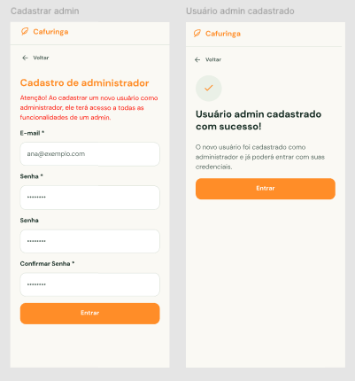

# HU03 — Cadastrar usuário administrador

## 1. Identificação

| Campo | Informação |
|---|---|
| **ID da História** | HU03 |
| **Requisito Funcional** | [RF03 — Cadastrar usuário administrador](../requisitos_software.md#71-requisitos-funcionais) |
| **Requisito Não Funcional** | [RNF03, RNF04, RNF07, RNF08, RNF10, RNF11, RNF12](../requisitos_software.md#72-requisitos-nao-funcionais) |
| **Regra de Negócio** | [RN01, RN03, RN05](../requisitos_software.md#74-lista-de-regras-de-negocio) |
| **Característica de Produto** | [CP1](../solucao.md#23-caracteristicas-do-produto) |
| **Objetivos Específicos** | [OE2](../solucao.md#22-objetivos-especificos-oe-do-produto) |
| **Prioridade** | Média |

---

## 2. História de Usuário

*Como responsável pela administração, quero cadastrar usuários administradores, para permitir apoio no gerenciamento da plataforma.*

---

## 3. Critérios de Aceitação

**CA01 — Cadastro com dados válidos**

- **Dado** que estou no fluxo autorizado de cadastro de administrador, **quando** informar um e-mail válido e uma senha que atenda aos critérios estabelecidos, **então** o sistema deve permitir a criação da conta de administrador.

**CA02 — Validação de campos obrigatórios**

- **Dado** que existam campos obrigatórios vazios ou inválidos, **quando** eu tentar concluir o cadastro, **então** o sistema deve impedir a criação da conta e informar os campos que precisam ser corrigidos.

**CA03 — Validação do formato do e-mail**

- **Dado** que o e-mail informado esteja em formato inválido, **quando** eu tentar concluir o cadastro, **então** o sistema deve impedir a operação e apresentar uma mensagem indicando a necessidade de correção.

**CA04 — E-mail já cadastrado**

- **Dado** que o e-mail informado já esteja associado a uma conta existente, **quando** eu tentar cadastrar um novo administrador utilizando esse endereço, **então** o sistema deve impedir a duplicidade e informar o problema.

**CA05 — Cadastro de administrador**

- **Dado** que os dados informados sejam válidos e não exista duplicidade de e-mail, **quando** o cadastro for concluído, **então** o sistema deve registrar a conta com o perfil de administrador.

**CA06 — Permissões administrativas**

- **Dado** que a conta de administrador tenha sido cadastrada, **quando** o usuário acessar a plataforma, **então** o sistema deve disponibilizar as funcionalidades administrativas compatíveis com esse perfil.

**CA07 — Cadastro concluído**

- **Dado** que todos os dados obrigatórios sejam válidos, **quando** o cadastro for concluído, **então** o sistema deve informar que a operação foi realizada com sucesso.

---

## 4. Relação com os Requisitos Não Funcionais

**RNF03 — Prevenção e Recuperação de Erros**

- Relação com a HU: Garante que o responsável consiga identificar e corrigir erros durante o cadastro, como campos obrigatórios vazios, e-mail inválido ou duplicado, por meio de mensagens claras e orientações para correção.

**RNF04 — Acessibilidade Digital**

- Relação com a HU: Permite que responsáveis pela administração com diferentes necessidades de acesso utilizem o formulário de cadastro, incluindo usuários que navegam por teclado ou utilizam tecnologias assistivas.

**RNF07 — Resiliência à Perda de Conexão**

- Relação com a HU: Evita que os dados já preenchidos sejam apagados automaticamente caso ocorra uma interrupção de conexão durante o cadastro, permitindo uma nova tentativa de envio.

**RNF08 — Controle de Acesso por Perfil**

- Relação com a HU: Garante que a conta criada seja identificada como perfil de administrador e receba as permissões correspondentes, impedindo que usuários de outros perfis acessem funcionalidades administrativas.

**RNF10 — Proteção da Comunicação**

- Relação com a HU: Protege os dados transmitidos durante o cadastro, especialmente o e-mail e a senha utilizados na criação da conta administrativa, por meio de comunicação segura.

**RNF11 — Proteção de Dados Pessoais**

- Relação com a HU: Garante que os dados utilizados no cadastro tenham finalidade funcional definida e sejam tratados adequadamente, impedindo a exposição indevida das informações da conta administrativa.

**RNF12 — Compatibilidade entre Navegadores**

- Relação com a HU: Garante que o formulário de cadastro e seu fluxo de conclusão funcionem nos navegadores e ambientes previstos para utilização da plataforma.

---

## 5. Relação com as Regras de Negócio

**RN01 — Perfis e permissões**

- Relação com a HU: Determina que a conta criada seja identificada como administrador, recebendo as permissões necessárias para executar as funcionalidades administrativas da plataforma.

**RN03 — Gestão administrativa**

- Relação com a HU: Estabelece que as atividades administrativas sobre usuários, conteúdos e informações institucionais sejam realizadas exclusivamente por administradores, justificando a necessidade de disponibilizar contas específicas para os responsáveis pelo gerenciamento da plataforma.

**RN05 — Autenticação e recuperação de acesso**

- Relação com a HU: Define que o acesso à conta administrativa deve utilizar e-mail e senha, sendo essas as credenciais registradas durante o cadastro. A recuperação de acesso deve verificar a titularidade antes de permitir a redefinição das credenciais.

---

## 6. Relação com as Características de Produto

**CP1 — Perfis**

- Relação com a HU: O cadastro de administradores permite estabelecer os perfis responsáveis pelo gerenciamento da Rede Cafuringa. Dessa forma, possibilita a organização das permissões administrativas e a identificação dos usuários autorizados a realizar atividades de gestão da plataforma.

---

## 7. Relação com os Objetivos Específicos

**OE2 — Visibilidade e oferta local**

- Relação com a HU: O cadastro de usuários administradores contribui indiretamente para a visibilidade das iniciativas locais, pois permite estruturar os responsáveis pela manutenção e organização das informações disponibilizadas na Rede Cafuringa. Dessa forma, apoia o gerenciamento da plataforma e a continuidade da divulgação dos produtores, produtos e experiências da região.

---

## 8. Protótipo

---

## 9. Atividades Relacionadas

| ID | Atividade | Descrição |
|---|---|---|
| AT01 | Definir os campos do cadastro | Identificar e disponibilizar os campos necessários à criação da conta administrativa: e-mail e senha. |
| AT02 | Implementar o formulário de cadastro | Desenvolver a interface para preenchimento e envio dos dados do usuário administrador. |
| AT03 | Implementar validação dos campos | Validar o preenchimento obrigatório, o formato do e-mail e os critérios definidos para a senha. |
| AT04 | Verificar duplicidade de e-mail | Impedir a criação de uma nova conta quando o e-mail informado já estiver associado a outro usuário. |
| AT05 | Registrar a conta administrativa | Implementar o processamento e armazenamento dos dados válidos, associando a conta ao perfil de administrador. |
| AT06 | Aplicar permissões administrativas | Garantir que a conta criada receba as permissões correspondentes ao perfil de administrador. |
| AT07 | Implementar mensagens de retorno | Informar o usuário sobre erros de preenchimento, duplicidades e conclusão bem-sucedida do cadastro. |
| AT08 | Aplicar medidas de segurança e privacidade | Proteger as credenciais utilizadas no cadastro e impedir a exposição indevida dos dados da conta administrativa. |
| AT09 | Verificar acessibilidade e responsividade | Avaliar a navegação por teclado, a identificação dos campos, o contraste e a adaptação do formulário a diferentes telas. |
| AT10 | Tratar interrupções de conexão | Garantir que os dados já preenchidos não sejam apagados automaticamente durante uma interrupção temporária da conexão, antes de uma nova tentativa de envio. |
| AT11 | Executar testes do cadastro | Testar o fluxo com dados válidos, campos vazios ou inválidos, e-mail duplicado e conclusão bem-sucedida. |
| AT12 | Validar compatibilidade entre navegadores | Verificar o funcionamento do cadastro nos navegadores e ambientes definidos no RNF12. |
| AT13 | Documentar e revisar a funcionalidade | Registrar o comportamento implementado, os resultados dos testes e eventuais pendências para revisão pela equipe. |

---

## 10. Checklist do Definition of Ready (DoR)

Marque os itens conforme a história atender a cada condição.

- [x] A HU possui definição clara e informação necessária para ser trabalhada?
- [x] O requisito está representado por uma história de usuário?
- [x] A HU está rastreada aos requisitos de origem?
- [x] A HU faz parte do escopo do MVP?
- [x] A HU está coberta por critérios de aceite?
- [x] Os RNFs e as restrições legais aplicáveis estão identificados?
- [x] A HU está mapeada para uma interface, quando necessário?
- [x] A HU cabe em uma iteração?
- [x] As dependências estão mapeadas?
- [x] Os responsáveis estão definidos?
- [x] O requisito está implementado no protótipo e validado?

---

## 11. Checklist do Definition of Done (DoD)

Marque os itens após a verificação da entrega.

- [ ] Entrega um incremento do produto?
- [ ] Contempla os critérios de aceite estabelecidos?
- [ ] O desenvolvimento foi concluído integralmente?
- [ ] Os testes foram executados e aprovados?
- [ ] Está aderente aos padrões de codificação?
- [ ] A funcionalidade foi revisada pela equipe?
- [ ] Mantém os índices de performance do produto?
- [ ] Atende aos requisitos de acessibilidade e responsividade?
- [ ] Preserva a segurança e a privacidade dos dados?
- [ ] Trata os erros do usuário?
- [ ] Está livre de defeitos críticos?
- [ ] Está documentado?