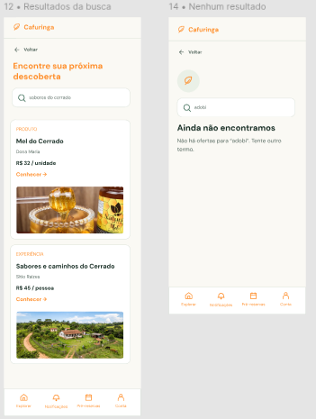

# HU36 — Buscar ofertas

## 1. Identificação

| Campo | Informação |
|---|---|
| ID da História | HU36 |
| Requisito Funcional | [RF36 — Buscar ofertas](../requisitos_software.md#71-requisitos-funcionais) |
| Requisito Não Funcional | [RNF01, RNF02, RNF03, RNF04, RNF05, RNF06 e RNF12](../requisitos_software.md#72-requisitos-nao-funcionais) |
| Regra de Negócio | [RN15](../requisitos_software.md#74-lista-de-regras-de-negocio) |
| Característica de Produto | [CP4](../solucao.md#23-caracteristicas-do-produto) |
| Objetivos Específicos | [OE2](../solucao.md#22-objetivos-especificos-oe-do-produto) |
| Prioridade | Alta |

---

## 2. História de Usuário

*Como consumidor ou visitante, quero buscar ofertas na plataforma, para encontrar produtores, produtos, experiências e eventos disponíveis na região da Cafuringa.*

---

## 3. Critérios de Aceitação

**CA01 — Acessar a funcionalidade de busca**

- **Dado** que o usuário esteja na plataforma, **quando** acessar a funcionalidade de busca, **então** o sistema deve disponibilizar um campo para informar o termo desejado.

**CA02 — Informar termo de busca**

- **Dado** que o usuário esteja na funcionalidade de busca,**quando** informar um termo de pesquisa, **então** o sistema deve permitir a execução da busca.
 
**CA03 — Buscar ofertas cadastradas**

- **Dado** que existam ofertas cadastradas na plataforma, **quando** o usuário executar uma busca, **então** o sistema deve pesquisar as ofertas correspondentes ao termo informado, considerando o escopo definido para a funcionalidade.

**CA04 — Apresentar resultados da busca**

- **Dado** que existam ofertas correspondentes ao termo pesquisado, **quando** a busca for concluída, **então** o sistema deve apresentar os resultados encontrados de forma organizada.

**CA05 — Acessar detalhes de um resultado**

- **Dado** que o sistema tenha apresentado resultados para a busca, **quando** o usuário selecionar uma oferta, **então** o sistema deve permitir o acesso às informações detalhadas da oferta selecionada.

**CA06 — Tratar busca sem resultados**

- **Dado** que não existam ofertas correspondentes ao termo informado, **quando** o usuário executar a busca, **então** o sistema deve informar que nenhum resultado foi encontrado.

**CA07 — Permitir nova busca**

- **Dado** que o usuário tenha realizado uma busca, **quando** desejar pesquisar outro termo, **então** o sistema deve permitir a alteração do termo e a execução de uma nova pesquisa.

**CA08 — Tratar entrada inválida**

- **Dado** que o usuário informe um termo inválido ou não permitido, **quando** tentar executar a busca, **então** o sistema deve apresentar uma orientação clara para corrigir a entrada.

**CA09 — Permitir busca sem autenticação**

- **Dado** que o usuário não esteja autenticado, **quando** acessar a funcionalidade de busca, **então** o sistema deve permitir a pesquisa e a consulta das ofertas públicas.

---

## 4. Relação com os Requisitos Não Funcionais

**RNF01 — Eficiência de Navegação**

- Relação com a HU: a funcionalidade deve facilitar a localização das ofertas e reduzir a quantidade de etapas necessárias para que o usuário encontre as informações desejadas.

**RNF02 — Tempo de Execução de Tarefas**

- Relação com a HU: a busca de uma oferta e a abertura de seus detalhes devem atender ao tempo máximo estabelecido para execução da tarefa.

**RNF03 — Prevenção e Recuperação de Erros**

- Relação com a HU: o sistema deve orientar o usuário diante de entradas inválidas e permitir a correção sem perda desnecessária das informações digitadas.

**RNF04 — Acessibilidade Digital**

- Relação com a HU: os campos de busca e os resultados devem ser acessíveis e compreensíveis para diferentes usuários.

**RNF05 — Responsividade da Interface**

- Relação com a HU: a funcionalidade de busca e a apresentação dos resultados devem se adaptar aos diferentes tamanhos de tela.

**RNF06 — Desempenho em Conectividade Limitada**

- Relação com a HU: a consulta e a apresentação dos resultados devem considerar as condições de conectividade previstas para a plataforma.

**RNF12 — Compatibilidade entre Navegadores**

- Relação com a HU: a funcionalidade de busca deve funcionar nos navegadores contemplados pelo requisito.

---

## 5. Relação com as Regras de Negócio

**RN15 — Busca e Descoberta**

- Relação com a HU: estabelece quais ofertas e informações devem ser consideradas durante a pesquisa realizada na plataforma.

---

## 6. Relação com as Características de Produto

**CP4 - Busca e Descoberta**

- Relação com a HU: a busca é um mecanismo de descoberta das ofertas cadastradas, permitindo que os usuários encontrem produtos, experiências, eventos e produtores.

---

## 7. Relação com os Objetivos Específicos

**OE2 — Visibilidade e oferta local**

- Relação com a HU: a busca facilita a localização das ofertas e amplia a visibilidade dos produtores e das iniciativas da região da Cafuringa.

---

## 8. Protótipo

---

## 9. Atividades Relacionadas

| ID | Atividade | Descrição |
|---|---|---|
| AT01 | Definir escopo da busca | Identificar os tipos de ofertas e informações que serão considerados na pesquisa. |
| AT02 | Implementar campo de busca | Desenvolver a interface para entrada do termo de pesquisa. |
| AT03 | Implementar mecanismo de busca | Desenvolver a consulta às ofertas cadastradas na plataforma. |
| AT04 | Apresentar resultados | Organizar e exibir os resultados correspondentes ao termo pesquisado. |
| AT05 | Implementar acesso aos detalhes | Permitir que o usuário acesse as informações completas de uma oferta selecionada. |
| AT06 | Tratar ausência de resultados e erros | Implementar mensagens para buscas sem correspondência e entradas inválidas. |
| AT07 | Validar funcionalidade | Testar os resultados, o tempo de resposta, a acessibilidade e a responsividade da busca. |

---

## 10. Checklist do Definition of Ready (DoR)

- [x] A HU possui definição clara e informação necessária para ser trabalhada?
- [x] O requisito está representado por uma história de usuário?
- [x] A HU está rastreada aos requisitos de origem?
- [x] A HU faz parte do escopo do MVP?
- [x] A HU está coberta por critérios de aceite?
- [x] Os RNFs e as restrições legais aplicáveis estão identificados?
- [x] A HU está mapeada para uma interface, quando necessário?
- [x] A HU cabe em uma iteração?
- [x] As dependências estão mapeadas?
- [x] Os responsáveis estão definidos?
- [x] O requisito está implementado no protótipo e validado?

---

## 11. Checklist do Definition of Done (DoD)

- [ ] Entrega um incremento do produto?
- [ ] Contempla os critérios de aceite estabelecidos?
- [ ] O desenvolvimento foi concluído integralmente?
- [ ] Os testes foram executados e aprovados?
- [ ] Está aderente aos padrões de codificação?
- [ ] A funcionalidade foi revisada pela equipe?
- [ ] Mantém os índices de performance do produto?
- [ ] Atende aos requisitos de acessibilidade e responsividade?
- [ ] Preserva a segurança e a privacidade dos dados?
- [ ] Trata os erros do usuário?
- [ ] Está livre de defeitos críticos?
- [ ] Está documentado?

