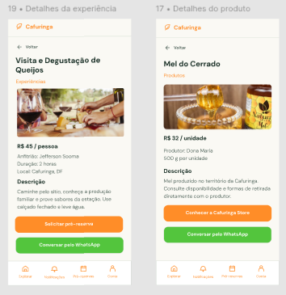

# HU39 — Disponibilizar contato direto

## 1. Identificação
<!-- REQUISITOS_HU_META_AUTO_INICIO -->
| Campo | Informação |
|---|---|
| **ID da História** | HU39 |
| **Requisito Funcional** | [RF39 — Disponibilizar contato direto](../requisitos_software.md#71-requisitos-funcionais) |
| **Requisito Não Funcional** | [RNF04](../requisitos_software.md#72-requisitos-nao-funcionais), [RNF05](../requisitos_software.md#72-requisitos-nao-funcionais), [RNF08](../requisitos_software.md#72-requisitos-nao-funcionais), [RNF10](../requisitos_software.md#72-requisitos-nao-funcionais), [RNF11](../requisitos_software.md#72-requisitos-nao-funcionais), [RNF12](../requisitos_software.md#72-requisitos-nao-funcionais) |
| **Regra de Negócio** | [RN17](../requisitos_software.md#73-lista-de-regras-de-negocio) |
| **Característica de Produto** | [CP5](../solucao.md#23-caracteristicas-do-produto) |
| **Objetivos Específicos** | [OE3](../solucao.md#22-objetivos-especificos-oe-do-produto) |
| **Prioridade** | Alta |
| **Escopo** | MVP |
| **Iteração** | [Iteração 8](../evidencias/iteracao8.md) |
<!-- REQUISITOS_HU_META_AUTO_FIM -->

---

## 2. História de Usuário

*Como consumidor ou visitante, quero entrar em contato diretamente com o produtor por meio do WhatsApp, para esclarecer dúvidas e obter informações sobre produtos, experiências e ofertas disponíveis.*

---

## 3. Critérios de Aceitação

**CA01 — Visualizar opção de contato**

- **Dado** que o usuário esteja visualizando o perfil de um produtor ou uma oferta, **quando** houver contato disponibilizado pelo responsável, **então** o sistema deve apresentar a opção de contato direto.

**CA02 — Disponibilizar contato por WhatsApp**

- **Dado** que o produtor tenha informado um número de WhatsApp para contato, **quando** o usuário selecionar a opção de contato, **então** o sistema deve direcioná-lo ao canal de comunicação correspondente.

**CA03 — Respeitar autorização de contato**

- **Dado** que o produtor tenha disponibilizado seu contato para divulgação, **quando** a plataforma apresentar a opção de contato, **então** deve respeitar a autorização concedida pelo responsável.

**CA04 — Não exibir contato não autorizado**

- **Dado** que o produtor não tenha autorizado a divulgação de seu contato, **quando** o usuário visualizar o perfil ou a oferta, **então** o sistema não deve disponibilizar o número privado do produtor.

**CA05 — Permitir acesso público**

- **Dado** que o usuário não esteja autenticado, **quando** visualizar uma oferta com contato público autorizado, **então** o sistema deve permitir o acesso à opção de contato sem exigir autenticação.

**CA06 — Tratar contato indisponível**

- **Dado** que o produtor não possua contato disponibilizado ou autorizado, **quando** o usuário visualizar seu perfil ou oferta, **então** o sistema não deve apresentar uma opção de contato indisponível.

---

## 4. Relação com os Requisitos Não Funcionais

**[RNF04 — Acessibilidade Digital](../requisitos_software.md#72-requisitos-nao-funcionais)**

Garante que a opção de contato seja apresentada de maneira acessível e compreensível a usuários com diferentes necessidades.

**[RNF05 — Responsividade da Interface](../requisitos_software.md#72-requisitos-nao-funcionais)**

Garante que o acesso ao contato funcione adequadamente em diferentes tamanhos de tela, dispositivos móveis e computadores.

**[RNF08 — Controle de Acesso por Perfil](../requisitos_software.md#72-requisitos-nao-funcionais)**

Garante que a disponibilização e a gestão das informações de contato respeitem as permissões de cada perfil de usuário.

**[RNF10 — Proteção da Comunicação](../requisitos_software.md#72-requisitos-nao-funcionais)**

Orienta que o acesso à plataforma e o direcionamento para o canal de contato utilizem comunicação protegida quando aplicável.

**[RNF11 — Proteção de Dados Pessoais](../requisitos_software.md#72-requisitos-nao-funcionais)**

Assegura que o número de contato do produtor somente seja apresentado quando houver autorização explícita para sua divulgação.

**[RNF12 — Compatibilidade entre Navegadores](../requisitos_software.md#72-requisitos-nao-funcionais)**

Garante o funcionamento correto da opção de contato nos principais navegadores contemplados pelo projeto.

---

## 5. Relação com as Regras de Negócio

**[RN17 — Contato direto](../requisitos_software.md#73-lista-de-regras-de-negocio)**

Estabelece as condições para disponibilizar o contato direto entre usuários e produtores por meio do WhatsApp, mediante autorização explícita do responsável.

---

## 6. Relação com as Características de Produto

**[CP5 — Intenção de Compra e Conexão Direta](../solucao.md#23-caracteristicas-do-produto)**

Permite a comunicação direta entre consumidores e produtores, aproximando as partes sem intermediação financeira pela plataforma.

---

## 7. Relação com os Objetivos Específicos

**[OE3 — Conexão direta e autonomia sem intermediação financeira](../solucao.md#22-objetivos-especificos-oe-do-produto)**

Facilita a comunicação direta de consumidores e visitantes com os produtores, fortalecendo a autonomia na negociação e na divulgação da oferta local.

---

## 8. Protótipo

---

## 9. Atividades Relacionadas

| ID | Atividade | Descrição |
| --- | --- | --- |
| AT01 | Identificar dados de contato | Definir as informações de contato que poderão ser disponibilizadas pelos produtores. |
| AT02 | Implementar opção de contato | Desenvolver a interface para acesso ao contato direto. |
| AT03 | Implementar direcionamento ao WhatsApp | Desenvolver o direcionamento para o canal de contato informado pelo produtor. |
| AT04 | Aplicar autorização de divulgação | Garantir que somente contatos autorizados sejam apresentados publicamente. |
| AT05 | Validar contato direto | Testar o direcionamento, a autorização e a apresentação da opção de contato. |

---

## 10. Checklist do Definition of Ready (DoR)

Marque os itens conforme a história atender a cada condição.

- [x] A HU possui definição clara e informação necessária para ser trabalhada?
- [x] O requisito está representado por uma história de usuário?
- [x] A HU está rastreada aos requisitos de origem?
- [x] A HU faz parte do escopo do MVP?
- [x] A HU está coberta por critérios de aceite?
- [x] Os RNFs e as restrições legais aplicáveis estão identificados?
- [x] A HU está mapeada para uma interface, quando necessário?
- [x] A HU cabe em uma iteração?
- [x] As dependências estão mapeadas?
- [x] Os responsáveis estão definidos?
- [x] O requisito está implementado no protótipo e validado?

---

## 11. Checklist do Definition of Done (DoD)

Marque os itens após a verificação da entrega.

- [x] Entrega um incremento do produto?
- [x] Contempla os critérios de aceite estabelecidos?
- [x] O desenvolvimento foi concluído integralmente?
- [x] Os testes foram executados e aprovados?
- [x] Está aderente aos padrões de codificação?
- [ ] A funcionalidade foi revisada pela equipe?
- [ ] Mantém os índices de performance do produto?
- [x] Atende aos requisitos de acessibilidade e responsividade?
- [x] Preserva a segurança e a privacidade dos dados?
- [x] Trata os erros do usuário?
- [x] Está livre de defeitos críticos?
- [x] Está documentado?

---

## Evidências

Registre abaixo **uma linha por contribuição**. Cada integrante deve informar o que realizou e inserir um link verificável para a evidência (por exemplo: **Pull Request, commit, resultado de teste, imagem ou vídeo**). Não registre atividades como concluídas sem comprovação.

| Integrante | Atividade realizada | Evidência (link ou arquivo) | Data |
|---|---|---|---|
| Italo Alves | Contato direto pelo WhatsApp no detalhe do produto, da experiência e no perfil público, só com o telefone autorizado pelo produtor (RN07) e só para usuário autenticado (RN17); testes de componente, integração e acessibilidade, e e2e do backend provando que o número privado não aparece em nenhuma rota pública nem no ETag/304 | [PR #77](https://github.com/mdsreq-fga-unb/REQ-2026.2-T02-RedeCafuringa/pull/77) · [commit 1e1985cf](https://github.com/mdsreq-fga-unb/REQ-2026.2-T02-RedeCafuringa/commit/1e1985cf) | 17/11/2026 |
| Italo Alves | Correção do redirect pós-login: página principal (Explorar/Painel) em vez da Conta, mantendo a volta à oferta ou ao perfil de origem em `?contato=` | [PR #77](https://github.com/mdsreq-fga-unb/REQ-2026.2-T02-RedeCafuringa/pull/77) · [commit 58c96621](https://github.com/mdsreq-fga-unb/REQ-2026.2-T02-RedeCafuringa/commit/58c96621) · [consumidor](../../img/evidencias/iteracao8/hu39-redirect-consumer-375.jpg) · [produtor](../../img/evidencias/iteracao8/hu39-redirect-producer-375.jpg) · [admin](../../img/evidencias/iteracao8/hu39-redirect-admin.jpg) · [logout e novo login](../../img/evidencias/iteracao8/hu39-redirect-logout-relogin.jpg) | 17/11/2026 |
| Italo Alves | Validação no Chrome (build de produção, 375/768/1280 px) dos critérios: opção visível sem login (CA01/CA05), login exigido (RN17), link wa.me em nova aba (CA02), autorização ligada e desligada pelo produtor (CA03), número privado oculto (CA04) e produtor sem telefone (CA06) | [PR #77](https://github.com/mdsreq-fga-unb/REQ-2026.2-T02-RedeCafuringa/pull/77) · [CA01/CA05](../../img/evidencias/iteracao8/hu39-ca01-ca05-produto-visitante-375.jpg) · [RN17 login](../../img/evidencias/iteracao8/hu39-rn17-visitante-login-375.jpg) · [CA02 produto](../../img/evidencias/iteracao8/hu39-ca02-produto-logado-375.jpg) · [CA02 experiência](../../img/evidencias/iteracao8/hu39-ca02-experiencia-logado-375.jpg) · [CA02 perfil](../../img/evidencias/iteracao8/hu39-ca02-perfil-logado-1280.jpg) · [CA03 desativa](../../img/evidencias/iteracao8/hu39-ca03-produtor-desativa.jpg) · [CA03 oferta sem contato](../../img/evidencias/iteracao8/hu39-ca03-oferta-apos-desativar.jpg) · [CA03 reativa](../../img/evidencias/iteracao8/hu39-ca03-oferta-apos-reativar.jpg) · [CA04](../../img/evidencias/iteracao8/hu39-ca04-privado-produto-375.jpg) · [CA06](../../img/evidencias/iteracao8/hu39-ca06-sem-telefone-produto-375.jpg) | 17/11/2026 |
| Italo Alves | Documentação da HU: numeração das seções, HU movida para a Iteração 8 e correção de links quebrados no `mkdocs build --strict` | [PR #77](https://github.com/mdsreq-fga-unb/REQ-2026.2-T02-RedeCafuringa/pull/77) · [commit 97007eeb](https://github.com/mdsreq-fga-unb/REQ-2026.2-T02-RedeCafuringa/commit/97007eeb) | 17/11/2026 |
| Italo Alves | Ajuste da revisão do PR: no modo de demonstração do frontend (`VITE_USE_MOCK_AUTH=true`) o botão "Conversar pelo WhatsApp" não aparecia, porque os perfis públicos fictícios não tinham telefone e usavam ids diferentes dos produtores das ofertas. Ids alinhados, casos de contato autorizado, não autorizado (CA04) e sem telefone (CA06) nos dados fictícios e teste que exige perfil para todo produtor das ofertas de demonstração; validado no Chrome a 375 px | [PR #77](https://github.com/mdsreq-fga-unb/REQ-2026.2-T02-RedeCafuringa/pull/77) · [commit b229f15d](https://github.com/mdsreq-fga-unb/REQ-2026.2-T02-RedeCafuringa/commit/b229f15d) · [produto](../../img/evidencias/iteracao8/hu39-review-demo-produto-375.png) · [experiência](../../img/evidencias/iteracao8/hu39-review-demo-experiencia-375.png) · [CA04 sem contato](../../img/evidencias/iteracao8/hu39-review-demo-ca04-produto-375.png) | 17/11/2026 |
