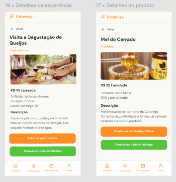

# HU39 — Disponibilizar contato direto

## 1. Identificação

| Campo | Informação |
| --- | --- |
| ID da História | HU39 |
| Requisito Funcional | [RF39 — Disponibilizar contato direto](https://www.google.com/search?q=../requisitos_software.md%2371-requisitos-funcionais) |
| Requisito Não Funcional | [RNF04, RNF05, RNF08, RNF10, RNF11 e RNF12](https://www.google.com/search?q=../requisitos_software.md%2372-requisitos-nao-funcionais) |
| Regra de Negócio | [RN17](https://www.google.com/search?q=../requisitos_software.md%2374-lista-de-regras-de-negocio) |
| Característica de Produto | [CP5](https://www.google.com/search?q=../solucao.md%2323-caracteristicas-do-produto) |
| Objetivos Específicos | [OE3](https://www.google.com/search?q=../solucao.md%2322-objetivos-especificos-oe-do-produto) |
| Prioridade | Alta |

---

## 2. História de Usuário

*Como consumidor ou visitante, quero entrar em contato diretamente com o produtor por meio do WhatsApp, para esclarecer dúvidas e obter informações sobre produtos, experiências e ofertas disponíveis.*

---

## 3. Critérios de Aceitação

**CA01 — Visualizar opção de contato**

* **Dado** que o usuário esteja visualizando o perfil de um produtor ou uma oferta, **quando** houver contato disponibilizado pelo responsável, **então** o sistema deve apresentar a opção de contato direto.

**CA02 — Disponibilizar contato por WhatsApp**

* **Dado** que o produtor tenha informado um número de WhatsApp para contato, **quando** o usuário selecionar a opção de contato, **então** o sistema deve direcioná-lo ao canal de comunicação correspondente.

**CA03 — Respeitar autorização de contato**

* **Dado** que o produtor tenha disponibilizado seu contato para divulgação, **quando** a plataforma apresentar a opção de contato, **então** deve respeitar a autorização concedida pelo responsável.

**CA04 — Não exibir contato não autorizado**

* **Dado** que o produtor não tenha autorizado a divulgação de seu contato, **quando** o usuário visualizar o perfil ou a oferta, **então** o sistema não deve disponibilizar o número privado do produtor.

**CA05 — Permitir acesso público**

* **Dado** que o usuário não esteja autenticado, **quando** visualizar uma oferta com contato público autorizado, **então** o sistema deve permitir o acesso à opção de contato sem exigir autenticação.

**CA06 — Tratar contato indisponível**

* **Dado** que o produtor não possua contato disponibilizado ou autorizado, **quando** o usuário visualizar seu perfil ou oferta, **então** o sistema não deve apresentar uma opção de contato indisponível.

---

## 4. Relação com os Requisitos Não Funcionais

**RNF04 — Acessibilidade Digital**

* Relação com a HU: a opção de contato deve ser apresentada de maneira acessível e compreensível.

**RNF05 — Responsividade da Interface**

* Relação com a HU: o acesso ao contato deve funcionar adequadamente em dispositivos móveis e computadores.

**RNF08 — Controle de Acesso por Perfil**

* Relação com a HU: a disponibilização e a gestão das informações de contato devem respeitar as permissões de cada perfil.

**RNF10 — Proteção da Comunicação**

* Relação com a HU: o acesso à plataforma e o direcionamento para o contato devem utilizar comunicação protegida quando aplicável.

**RNF11 — Proteção de Dados Pessoais**

* Relação com a HU: o número de contato do produtor somente deve ser apresentado quando houver autorização para sua divulgação.

**RNF12 — Compatibilidade entre Navegadores**

* Relação com a HU: a opção de contato deve funcionar nos navegadores contemplados pelo requisito.

---

## 5. Relação com as Regras de Negócio

**RN17 — Contato direto**

* Relação com a HU: estabelece as condições para disponibilizar o contato direto entre usuários e produtores por meio do WhatsApp, mediante autorização explícita do responsável.

---

## 6. Relação com as Características de Produto

**CP5 - Intenção de Compra e Conexão Direta**

* Relação com a HU: a disponibilização de contato direto permite a comunicação entre consumidores e produtores, aproximando as partes sem intermediação financeira pela plataforma.

---

## 7. Relação com os Objetivos Específicos

**OE3 — Conexão direta e autonomia sem intermediação financeira**

* Relação com a HU: a funcionalidade permite que consumidores e visitantes entrem em contato diretamente com os produtores, fortalecendo a autonomia na negociação e na comunicação.

---

## 8. Protótipo

---

## 9. Atividades Relacionadas

| ID | Atividade | Descrição |
| --- | --- | --- |
| AT01 | Identificar dados de contato | Definir as informações de contato que poderão ser disponibilizadas pelos produtores. |
| AT02 | Implementar opção de contato | Desenvolver a interface para acesso ao contato direto. |
| AT03 | Implementar direcionamento ao WhatsApp | Desenvolver o direcionamento para o canal de contato informado pelo produtor. |
| AT04 | Aplicar autorização de divulgação | Garantir que somente contatos autorizados sejam apresentados publicamente. |
| AT05 | Validar contato direto | Testar o direcionamento, a autorização e a apresentação da opção de contato. |

---

## 10. Checklist do Definition of Ready (DoR)

* [x] A HU possui definição clara e informação necessária para ser trabalhada?
* [x] O requisito está representado por uma história de usuário?
* [x] A HU está rastreada aos requisitos de origem?
* [x] A HU faz parte do escopo do MVP?
* [x] A HU está coberta por critérios de aceite?
* [x] Os RNFs e as restrições legais aplicáveis estão identificados?
* [x] A HU está mapeada para uma interface, quando necessário?
* [x] A HU cabe em uma iteração?
* [x] As dependências estão mapeadas?
* [x] Os responsáveis estão definidos?
* [x] O requisito está implementado no protótipo e validado?

---

## 11. Checklist do Definition of Done (DoD)

* [ ] Entrega um incremento do produto?
* [ ] Contempla os critérios de aceite estabelecidos?
* [ ] O desenvolvimento foi concluído integralmente?
* [ ] Os testes foram executados e aprovados?
* [ ] Está aderente aos padrões de codificação?
* [ ] A funcionalidade foi revisada pela equipe?
* [ ] Mantém os índices de performance do produto?
* [ ] Atende aos requisitos de acessibilidade e responsividade?
* [ ] Preserva a segurança e a privacidade dos dados?
* [ ] Trata os erros do usuário?
* [ ] Está livre de defeitos críticos?
* [ ] Está documentado?

