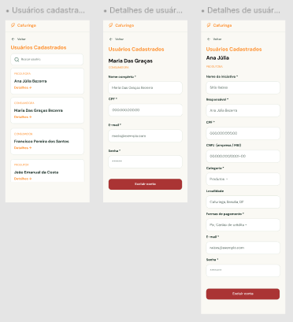

# HU04 — Consultar usuários cadastrados

## 1. Identificação

| Campo | Informação |
|---|---|
| **ID da História** | HU04 |
| **Requisito Funcional** | [RF04 — Consultar usuários cadastrados](../requisitos_software.md#71-requisitos-funcionais) |
| **Requisito Não Funcional** | [RNF03, RNF04, RNF05, RNF08, RNF11, RNF12](../requisitos_software.md#72-requisitos-nao-funcionais) |
| **Regra de Negócio** | [RN01, RN03](../requisitos_software.md#74-lista-de-regras-de-negocio) |
| **Característica de Produto** | [CP1](../solucao.md#23-caracteristicas-do-produto) |
| **Objetivos Específicos** | [OE2](../solucao.md#22-objetivos-especificos-oe-do-produto) |
| **Prioridade** | Alta |

---

## 2. História de Usuário

*Como administrador, quero consultar os usuários cadastrados, para acompanhar e administrar os perfis existentes.*

---

## 3. Critérios de Aceitação

**CA01 — Acesso à consulta de usuários**

- **Dado** que estou autenticado na plataforma com um perfil de administrador, **quando** acessar a funcionalidade de gerenciamento de usuários, **então** o sistema deve disponibilizar a consulta dos usuários cadastrados.

**CA02 — Visualização de consumidores**

- **Dado** que existam consumidores cadastrados na plataforma, **quando** acessar a consulta de usuários, **então** o sistema deve apresentar os registros correspondentes aos perfis de consumidores.

**CA03 — Visualização de produtores**

- **Dado** que existam produtores cadastrados na plataforma, **quando** acessar a consulta de usuários, **então** o sistema deve apresentar os registros correspondentes aos perfis de produtores.

**CA04 — Visualização de administradores**

- **Dado** que existam outros administradores cadastrados na plataforma, **quando** acessar a consulta de usuários, **então** o sistema deve apresentar os registros correspondentes aos perfis administrativos.

**CA05 — Identificação do tipo de perfil**

- **Dado** que existam usuários de diferentes categorias cadastrados, **quando** consultar os registros, **então** o sistema deve permitir identificar o tipo de perfil correspondente a cada usuário.

**CA06 — Proteção das credenciais**

- **Dado** que estou consultando os usuários cadastrados, **quando** visualizar as informações dos registros, **então** o sistema não deve disponibilizar as senhas dos usuários.

**CA07 — Restrição de acesso**

- **Dado** que estou autenticado com um perfil de consumidor ou produtor, **quando** tentar acessar a funcionalidade de consulta de usuários, **então** o sistema deve impedir o acesso à funcionalidade administrativa.

**CA08 — Consulta sem registros**

- **Dado** que não existam usuários cadastrados ou que não existam registros disponíveis para apresentação, **quando** acessar a funcionalidade, **então** o sistema deve informar que não há usuários para exibir.

**CA09 — Consulta concluída**

- **Dado** que existam usuários cadastrados e que o administrador possua autorização para realizar a consulta, **quando** acessar a funcionalidade, **então** o sistema deve apresentar os registros disponíveis de forma organizada.

---

## 4. Relação com os Requisitos Não Funcionais

**RNF03 — Prevenção e Recuperação de Erros**

- Relação com a HU: Garante que o administrador receba mensagens claras caso ocorra alguma falha durante a consulta, como indisponibilidade dos registros ou problemas no carregamento das informações.

**RNF04 — Acessibilidade Digital**

- Relação com a HU: Permite que administradores com diferentes necessidades de acesso utilizem a interface de consulta, incluindo navegação por teclado, identificação adequada dos elementos e utilização de tecnologias assistivas.

**RNF05 — Responsividade da Interface**

- Relação com a HU: Garante que a interface de consulta dos usuários se adapte a diferentes tamanhos de tela, permitindo a visualização organizada dos registros em computadores e dispositivos móveis.

**RNF08 — Controle de Acesso por Perfil**

- Relação com a HU: Garante que somente usuários com perfil de administrador possam acessar a funcionalidade de consulta de todos os usuários cadastrados, impedindo o acesso por consumidores e produtores.

**RNF11 — Proteção de Dados Pessoais**

- Relação com a HU: Garante que as informações pessoais consultadas sejam tratadas conforme suas finalidades e permissões, impedindo a exposição de dados privados e, especialmente, de credenciais como senhas.

**RNF12 — Compatibilidade entre Navegadores**

- Relação com a HU: Garante que a funcionalidade de consulta e apresentação dos registros seja executada corretamente nos navegadores e ambientes previstos para utilização da plataforma.

---

## 5. Relação com as Regras de Negócio

**RN01 — Perfis e permissões**

- Relação com a HU: Determina que a consulta de usuários seja disponibilizada exclusivamente ao perfil de administrador, respeitando as permissões estabelecidas para cada categoria de usuário.

**RN03 — Gestão administrativa**

- Relação com a HU: Estabelece que consultas e intervenções administrativas sobre usuários sejam de responsabilidade exclusiva dos administradores. Dessa forma, a funcionalidade permite acompanhar os consumidores, produtores e demais administradores cadastrados na plataforma.

---

## 6. Relação com as Características de Produto

**CP1 — Perfis**

- Relação com a HU: A consulta de usuários permite que os administradores acompanhem os diferentes perfis existentes na Rede Cafuringa, incluindo consumidores, produtores e outros administradores. Dessa forma, contribui para a organização e o gerenciamento dos usuários cadastrados, mantendo a identificação das categorias de acesso à plataforma.

---

## 7. Relação com os Objetivos Específicos

**OE2 — Visibilidade e oferta local**

- Relação com a HU: A consulta de usuários contribui indiretamente para a visibilidade das iniciativas locais ao permitir que a administração acompanhe os produtores cadastrados e a composição da base de usuários da Rede Cafuringa. Dessa forma, apoia o gerenciamento das informações necessárias à divulgação e à conexão entre produtores, consumidores e visitantes.

---

## 8. Protótipo

---

## 9. Atividades Relacionadas

| ID | Atividade | Descrição |
|---|---|---|
| AT01 | Definir as informações exibidas | Identificar quais informações dos usuários devem ser apresentadas durante a consulta, considerando os diferentes tipos de perfil e as restrições de privacidade. |
| AT02 | Desenvolver a interface de consulta | Implementar a interface destinada à apresentação dos usuários cadastrados na plataforma. |
| AT03 | Implementar recuperação dos registros | Desenvolver a funcionalidade responsável por recuperar os registros de consumidores, produtores e administradores cadastrados. |
| AT04 | Identificar os tipos de perfil | Implementar a identificação e apresentação da categoria correspondente a cada usuário consultado. |
| AT05 | Implementar controle de acesso | Garantir que somente usuários autenticados com perfil de administrador possam acessar a funcionalidade. |
| AT06 | Aplicar medidas de segurança e privacidade | Impedir a exposição de senhas e proteger as informações pessoais dos usuários durante a consulta. |
| AT07 | Implementar mensagens de retorno | Apresentar mensagens informativas para situações de consulta sem registros disponíveis ou ocorrência de falhas no carregamento. |
| AT08 | Verificar acessibilidade e responsividade | Avaliar a navegação por teclado, a identificação dos elementos e a adaptação da interface a diferentes tamanhos de tela. |
| AT09 | Executar testes de consulta | Testar a apresentação dos registros de consumidores, produtores e administradores, verificando também a ausência de senhas nas informações exibidas. |
| AT10 | Executar testes de autorização | Verificar se consumidores e produtores são impedidos de acessar a funcionalidade administrativa. |
| AT11 | Validar compatibilidade entre navegadores | Verificar o funcionamento da consulta nos navegadores e ambientes definidos no RNF12. |
| AT12 | Documentar e revisar a funcionalidade | Registrar o comportamento implementado, os resultados dos testes e eventuais pendências para revisão pela equipe. |

---

## 10. Checklist do Definition of Ready (DoR)

Marque os itens conforme a história atender a cada condição.

- [x] A HU possui definição clara e informação necessária para ser trabalhada?
- [x] O requisito está representado por uma história de usuário?
- [x] A HU está rastreada aos requisitos de origem?
- [x] A HU faz parte do escopo do MVP?
- [x] A HU está coberta por critérios de aceite?
- [x] Os RNFs e as restrições legais aplicáveis estão identificados?
- [x] A HU está mapeada para uma interface, quando necessário?
- [x] A HU cabe em uma iteração?
- [x] As dependências estão mapeadas?
- [x] Os responsáveis estão definidos?
- [x] O requisito está implementado no protótipo e validado?

---

## 11. Checklist do Definition of Done (DoD)

Marque os itens após a verificação da entrega.

- [ ] Entrega um incremento do produto?
- [ ] Contempla os critérios de aceite estabelecidos?
- [ ] O desenvolvimento foi concluído integralmente?
- [ ] Os testes foram executados e aprovados?
- [ ] Está aderente aos padrões de codificação?
- [ ] A funcionalidade foi revisada pela equipe?
- [ ] Mantém os índices de performance do produto?
- [ ] Atende aos requisitos de acessibilidade e responsividade?
- [ ] Preserva a segurança e a privacidade dos dados?
- [ ] Trata os erros do usuário?
- [ ] Está livre de defeitos críticos?
- [ ] Está documentado?