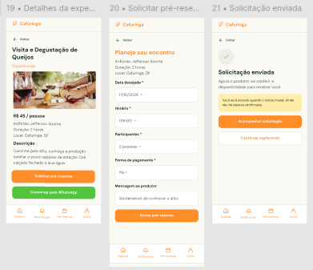

# HU44 — Solicitar pré-reserva de experiência

## 1. Identificação

| Campo | Informação |
| --- | --- |
| ID da História | HU44 |
| Requisito Funcional | [RF44 — Solicitar pré-reserva de experiência](https://www.google.com/search?q=../requisitos_software.md%2371-requisitos-funcionais) |
| Requisito Não Funcional | [RNF03, RNF04, RNF05, RNF07, RNF08, RNF10 e RNF11](https://www.google.com/search?q=../requisitos_software.md%2372-requisitos-nao-funcionais) |
| Regra de Negócio | [RN19](https://www.google.com/search?q=../requisitos_software.md%2374-lista-de-regras-de-negocio) |
| Característica de Produto | [CP6](https://www.google.com/search?q=../solucao.md%2323-caracteristicas-do-produto) |
| Objetivos Específicos | [OE3](https://www.google.com/search?q=../solucao.md%2322-objetivos-especificos-oe-do-produto) |
| Prioridade | Alta |

---

## 2. História de Usuário

*Como consumidor ou visitante, quero solicitar uma pré-reserva de experiência, para manifestar meu interesse em participar de uma atividade oferecida por um produtor da região da Cafuringa.*

---

## 3. Critérios de Aceitação

**CA01 — Acessar experiência**

* **Dado** que o usuário esteja visualizando uma experiência disponível, **quando** acessar os detalhes da experiência, **então** o sistema deve apresentar a opção de solicitar uma pré-reserva, quando aplicável.

**CA02 — Iniciar solicitação**

* **Dado** que o usuário esteja autenticado e a experiência permita solicitações, **quando** selecionar a opção de pré-reserva, **então** o sistema deve apresentar os campos necessários para registrar a solicitação.

**CA03 — Preencher dados da solicitação**

* **Dado** que o usuário esteja preenchendo a solicitação, **quando** informar os dados necessários, **então** o sistema deve permitir o preenchimento das informações exigidas para a pré-reserva.

**CA04 — Validar solicitação**

* **Dado** que o usuário tenha preenchido os campos da solicitação, **quando** tentar enviá-la, **então** o sistema deve validar as informações obrigatórias e indicar eventuais inconsistências.

**CA05 — Enviar solicitação**

* **Dado** que os dados estejam válidos, **quando** o usuário confirmar o envio, **então** o sistema deve registrar a solicitação de pré-reserva associada à experiência e ao usuário.

**CA06 — Informar situação da solicitação**

* **Dado** que a solicitação tenha sido registrada, **quando** o processamento for concluído, **então** o sistema deve informar que a solicitação foi enviada e que aguarda resposta do responsável pela experiência.

**CA07 — Impedir solicitação de experiência indisponível**

* **Dado** que uma experiência não esteja disponível para receber solicitações, **quando** o usuário acessar seus detalhes, **então** o sistema não deve permitir o envio de uma nova pré-reserva.

**CA08 — Tratar falha no envio**

* **Dado** que ocorra uma falha durante o envio, **quando** o usuário confirmar a solicitação, **então** o sistema deve informar que a operação não foi concluída e preservar os dados preenchidos quando possível.

---

## 4. Relação com os Requisitos Não Funcionais

**RNF03 — Prevenção e Recuperação de Erros**

* Relação com a HU: o sistema deve validar os dados da solicitação e orientar o usuário diante de inconsistências ou falhas no envio.

**RNF04 — Acessibilidade Digital**

* Relação com a HU: os campos e orientações da solicitação devem ser acessíveis e compreensíveis.

**RNF05 — Responsividade da Interface**

* Relação com a HU: o formulário de pré-reserva deve funcionar adequadamente em diferentes tamanhos de tela.

**RNF07 — Resiliência à Perda de Conexão**

* Relação com a HU: os dados preenchidos não devem ser automaticamente apagados em caso de perda de conexão, conforme as condições previstas no requisito.

**RNF08 — Controle de Acesso por Perfil**

* Relação com a HU: a solicitação deve respeitar as permissões previstas para o perfil do usuário.

**RNF10 — Proteção da Comunicação**

* Relação com a HU: o envio das informações da pré-reserva deve ocorrer por meio de comunicação protegida.

**RNF11 — Proteção de Dados Pessoais**

* Relação com a HU: os dados pessoais informados na solicitação devem ser tratados conforme sua finalidade e sem exposição indevida.

---

## 5. Relação com as Regras de Negócio

**RN19 — Solicitação de pré-reserva**

* Relação com a HU: estabelece as condições para que o usuário registre uma solicitação de pré-reserva de experiência, vinculando-a ao responsável pela oferta.

---

## 6. Relação com as Características de Produto

**CP6**

* Relação com a HU: a solicitação de pré-reserva permite que consumidores e visitantes manifestem interesse nas experiências oferecidas pelos produtores, iniciando o fluxo de comunicação entre as partes.

---

## 7. Relação com os Objetivos Específicos

**OE3 — Conexão direta e autonomia sem intermediação financeira**

* Relação com a HU: a pré-reserva aproxima consumidores e produtores e permite que as partes iniciem a organização da experiência sem que a plataforma realize a intermediação financeira.

---

## 8. Protótipo

---

## 9. Atividades Relacionadas

| ID | Atividade | Descrição |
| --- | --- | --- |
| AT01 | Definir dados da pré-reserva | Identificar as informações necessárias para registrar uma solicitação de experiência. |
| AT02 | Implementar formulário | Desenvolver a interface para preenchimento dos dados da solicitação. |
| AT03 | Implementar registro | Desenvolver o mecanismo de armazenamento da pré-reserva vinculada ao usuário e à experiência. |
| AT04 | Implementar validações | Validar campos obrigatórios e disponibilidade da experiência. |
| AT05 | Apresentar confirmação | Informar ao usuário que a solicitação foi registrada e aguarda resposta. |
| AT06 | Validar solicitação | Testar envio, validações, indisponibilidade e tratamento de falhas. |

---

## 10. Checklist do Definition of Ready (DoR)

* [x] A HU possui definição clara e informação necessária para ser trabalhada?
* [x] O requisito está representado por uma história de usuário?
* [x] A HU está rastreada aos requisitos de origem?
* [x] A HU faz parte do escopo do MVP?
* [x] A HU está coberta por critérios de aceite?
* [x] Os RNFs e as restrições legais aplicáveis estão identificados?
* [x] A HU está mapeada para uma interface, quando necessário?
* [x] A HU cabe em uma iteração?
* [x] As dependências estão mapeadas?
* [x] Os responsáveis estão definidos?
* [x] O requisito está implementado no protótipo e validado?

---

## 11. Checklist do Definition of Done (DoD)

* [ ] Entrega um incremento do produto?
* [ ] Contempla os critérios de aceite estabelecidos?
* [ ] O desenvolvimento foi concluído integralmente?
* [ ] Os testes foram executados e aprovados?
* [ ] Está aderente aos padrões de codificação?
* [ ] A funcionalidade foi revisada pela equipe?
* [ ] Mantém os índices de performance do produto?
* [ ] Atende aos requisitos de acessibilidade e responsividade?
* [ ] Preserva a segurança e a privacidade dos dados?
* [ ] Trata os erros do usuário?
* [ ] Está livre de defeitos críticos?
* [ ] Está documentado?
