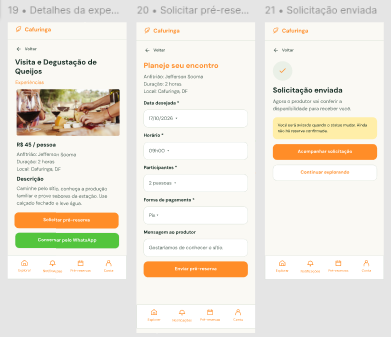

# HU44 — Solicitar pré-reserva de experiência

## 1. Identificação
<!-- REQUISITOS_HU_META_AUTO_INICIO -->
| Campo | Informação |
|---|---|
| **ID da História** | HU44 |
| **Requisito Funcional** | [RF44 — Solicitar pré-reserva de experiência](../requisitos_software.md#71-requisitos-funcionais) |
| **Requisito Não Funcional** | [RNF03](../requisitos_software.md#72-requisitos-nao-funcionais), [RNF04](../requisitos_software.md#72-requisitos-nao-funcionais), [RNF05](../requisitos_software.md#72-requisitos-nao-funcionais), [RNF07](../requisitos_software.md#72-requisitos-nao-funcionais), [RNF08](../requisitos_software.md#72-requisitos-nao-funcionais), [RNF10](../requisitos_software.md#72-requisitos-nao-funcionais), [RNF11](../requisitos_software.md#72-requisitos-nao-funcionais) |
| **Regra de Negócio** | [RN19](../requisitos_software.md#73-lista-de-regras-de-negocio) |
| **Característica de Produto** | [CP6](../solucao.md#23-caracteristicas-do-produto) |
| **Objetivos Específicos** | [OE3](../solucao.md#22-objetivos-especificos-oe-do-produto) |
| **Prioridade** | Alta |
| **Escopo** | MVP |
| **Iteração** | [Iteração 8](../evidencias/iteracao8.md) |
<!-- REQUISITOS_HU_META_AUTO_FIM -->

---

## 2. História de Usuário

*Como consumidor ou visitante, quero solicitar uma pré-reserva de experiência, para manifestar meu interesse em participar de uma atividade oferecida por um produtor da região da Cafuringa.*

---

## 3. Critérios de Aceitação

**CA01 — Acessar experiência**

* **Dado** que o usuário esteja visualizando uma experiência disponível, **quando** acessar os detalhes da experiência, **então** o sistema deve apresentar a opção de solicitar uma pré-reserva, quando aplicável.

**CA02 — Iniciar solicitação**

* **Dado** que o usuário esteja autenticado e a experiência permita solicitações, **when** selecionar a opção de pré-reserva, **então** o sistema deve apresentar os campos necessários para registrar a solicitação.

**CA03 — Preencher dados da solicitação**

* **Dado** que o usuário esteja preenchendo a solicitação, **quando** informar os dados necessários, **então** o sistema deve permitir o preenchimento das informações exigidas para a pré-reserva.

**CA04 — Validar solicitação**

* **Dado** que o usuário tenha preenchido os campos da solicitação, **quando** tentar enviá-la, **então** o sistema deve validar as informações obrigatórias e indicar eventuais inconsistências.

**CA05 — Enviar solicitação**

* **Dado** que os dados estejam válidos, **quando** o usuário confirmar o envio, **então** o sistema deve registrar a solicitação de pré-reserva associada à experiência e ao usuário.

**CA06 — Informar situação da solicitação**

* **Dado** que a solicitação tenha sido registrada, **quando** o processamento for concluído, **então** o sistema deve informar que a solicitação foi enviada e que aguarda resposta do responsável pela experiência.

**CA07 — Impedir solicitação de experiência indisponível**

* **Dado** que uma experiência não esteja disponível para receber solicitações, **quando** o usuário acessar seus detalhes, **então** o sistema não deve permitir o envio de uma nova pré-reserva.

**CA08 — Tratar falha no envio**

* **Dado** que ocorra uma falha durante o envio, **quando** o usuário confirmar a solicitação, **então** o sistema deve informar que a operação não foi concluída e preservar os dados preenchidos quando possível.

---

## 4. Relação com os Requisitos Não Funcionais

**[RNF03 — Prevenção e Recuperação de Erros](../requisitos_software.md#72-requisitos-nao-funcionais)**

Garante que o sistema valide os dados da solicitação e oriente o usuário de forma clara diante de inconsistências ou falhas no envio.

**[RNF04 — Acessibilidade Digital](../requisitos_software.md#72-requisitos-nao-funcionais)**

Garante que os campos e orientações da solicitação sejam acessíveis e compreensíveis a usuários com diferentes necessidades.

**[RNF05 — Responsividade da Interface](../requisitos_software.md#72-requisitos-nao-funcionais)**

Garante que o formulário de pré-reserva funcione adequadamente em diferentes tamanhos de tela e dispositivos.

**[RNF07 — Resiliência à Perda de Conexão](../requisitos_software.md#72-requisitos-nao-funcionais)**

Garante que os dados preenchidos não sejam automaticamente apagados em caso de perda de conexão, conforme as condições previstas no requisito.

**[RNF08 — Controle de Acesso por Perfil](../requisitos_software.md#72-requisitos-nao-funcionais)**

Garante que a solicitação respeite rigorosamente as permissões previstas para o perfil de cada usuário.

**[RNF10 — Proteção da Comunicação](../requisitos_software.md#72-requisitos-nao-funcionais)**

Orienta que o envio das informações da pré-reserva ocorra por meio de comunicação protegida.

**[RNF11 — Proteção de Dados Pessoais](../requisitos_software.md#72-requisitos-nao-funcionais)**

Assegura que os dados pessoais informados na solicitação sejam tratados conforme sua finalidade, sem exposição indevida.

---

## 5. Relação com as Regras de Negócio

**[RN19 — Solicitação de pré-reserva](../requisitos_software.md#73-lista-de-regras-de-negocio)**

Estabelece as condições para que o usuário registre uma solicitação de pré-reserva de experiência, vinculando-a ao responsável pela oferta.

---

## 6. Relação com as Características de Produto

**[CP6 — Experiências e atividades](../solucao.md#23-caracteristicas-do-produto)**

Permite que consumidores e visitantes manifestem interesse nas experiências oferecidas pelos produtores, iniciando o fluxo de comunicação entre as partes.

---

## 7. Relação com os Objetivos Específicos

**[OE3 — Conexão direta e autonomia sem intermediação financeira](../solucao.md#22-objetivos-especificos-oe-do-produto)**

Aproxima consumidores e produtores e permite que as partes iniciem a organização da experiência sem que a plataforma realize a intermediação financeira.

---

## 8. Protótipo

---

## 9. Atividades Relacionadas

| ID | Atividade | Descrição |
| --- | --- | --- |
| AT01 | Definir dados da pré-reserva | Identificar as informações necessárias para registrar uma solicitação de experiência. |
| AT02 | Implementar formulário | Desenvolver a interface para preenchimento dos dados da solicitação. |
| AT03 | Implementar registro | Desenvolver o mecanismo de armazenamento da pré-reserva vinculada ao usuário e à experiência. |
| AT04 | Implementar validações | Validar campos obrigatórios e disponibilidade da experiência. |
| AT05 | Apresentar confirmação | Informar ao usuário que a solicitação foi registrada e aguarda resposta. |
| AT06 | Validar solicitação | Testar envio, validações, indisponibilidade e tratamento de falhas. |

---

## 10. Checklist do Definition of Ready (DoR)

Marque os itens conforme a história atender a cada condição.

* [x] A HU possui definição clara e informação necessária para ser trabalhada?
* [x] O requisito está representado por uma história de usuário?
* [x] A HU está rastreada aos requisitos de origem?
* [x] A HU faz parte do escopo do MVP?
* [x] A HU está coberta por critérios de aceite?
* [x] Os RNFs e as restrições legais aplicáveis estão identificados?
* [x] A HU está mapeada para uma interface, quando necessário?
* [x] A HU cabe em uma iteração?
* [x] As dependências estão mapeadas?
* [x] Os responsáveis estão definidos?
* [x] O requisito está implementado no protótipo e validado?

---

## 11. Checklist do Definition of Done (DoD)

Marque os itens após a verificação da entrega.

* [ ] Entrega um incremento do produto?
* [ ] Contempla os critérios de aceite estabelecidos?
* [ ] O desenvolvimento foi concluído integralmente?
* [ ] Os testes foram executados e aprovados?
* [ ] Está aderente aos padrões de codificação?
* [ ] A funcionalidade foi revisada pela equipe?
* [ ] Mantém os índices de performance do produto?
* [ ] Atende aos requisitos de acessibilidade e responsividade?
* [ ] Preserva a segurança e a privacidade dos dados?
* [ ] Trata os erros do usuário?
* [ ] Está livre de defeitos críticos?
* [ ] Está documentado?