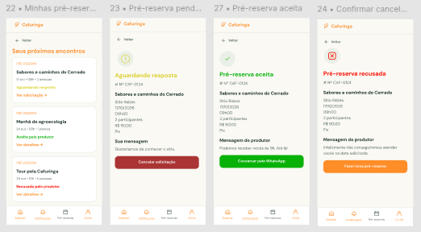

# HU45 — Consultar pré-reserva

## 1. Identificação
<!-- REQUISITOS_HU_META_AUTO_INICIO -->
| Campo | Informação |
|---|---|
| **ID da História** | HU45 |
| **Requisito Funcional** | [RF45 — Consultar pré-reserva](../requisitos_software.md#71-requisitos-funcionais) |
| **Requisito Não Funcional** | [RNF04](../requisitos_software.md#72-requisitos-nao-funcionais), [RNF05](../requisitos_software.md#72-requisitos-nao-funcionais), [RNF08](../requisitos_software.md#72-requisitos-nao-funcionais), [RNF10](../requisitos_software.md#72-requisitos-nao-funcionais), [RNF11](../requisitos_software.md#72-requisitos-nao-funcionais) |
| **Regra de Negócio** | [RN20](../requisitos_software.md#73-lista-de-regras-de-negocio) |
| **Característica de Produto** | [CP6](../solucao.md#23-caracteristicas-do-produto) |
| **Objetivos Específicos** | [OE3](../solucao.md#22-objetivos-especificos-oe-do-produto) |
| **Prioridade** | Alta |
| **Escopo** | MVP |
| **Iteração** | [Iteração 9](../evidencias/iteracao9.md) |
<!-- REQUISITOS_HU_META_AUTO_FIM -->

---

## 2. História de Usuário

*Como consumidor ou produtor, quero consultar as solicitações de pré-reserva relacionadas à minha conta ou às minhas experiências, para acompanhar as solicitações e verificar suas respectivas situações.*

---

## 3. Critérios de Aceitação

**CA01 — Acessar pré-reservas**

* **Dado** que o usuário esteja autenticado, **quando** acessar a funcionalidade de consulta de pré-reservas, **então** o sistema deve apresentar os registros aos quais seu perfil possui permissão de acesso.

**CA02 — Consultar solicitações como consumidor**

* **Dado** que o usuário possua solicitações de pré-reserva realizadas, **quando** acessar sua área de pré-reservas, **então** o sistema deve apresentar as solicitações associadas à sua conta.

**CA03 — Consultar solicitações como produtor**

* **Dado** que o usuário possua perfil de produtor, **quando** acessar a área de pré-reservas de suas experiências, **então** o sistema deve apresentar as solicitações recebidas para as experiências sob sua responsabilidade.

**CA04 — Visualizar informações da solicitação**

* **Dado** que existam solicitações disponíveis para consulta, **quando** o usuário selecionar uma delas, **então** o sistema deve apresentar as informações registradas e a situação correspondente.

**CA05 — Restringir acesso por perfil e vínculo**

* **Dado** que o usuário tente consultar uma pré-reserva que não esteja vinculada à sua conta ou às experiências sob sua responsabilidade, **quando** solicitar acesso ao registro, **então** o sistema deve impedir a visualização não autorizada.

**CA06 — Tratar ausência de solicitações**

* **Dado** que não existam pré-reservas associadas ao usuário ou às suas experiências, **quando** acessar a funcionalidade, **então** o sistema deve informar que não há solicitações disponíveis.

**CA07 — Apresentar situação atualizada**

* **Dado** que uma solicitação tenha sua situação alterada, **quando** o usuário consultar o registro, **então** o sistema deve apresentar a situação atualmente registrada.

**CA08 — Apresentar a situação do sinal**

* **Dado** que uma pré-reserva aceita possua sinal, **quando** o consumidor ou o produtor consultar a solicitação, **então** o sistema deve apresentar o valor do sinal, o restante, o prazo de pagamento e a situação atual do sinal, conforme a [HU49](HU49.md).

---

## 4. Relação com os Requisitos Não Funcionais

**[RNF04 — Acessibilidade Digital](../requisitos_software.md#72-requisitos-nao-funcionais)**

Garante que as informações das pré-reservas sejam apresentadas de maneira acessível e compreensível a usuários com diferentes necessidades.

**[RNF05 — Responsividade da Interface](../requisitos_software.md#72-requisitos-nao-funcionais)**

Garante que a consulta das solicitações funcione adequadamente em diferentes tamanhos de tela e dispositivos.

**[RNF08 — Controle de Acesso por Perfil](../requisitos_software.md#72-requisitos-nao-funcionais)**

Garante que a consulta respeite rigorosamente as permissões dos perfis de consumidor e produtor, restringindo o acesso aos registros correspondentes.

**[RNF10 — Proteção da Comunicação](../requisitos_software.md#72-requisitos-nao-funcionais)**

Orienta que o acesso às informações das pré-reservas utilize comunicação protegida por HTTPS.

**[RNF11 — Proteção de Dados Pessoais](../requisitos_software.md#72-requisitos-nao-funcionais)**

Assegura que os dados pessoais presentes nas solicitações sejam protegidos e apresentados exclusivamente aos usuários autorizados.

---

## 5. Relação com as Regras de Negócio

**[RN20 — Consulta de pré-reserva](../requisitos_software.md#73-lista-de-regras-de-negocio)**

Estabelece as condições para consulta das solicitações de pré-reserva, respeitando o vínculo entre consumidores, produtores e experiências.

---

## 6. Relação com as Características de Produto

**[CP6 — Experiências e atividades](../solucao.md#23-caracteristicas-do-produto)**

Permite acompanhar o fluxo de solicitações de experiências e facilita a comunicação direta entre consumidores e produtores.

---

## 7. Relação com os Objetivos Específicos

**[OE3 — Conexão direta e autonomia sem intermediação financeira](../solucao.md#22-objetivos-especificos-oe-do-produto)**

Permite que consumidores e produtores acompanhem diretamente o andamento das pré-reservas, sem intermediação financeira pela plataforma.

---

## 8. Protótipo

---

## 9. Atividades Relacionadas

| ID | Atividade | Descrição |
| --- | --- | --- |
| AT01 | Definir permissões de consulta | Identificar as condições de acesso às pré-reservas para consumidores e produtores. |
| AT02 | Implementar consulta do consumidor | Desenvolver a apresentação das solicitações realizadas pelo consumidor. |
| AT03 | Implementar consulta do produtor | Desenvolver a apresentação das solicitações recebidas para as experiências do produtor. |
| AT04 | Apresentar detalhes e situação | Exibir as informações e a situação atual de cada solicitação. |
| AT05 | Validar permissões | Testar o acesso conforme o perfil e o vínculo com as pré-reservas. |
| AT06 | Validar consulta | Testar a apresentação dos registros, a atualização da situação e a ausência de solicitações. |

---

## 10. Checklist do Definition of Ready (DoR)

Marque os itens conforme a história atender a cada condição.

* [x] A HU possui definição clara e informação necessária para ser trabalhada?
* [x] O requisito está representado por uma história de usuário?
* [x] A HU está rastreada aos requisitos de origem?
* [x] A HU faz parte do escopo do MVP?
* [x] A HU está coberta por critérios de aceite?
* [x] Os RNFs e as restrições legais aplicáveis estão identificados?
* [x] A HU está mapeada para uma interface, quando necessário?
* [x] A HU cabe em uma iteração?
* [x] As dependências estão mapeadas?
* [x] Os responsáveis estão definidos?
* [x] O requisito está implementado no protótipo e validado?

---

## 11. Checklist do Definition of Done (DoD)

Marque os itens após a verificação da entrega.

* [ ] Entrega um incremento do produto?
* [ ] Contempla os critérios de aceite estabelecidos?
* [ ] O desenvolvimento foi concluído integralmente?
* [ ] Os testes foram executados e aprovados?
* [ ] Está aderente aos padrões de codificação?
* [ ] A funcionalidade foi revisada pela equipe?
* [ ] Mantém os índices de performance do produto?
* [ ] Atende aos requisitos de acessibilidade e responsividade?
* [ ] Preserva a segurança e a privacidade dos dados?
* [ ] Trata os erros do usuário?
* [ ] Está livre de defeitos críticos?
* [ ] Está documentado?

---

## Evidências

Registre abaixo **uma linha por contribuição**. Cada integrante deve informar o que realizou e inserir um link verificável para a evidência (por exemplo: **Pull Request, commit, resultado de teste, imagem ou vídeo**). Não registre atividades como concluídas sem comprovação.

| Integrante | Atividade realizada | Evidência (link ou arquivo) | Data |
|---|---|---|---|
| Italo Alves | Back-end da consulta de pré-reservas, sem front: `GET /bookings/mine` (consumidor), `GET /bookings/received` (produtor) e `GET /bookings/:id`, da mais nova à mais antiga, com filtro por situação e paginação. Dono sempre do token; registro de terceiros, produtor sem vínculo, inexistente e id inválido respondem 404 igual (CA05); administrador recebe 403 (RNF08); lista vazia devolve 200 com `itens` vazio (CA06); a situação mostrada é a gravada (CA07). Resposta com experiência e nome do outro lado, sem e-mail, telefone ou documentos (RNF11). Índice novo `{produtor, criadoEm, _id}` achado pelo `explain` (a lista do produtor ordenava em memória). Swagger completo, contrato OpenAPI 0.13.0 e tipos do front regenerados. Verificado: 31 testes unitários e 35 e2e da HU45 (Mongo real), backend com 741 unitários e 423 e2e, lint, `tsc` e Prettier limpos, `tsc -b` do app. O front ainda não foi feito: critérios e DoD seguem em aberto até a interface e a revisão | [filtros e respostas d777696b](https://github.com/mdsreq-fga-unb/REQ-2026.2-T02-RedeCafuringa/commit/d777696b) · [serviço 3ec677ed](https://github.com/mdsreq-fga-unb/REQ-2026.2-T02-RedeCafuringa/commit/3ec677ed) · [rotas 8462f1df](https://github.com/mdsreq-fga-unb/REQ-2026.2-T02-RedeCafuringa/commit/8462f1df) · [índice 8e0b1e40](https://github.com/mdsreq-fga-unb/REQ-2026.2-T02-RedeCafuringa/commit/8e0b1e40) · [e2e 6ff39a76](https://github.com/mdsreq-fga-unb/REQ-2026.2-T02-RedeCafuringa/commit/6ff39a76) · [contrato 7e69a2ac](https://github.com/mdsreq-fga-unb/REQ-2026.2-T02-RedeCafuringa/commit/7e69a2ac) · [saída dos testes e do explain](../../img/evidencias/iteracao9/hu45-testes-e-explain.txt) · [respostas reais da API](../../img/evidencias/iteracao9/hu45-api-respostas-reais.json) | 22/11/2026 |
| Pedro Augusto (macedoPedro20) | Front, por TDD: adaptador e textos da pré-reserva (situação, data, horário, participantes, pagamento e valor) e serviço de consulta na API real (`/bookings/mine`, `/received` e `/:id`, com 404 virando "não encontrada" e 401 virando sessão expirada) e no modo demonstração, com a mesma regra de acesso (CA01 a CA07) | [PR #81](https://github.com/mdsreq-fga-unb/REQ-2026.2-T02-RedeCafuringa/pull/81) · [commit 80683ab](https://github.com/mdsreq-fga-unb/REQ-2026.2-T02-RedeCafuringa/commit/80683ab) · [commit 3d7e272](https://github.com/mdsreq-fga-unb/REQ-2026.2-T02-RedeCafuringa/commit/3d7e272) · [commit 592542f](https://github.com/mdsreq-fga-unb/REQ-2026.2-T02-RedeCafuringa/commit/592542f) · [commit db6bb3d](https://github.com/mdsreq-fga-unb/REQ-2026.2-T02-RedeCafuringa/commit/db6bb3d) · [commit ab46d0a](https://github.com/mdsreq-fga-unb/REQ-2026.2-T02-RedeCafuringa/commit/ab46d0a) · [commit 1d4d950](https://github.com/mdsreq-fga-unb/REQ-2026.2-T02-RedeCafuringa/commit/1d4d950) | 22/11/2026 |
| Pedro Augusto (macedoPedro20) | Front, por TDD: telas "Minhas pré-reservas" (consumidora) e "Pré-reservas recebidas" (produtora) e detalhe com a situação atual, estados de vazio, erro e sessão expirada, e verificação de acessibilidade com axe (CA01 a CA07, RNF04) | [PR #81](https://github.com/mdsreq-fga-unb/REQ-2026.2-T02-RedeCafuringa/pull/81) · [commit 8b3f3f0](https://github.com/mdsreq-fga-unb/REQ-2026.2-T02-RedeCafuringa/commit/8b3f3f0) · [commit 1ce4275](https://github.com/mdsreq-fga-unb/REQ-2026.2-T02-RedeCafuringa/commit/1ce4275) · [commit 4a6b3c1](https://github.com/mdsreq-fga-unb/REQ-2026.2-T02-RedeCafuringa/commit/4a6b3c1) · [commit 5d1dd68](https://github.com/mdsreq-fga-unb/REQ-2026.2-T02-RedeCafuringa/commit/5d1dd68) | 22/11/2026 |
| Pedro Augusto (macedoPedro20) | Front, por TDD: rotas `/reservas` e `/reservas/<id>`, item "Pré-reservas" no menu inferior da produtora e testes de integração no app para consumidora, produtora, acesso negado e sem sessão (CA01 a CA05) | [PR #81](https://github.com/mdsreq-fga-unb/REQ-2026.2-T02-RedeCafuringa/pull/81) · [commit 6a3b4f3](https://github.com/mdsreq-fga-unb/REQ-2026.2-T02-RedeCafuringa/commit/6a3b4f3) · [commit 87ae53b](https://github.com/mdsreq-fga-unb/REQ-2026.2-T02-RedeCafuringa/commit/87ae53b) | 22/11/2026 |
