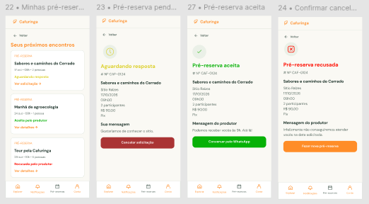

# HU45 — Consultar pré-reserva

## 1. Identificação

| Campo | Informação |
| --- | --- |
| ID da História | HU45 |
| Requisito Funcional | [RF45 — Consultar pré-reserva](https://www.google.com/search?q=../requisitos_software.md%2371-requisitos-funcionais) |
| Requisito Não Funcional | [RNF04, RNF05, RNF08, RNF10 e RNF11](https://www.google.com/search?q=../requisitos_software.md%2372-requisitos-nao-funcionais) |
| Regra de Negócio | [RN20](https://www.google.com/search?q=../requisitos_software.md%2374-lista-de-regras-de-negocio) |
| Característica de Produto | [CP6](https://www.google.com/search?q=../solucao.md%2323-caracteristicas-do-produto) |
| Objetivos Específicos | [OE3](https://www.google.com/search?q=../solucao.md%2322-objetivos-especificos-oe-do-produto) |
| Prioridade | Alta |

---

## 2. História de Usuário

*Como consumidor ou produtor, quero consultar as solicitações de pré-reserva relacionadas à minha conta ou às minhas experiências, para acompanhar as solicitações e verificar suas respectivas situações.*

---

## 3. Critérios de Aceitação

**CA01 — Acessar pré-reservas**

* **Dado** que o usuário esteja autenticado, **quando** acessar a funcionalidade de consulta de pré-reservas, **então** o sistema deve apresentar os registros aos quais seu perfil possui permissão de acesso.

**CA02 — Consultar solicitações como consumidor**

* **Dado** que o usuário possua solicitações de pré-reserva realizadas, **quando** acessar sua área de pré-reservas, **então** o sistema deve apresentar as solicitações associadas à sua conta.

**CA03 — Consultar solicitações como produtor**

* **Dado** que o usuário possua perfil de produtor, **quando** acessar a área de pré-reservas de suas experiências, **então** o sistema deve apresentar as solicitações recebidas para as experiências sob sua responsabilidade.

**CA04 — Visualizar informações da solicitação**

* **Dado** que existam solicitações disponíveis para consulta, **quando** o usuário selecionar uma delas, **então** o sistema deve apresentar as informações registradas e a situação correspondente.

**CA05 — Restringir acesso por perfil e vínculo**

* **Dado** que o usuário tente consultar uma pré-reserva que não esteja vinculada à sua conta ou às experiências sob sua responsabilidade, **quando** solicitar acesso ao registro, **então** o sistema deve impedir a visualização não autorizada.

**CA06 — Tratar ausência de solicitações**

* **Dado** que não existam pré-reservas associadas ao usuário ou às suas experiências, **quando** acessar a funcionalidade, **então** o sistema deve informar que não há solicitações disponíveis.

**CA07 — Apresentar situação atualizada**

* **Dado** que uma solicitação tenha sua situação alterada, **quando** o usuário consultar o registro, **então** o sistema deve apresentar a situação atualmente registrada.

---

## 4. Relação com os Requisitos Não Funcionais

**RNF04 — Acessibilidade Digital**

* Relação com a HU: as informações das pré-reservas devem ser apresentadas de maneira acessível e compreensível.

**RNF05 — Responsividade da Interface**

* Relação com a HU: a consulta das solicitações deve funcionar adequadamente em diferentes tamanhos de tela.

**RNF08 — Controle de Acesso por Perfil**

* Relação com a HU: a consulta deve respeitar as permissões dos perfis de consumidor e produtor, restringindo o acesso aos registros correspondentes.

**RNF10 — Proteção da Comunicação**

* Relação com a HU: o acesso às informações das pré-reservas deve utilizar comunicação protegida por HTTPS.

**RNF11 — Proteção de Dados Pessoais**

* Relação com a HU: os dados pessoais presentes nas solicitações devem ser protegidos e apresentados somente aos usuários autorizados.

---

## 5. Relação com as Regras de Negócio

**RN20 — Consulta de pré-reserva**

* Relação com a HU: estabelece as condições para consulta das solicitações de pré-reserva, respeitando o vínculo entre consumidores, produtores e experiências.

---

## 6. Relação com as Características de Produto

**CP6**

* Relação com a HU: a consulta de pré-reservas permite acompanhar o fluxo de solicitações de experiências e facilita a comunicação entre consumidores e produtores.

---

## 7. Relação com os Objetivos Específicos

**OE3 — Conexão direta e autonomia sem intermediação financeira**

* Relação com a HU: a consulta das solicitações permite que consumidores e produtores acompanhem diretamente o andamento das pré-reservas, sem intermediação financeira pela plataforma.

---

## 8. Protótipo

---

## 9. Atividades Relacionadas

| ID | Atividade | Descrição |
| --- | --- | --- |
| AT01 | Definir permissões de consulta | Identificar as condições de acesso às pré-reservas para consumidores e produtores. |
| AT02 | Implementar consulta do consumidor | Desenvolver a apresentação das solicitações realizadas pelo consumidor. |
| AT03 | Implementar consulta do produtor | Desenvolver a apresentação das solicitações recebidas para as experiências do produtor. |
| AT04 | Apresentar detalhes e situação | Exibir as informações e a situação atual de cada solicitação. |
| AT05 | Validar permissões | Testar o acesso conforme o perfil e o vínculo com as pré-reservas. |
| AT06 | Validar consulta | Testar a apresentação dos registros, a atualização da situação e a ausência de solicitações. |

---

## 10. Checklist do Definition of Ready (DoR)

* [x] A HU possui definição clara e informação necessária para ser trabalhada?
* [x] O requisito está representado por uma história de usuário?
* [x] A HU está rastreada aos requisitos de origem?
* [x] A HU faz parte do escopo do MVP?
* [x] A HU está coberta por critérios de aceite?
* [x] Os RNFs e as restrições legais aplicáveis estão identificados?
* [x] A HU está mapeada para uma interface, quando necessário?
* [x] A HU cabe em uma iteração?
* [x] As dependências estão mapeadas?
* [x] Os responsáveis estão definidos?
* [x] O requisito está implementado no protótipo e validado?

---

## 11. Checklist do Definition of Done (DoD)

* [ ] Entrega um incremento do produto?
* [ ] Contempla os critérios de aceite estabelecidos?
* [ ] O desenvolvimento foi concluído integralmente?
* [ ] Os testes foram executados e aprovados?
* [ ] Está aderente aos padrões de codificação?
* [ ] A funcionalidade foi revisada pela equipe?
* [ ] Mantém os índices de performance do produto?
* [ ] Atende aos requisitos de acessibilidade e responsividade?
* [ ] Preserva a segurança e a privacidade dos dados?
* [ ] Trata os erros do usuário?
* [ ] Está livre de defeitos críticos?
* [ ] Está documentado?

