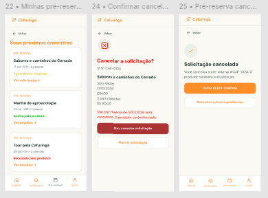

# HU46 — Cancelar pré-reserva

## 1. Identificação
<!-- REQUISITOS_HU_META_AUTO_INICIO -->
| Campo | Informação |
|---|---|
| **ID da História** | HU46 |
| **Requisito Funcional** | [RF46 — Cancelar pré-reserva](../requisitos_software.md#71-requisitos-funcionais) |
| **Requisito Não Funcional** | [RNF03](../requisitos_software.md#72-requisitos-nao-funcionais), [RNF04](../requisitos_software.md#72-requisitos-nao-funcionais), [RNF05](../requisitos_software.md#72-requisitos-nao-funcionais), [RNF08](../requisitos_software.md#72-requisitos-nao-funcionais), [RNF10](../requisitos_software.md#72-requisitos-nao-funcionais), [RNF11](../requisitos_software.md#72-requisitos-nao-funcionais) |
| **Regra de Negócio** | [RN21](../requisitos_software.md#73-lista-de-regras-de-negocio) |
| **Característica de Produto** | [CP6](../solucao.md#23-caracteristicas-do-produto) |
| **Objetivos Específicos** | [OE3](../solucao.md#22-objetivos-especificos-oe-do-produto) |
| **Prioridade** | Média |
| **Escopo** | MVP |
| **Iteração** | [Iteração 8](../evidencias/iteracao8.md) |
<!-- REQUISITOS_HU_META_AUTO_FIM -->

---

## 2. História de Usuário

*Como consumidor, quero cancelar uma solicitação de pré-reserva realizada, para desistir de uma experiência quando não tiver mais interesse ou disponibilidade para participar.*

---

## 3. Critérios de Aceitação

**CA01 — Consultar solicitações próprias**

* **Dado** que o usuário esteja autenticado, **quando** acessar suas solicitações de pré-reserva, **então** o sistema deve apresentar os registros associados à sua conta.

**CA02 — Selecionar solicitação para cancelamento**

* **Dado** que o usuário possua uma solicitação de pré-reserva, **quando** selecionar a opção de cancelamento, **então** o sistema deve solicitar a confirmação da operação.

**CA03 — Confirmar cancelamento**

* **Dado** que o sistema tenha solicitado a confirmação, **quando** o usuário confirmar o cancelamento, **então** o sistema deve registrar o cancelamento da solicitação, respeitando as condições estabelecidas pela regra de negócio.

**CA04 — Cancelar operação**

* **Dado** que o usuário tenha selecionado a opção de cancelamento, **quando** desistir da operação antes da confirmação, **então** o sistema deve manter a solicitação sem alterações.

**CA05 — Restringir cancelamento de solicitações de terceiros**

* **Dado** que a solicitação pertença a outro usuário, **quando** alguém tentar cancelá-la sem possuir autorização, **então** o sistema deve impedir a operação.

**CA06 — Atualizar situação da solicitação**

* **Dado** que o cancelamento tenha sido realizado com sucesso, **quando** o usuário consultar a solicitação, **então** o sistema deve apresentar a situação atualizada.

**CA07 — Tratar falha no cancelamento**

* **Dado** que ocorra uma falha durante o processamento, **quando** o usuário confirmar o cancelamento, **então** o sistema deve informar que a operação não foi concluída e manter a situação anterior da solicitação.

---

## 4. Relação com os Requisitos Não Funcionais

**[RNF03 — Prevenção e Recuperação de Erros](../requisitos_software.md#72-requisitos-nao-funcionais)**

Garante que o sistema solicite confirmação antes do cancelamento e oriente o usuário de forma clara diante de eventuais falhas na operação.

**[RNF04 — Acessibilidade Digital](../requisitos_software.md#72-requisitos-nao-funcionais)**

Garante que as opções de cancelamento, confirmação e desistência sejam acessíveis e compreensíveis a usuários com diferentes necessidades.

**[RNF05 — Responsividade da Interface](../requisitos_software.md#72-requisitos-nao-funcionais)**

Garante que a funcionalidade de cancelamento funcione adequadamente em diferentes tamanhos de tela e dispositivos.

**[RNF08 — Controle de Acesso por Perfil](../requisitos_software.md#72-requisitos-nao-funcionais)**

Garante que o cancelamento respeite rigorosamente as permissões do perfil e permita a operação exclusivamente ao usuário autorizado.

**[RNF10 — Proteção da Comunicação](../requisitos_software.md#72-requisitos-nao-funcionais)**

Orienta que o envio da solicitação de cancelamento utilize comunicação protegida por HTTPS.

**[RNF11 — Proteção de Dados Pessoais](../requisitos_software.md#72-requisitos-nao-funcionais)**

Assegura que os dados pessoais associados à pré-reserva permaneçam protegidos durante todo o processo de cancelamento.

---

## 5. Relação com as Regras de Negócio

**[RN21 — Cancelamento de pré-reserva](../requisitos_software.md#73-lista-de-regras-de-negocio)**

Estabelece as condições para o cancelamento de uma solicitação de pré-reserva, incluindo as permissões e as alterações de situação correspondentes.

---

## 6. Relação com as Características de Produto

**[CP6 — Experiências e atividades](../solucao.md#23-caracteristicas-do-produto)**

Permite que o consumidor gerencie suas solicitações de pré-reserva, mantendo atualizado o fluxo de comunicação entre as partes.

---

## 7. Relação com os Objetivos Específicos

**[OE3 — Conexão direta e autonomia sem intermediação financeira](../solucao.md#22-objetivos-especificos-oe-do-produto)**

Permite que o consumidor gerencie diretamente seu interesse em participar de uma experiência, sem depender de intermediação financeira da plataforma.

---

## 8. Protótipo

---

## 9. Atividades Relacionadas

| ID | Atividade | Descrição |
| --- | --- | --- |
| AT01 | Definir condições de cancelamento | Identificar as condições em que uma solicitação poderá ser cancelada. |
| AT02 | Implementar opção de cancelamento | Desenvolver a interface para iniciar o cancelamento de uma solicitação própria. |
| AT03 | Implementar confirmação | Desenvolver a solicitação de confirmação antes da operação. |
| AT04 | Implementar atualização de situação | Desenvolver o mecanismo de registro do cancelamento. |
| AT05 | Validar cancelamento | Testar permissões, confirmação, desistência e tratamento de falhas. |

---

## 10. Checklist do Definition of Ready (DoR)

Marque os itens conforme a história atender a cada condição.

* [x] A HU possui definição clara e informação necessária para ser trabalhada?
* [x] O requisito está representado por uma história de usuário?
* [x] A HU está rastreada aos requisitos de origem?
* [x] A HU faz parte do escopo do MVP?
* [x] A HU está coberta por critérios de aceite?
* [x] Os RNFs e as restrições legais aplicáveis estão identificados?
* [x] A HU está mapeada para uma interface, quando necessário?
* [x] A HU cabe em uma iteração?
* [x] As dependências estão mapeadas?
* [x] Os responsáveis estão definidos?
* [x] O requisito está implementado no protótipo e validado?

---

## 11. Checklist do Definition of Done (DoD)

Marque os itens após a verificação da entrega.

* [ ] Entrega um incremento do produto?
* [ ] Contempla os critérios de aceite estabelecidos?
* [ ] O desenvolvimento foi concluído integralmente?
* [ ] Os testes foram executados e aprovados?
* [ ] Está aderente aos padrões de codificação?
* [ ] A funcionalidade foi revisada pela equipe?
* [ ] Mantém os índices de performance do produto?
* [ ] Atende aos requisitos de acessibilidade e responsividade?
* [ ] Preserva a segurança e a privacidade dos dados?
* [ ] Trata os erros do usuário?
* [ ] Está livre de defeitos críticos?
* [ ] Está documentado?