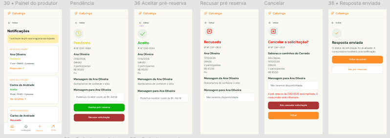

# HU47 — Responder pré-reserva de experiência

## 1. Identificação

| Campo | Informação |
| --- | --- |
| ID da História | HU47 |
| Requisito Funcional | [RF47 — Responder pré-reserva de experiência](https://www.google.com/search?q=../requisitos_software.md%2371-requisitos-funcionais) |
| Requisito Não Funcional | [RNF03, RNF04, RNF05, RNF08, RNF10 e RNF11](https://www.google.com/search?q=../requisitos_software.md%2372-requisitos-nao-funcionais) |
| Regra de Negócio | [RN22](https://www.google.com/search?q=../requisitos_software.md%2374-lista-de-regras-de-negocio) |
| Característica de Produto | [CP6](https://www.google.com/search?q=../solucao.md%2323-caracteristicas-do-produto) |
| Objetivos Específicos | [OE3](https://www.google.com/search?q=../solucao.md%2322-objetivos-especificos-oe-do-produto) |
| Prioridade | Média |

---

## 2. História de Usuário

*Como produtor, quero responder às solicitações de pré-reserva recebidas para minhas experiências, para informar ao consumidor se posso atender ao interesse manifestado.*

---

## 3. Critérios de Aceitação

**CA01 — Consultar solicitações recebidas**

* **Dado** que o produtor esteja autenticado, **quando** acessar a área de pré-reservas de suas experiências, **então** o sistema deve apresentar as solicitações recebidas que estejam vinculadas às experiências sob sua responsabilidade.

**CA02 — Selecionar solicitação**

* **Dado** que existam solicitações recebidas, **quando** o produtor selecionar uma solicitação, **então** o sistema deve apresentar os dados necessários para que ele possa analisá-la.

**CA03 — Responder solicitação**

* **Dado** que o produtor tenha selecionado uma solicitação, **quando** escolher uma resposta disponível, **então** o sistema deve permitir o registro da resposta correspondente.

**CA04 — Registrar resposta**

* **Dado** que o produtor tenha escolhido uma resposta válida, **quando** confirmar a operação, **então** o sistema deve registrar a resposta e atualizar a situação da solicitação.

**CA05 — Restringir resposta a produtor responsável**

* **Dado** que uma solicitação esteja vinculada a uma experiência de outro produtor, **quando** um produtor sem vínculo tentar respondê-la, **então** o sistema deve impedir a operação.

**CA06 — Impedir resposta de solicitação indisponível**

* **Dado** que uma solicitação não esteja mais disponível para resposta, **quando** o produtor tentar respondê-la, **então** o sistema deve impedir a alteração e informar a situação atual do registro.

**CA07 — Confirmar resposta**

* **Dado** que a resposta tenha sido registrada com sucesso, **quando** o processamento for concluído, **então** o sistema deve informar ao produtor que a solicitação foi respondida.

**CA08 — Tratar falha na resposta**

* **Dado** que ocorra uma falha durante o registro da resposta, **quando** o produtor confirmar a operação, **então** o sistema deve informar que a resposta não foi registrada e preservar a situação anterior da solicitação.

---

## 4. Relação com os Requisitos Não Funcionais

**RNF03 — Prevenção e Recuperação de Erros**

* Relação com a HU: o sistema deve validar a resposta e informar falhas durante o processamento, evitando alterações inconsistentes.

**RNF04 — Acessibilidade Digital**

* Relação com a HU: as informações e opções de resposta devem ser apresentadas de maneira acessível e compreensível.

**RNF05 — Responsividade da Interface**

* Relação com a HU: a consulta e a resposta às pré-reservas devem funcionar em diferentes tamanhos de tela.

**RNF08 — Controle de Acesso por Perfil**

* Relação com a HU: somente o produtor responsável pela experiência deve poder responder às solicitações correspondentes.

**RNF10 — Proteção da Comunicação**

* Relação com a HU: o envio das respostas deve utilizar comunicação protegida por HTTPS.

**RNF11 — Proteção de Dados Pessoais**

* Relação com a HU: os dados pessoais presentes nas solicitações devem ser protegidos durante a consulta e o registro da resposta.

---

## 5. Relação com as Regras de Negócio

**RN22 — Resposta de pré-reserva**

* Relação com a HU: estabelece as condições para que o produtor responsável responda às solicitações de pré-reserva recebidas para suas experiências.

---

## 6. Relação com as Características de Produto

**CP6**

* Relação com a HU: a resposta às pré-reservas permite que o produtor acompanhe e gerencie o interesse dos consumidores em suas experiências, dando continuidade ao fluxo de comunicação.

---

## 7. Relação com os Objetivos Específicos

**OE3 — Conexão direta e autonomia sem intermediação financeira**

* Relação com a HU: a resposta permite que o produtor se comunique diretamente com o consumidor sobre a solicitação de experiência, sem intermediação financeira pela plataforma.

---

## 8. Protótipo

---

## 9. Atividades Relacionadas

| ID | Atividade | Descrição |
| --- | --- | --- |
| AT01 | Definir opções de resposta | Identificar as respostas disponíveis para as solicitações de pré-reserva. |
| AT02 | Implementar consulta de solicitações | Disponibilizar ao produtor as solicitações recebidas para suas experiências. |
| AT03 | Implementar resposta | Desenvolver a interface para selecionar e registrar a resposta. |
| AT04 | Validar vínculo e situação | Garantir que somente o produtor responsável responda a solicitações disponíveis. |
| AT05 | Atualizar situação da solicitação | Implementar a atualização do registro após a resposta. |
| AT06 | Validar resposta | Testar permissões, atualização de situação e tratamento de falhas. |

---

## 10. Checklist do Definition of Ready (DoR)

* [x] A HU possui definição clara e informação necessária para ser trabalhada?
* [x] O requisito está representado por uma história de usuário?
* [x] A HU está rastreada aos requisitos de origem?
* [x] A HU faz parte do escopo do MVP?
* [x] A HU está coberta por critérios de aceite?
* [x] Os RNFs e as restrições legais aplicáveis estão identificados?
* [x] A HU está mapeada para uma interface, quando necessário?
* [x] A HU cabe em uma iteração?
* [x] As dependências estão mapeadas?
* [x] Os responsáveis estão definidos?
* [x] O requisito está implementado no protótipo e validado?

---

## 11. Checklist do Definition of Done (DoD)

* [ ] Entrega um incremento do produto?
* [ ] Contempla os critérios de aceite estabelecidos?
* [ ] O desenvolvimento foi concluído integralmente?
* [ ] Os testes foram executados e aprovados?
* [ ] Está aderente aos padrões de codificação?
* [ ] A funcionalidade foi revisada pela equipe?
* [ ] Mantém os índices de performance do produto?
* [ ] Atende aos requisitos de acessibilidade e responsividade?
* [ ] Preserva a segurança e a privacidade dos dados?
* [ ] Trata os erros do usuário?
* [ ] Está livre de defeitos críticos?
* [ ] Está documentado?
