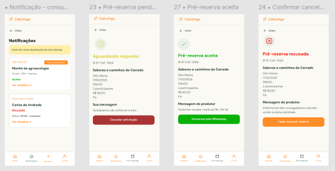

# HU48 — Notificar alteração de pré-reserva

## 1. Identificação

| Campo | Informação |
| --- | --- |
| ID da História | HU48 |
| Requisito Funcional | [RF48 — Notificar alteração de pré-reserva](https://www.google.com/search?q=../requisitos_software.md%2371-requisitos-funcionais) |
| Requisito Não Funcional | [RNF03, RNF05, RNF10, RNF11 e RNF12](https://www.google.com/search?q=../requisitos_software.md%2372-requisitos-nao-funcionais) |
| Regra de Negócio | [RN22](https://www.google.com/search?q=../requisitos_software.md%2374-lista-de-regras-de-negocio) |
| Característica de Produto | [CP6](https://www.google.com/search?q=../solucao.md%2323-caracteristicas-do-produto) |
| Objetivos Específicos | [OE3](https://www.google.com/search?q=../solucao.md%2322-objetivos-especificos-oe-do-produto) |
| Prioridade | Média |

---

## 2. História de Usuário

*Como usuário envolvido em uma solicitação de pré-reserva, quero receber notificações sobre alterações na situação da solicitação, para acompanhar o andamento da pré-reserva e tomar as providências necessárias.*

---

## 3. Critérios de Aceitação

**CA01 — Identificar alteração na pré-reserva**

* **Dado** que uma solicitação de pré-reserva tenha sua situação alterada, **quando** o sistema registrar a alteração, **então** deve identificar que existe uma atualização que precisa ser comunicada ao usuário envolvido.

**CA02 — Enviar notificação**

* **Dado** que uma alteração tenha sido registrada, **quando** o processo de notificação for executado, **então** o sistema deve enviar uma notificação ao usuário correspondente, conforme as regras estabelecidas.

**CA03 — Informar alteração realizada**

* **Dado** que uma notificação seja enviada, **quando** o usuário receber a mensagem, **então** ela deve informar que houve uma alteração na solicitação de pré-reserva.

**CA04 — Identificar solicitação relacionada**

* **Dado** que o usuário receba uma notificação, **quando** consultar seu conteúdo, **então** deve conseguir identificar a solicitação de pré-reserva à qual a alteração está relacionada.

**CA05 — Direcionar para consulta**

* **Dado** que a notificação disponibilize um acesso à solicitação, **quando** o usuário selecionar esse acesso, **então** o sistema deve direcioná-lo à consulta da pré-reserva correspondente, respeitando as permissões de acesso.

**CA06 — Não notificar alterações não registradas**

* **Dado** que uma alteração não tenha sido efetivamente registrada, **quando** o processo de notificação for executado, **então** o sistema não deve enviar uma notificação indicando uma alteração inexistente.

**CA07 — Tratar falha no envio**

* **Dado** que ocorra uma falha durante o envio, **quando** o sistema tentar notificar o usuário, **então** deve tratar a falha sem indicar que a notificação foi enviada com sucesso.

**CA08 — Preservar dados pessoais**

* **Dado** que a notificação contenha informações sobre uma pré-reserva, **quando** a mensagem for preparada e enviada, **então** o sistema deve evitar a exposição indevida de dados pessoais dos envolvidos.

---

## 4. Relação com os Requisitos Não Funcionais

**RNF03 — Prevenção e Recuperação de Erros**

* Relação com a HU: falhas no processo de notificação devem ser tratadas adequadamente, sem indicar o envio como concluído quando não tiver sido realizado.

**RNF05 — Responsividade da Interface**

* Relação com a HU: as páginas acessadas por meio das notificações devem funcionar adequadamente em diferentes tamanhos de tela.

**RNF10 — Proteção da Comunicação**

* Relação com a HU: o envio das notificações e o acesso às informações da pré-reserva devem utilizar comunicação protegida por HTTPS.

**RNF11 — Proteção de Dados Pessoais**

* Relação com a HU: as informações pessoais presentes nas notificações devem ser protegidas e limitadas à finalidade da comunicação.

**RNF12 — Compatibilidade entre Navegadores**

* Relação com a HU: as páginas acessadas por meio das notificações devem funcionar nos navegadores contemplados pelo requisito.

---

## 5. Relação com as Regras de Negócio

**RN22 — Notificação de pré-reserva**

* Relação com a HU: estabelece as condições para comunicar aos usuários envolvidos as alterações realizadas nas solicitações de pré-reserva.

---

## 6. Relação com as Características de Produto

**CP6**

* Relação com a HU: as notificações complementam o fluxo de pré-reserva, mantendo consumidores e produtores informados sobre as alterações nas solicitações.

---

## 7. Relação com os Objetivos Específicos

**OE3 — Conexão direta e autonomia sem intermediação financeira**

* Relação com a HU: a comunicação das alterações permite que consumidores e produtores acompanhem diretamente o andamento das solicitações e mantenham a interação sem intermediação financeira pela plataforma.

---

## 8. Protótipo

---

## 9. Atividades Relacionadas

| ID | Atividade | Descrição |
| --- | --- | --- |
| AT01 | Identificar alterações notificáveis | Definir quais alterações na situação da pré-reserva devem gerar notificações. |
| AT02 | Estruturar mensagem | Definir as informações que serão apresentadas na notificação. |
| AT03 | Implementar envio | Desenvolver o mecanismo de envio das notificações aos usuários envolvidos. |
| AT04 | Implementar direcionamento | Permitir o acesso à solicitação de pré-reserva correspondente, respeitando as permissões. |
| AT05 | Tratar falhas de envio | Implementar o tratamento de erros no processo de notificação. |
| AT06 | Validar notificações | Testar os eventos de alteração, o conteúdo das mensagens, o envio e a privacidade dos dados. |

---

## 10. Checklist do Definition of Ready (DoR)

* [x] A HU possui definição clara e informação necessária para ser trabalhada?
* [x] O requisito está representado por uma história de usuário?
* [x] A HU está rastreada aos requisitos de origem?
* [x] A HU faz parte do escopo do MVP?
* [x] A HU está coberta por critérios de aceite?
* [x] Os RNFs e as restrições legais aplicáveis estão identificados?
* [x] A HU está mapeada para uma interface, quando necessário?
* [x] A HU cabe em uma iteração?
* [x] As dependências estão mapeadas?
* [x] Os responsáveis estão definidos?
* [x] O requisito está implementado no protótipo e validado?

---

## 11. Checklist do Definition of Done (DoD)

* [ ] Entrega um incremento do produto?
* [ ] Contempla os critérios de aceite estabelecidos?
* [ ] O desenvolvimento foi concluído integralmente?
* [ ] Os testes foram executados e aprovados?
* [ ] Está aderente aos padrões de codificação?
* [ ] A funcionalidade foi revisada pela equipe?
* [ ] Mantém os índices de performance do produto?
* [ ] Atende aos requisitos de acessibilidade e responsividade?
* [ ] Preserva a segurança e a privacidade dos dados?
* [ ] Trata os erros do usuário?
* [ ] Está livre de defeitos críticos?
* [ ] Está documentado?

