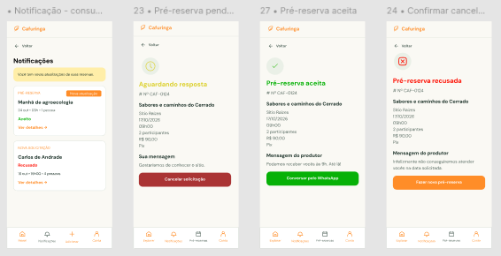

# HU48 — Notificar alteração de pré-reserva

## 1. Identificação
<!-- REQUISITOS_HU_META_AUTO_INICIO -->
| Campo | Informação |
|---|---|
| **ID da História** | HU48 |
| **Requisito Funcional** | [RF48 — Notificar alteração de pré-reserva](../requisitos_software.md#71-requisitos-funcionais) |
| **Requisito Não Funcional** | [RNF03](../requisitos_software.md#72-requisitos-nao-funcionais), [RNF05](../requisitos_software.md#72-requisitos-nao-funcionais), [RNF10](../requisitos_software.md#72-requisitos-nao-funcionais), [RNF11](../requisitos_software.md#72-requisitos-nao-funcionais), [RNF12](../requisitos_software.md#72-requisitos-nao-funcionais) |
| **Regra de Negócio** | [RN22](../requisitos_software.md#73-lista-de-regras-de-negocio) |
| **Característica de Produto** | [CP6](../solucao.md#23-caracteristicas-do-produto) |
| **Objetivos Específicos** | [OE3](../solucao.md#22-objetivos-especificos-oe-do-produto) |
| **Prioridade** | Média |
| **Escopo** | MVP |
| **Iteração** | [Iteração 9](../evidencias/iteracao9.md) |
<!-- REQUISITOS_HU_META_AUTO_FIM -->

---

## 2. História de Usuário

*Como usuário envolvido em uma solicitação de pré-reserva, quero receber notificações sobre alterações na situação da solicitação, para acompanhar o andamento da pré-reserva e tomar as providências necessárias.*

---

## 3. Critérios de Aceitação

**CA01 — Identificar alteração na pré-reserva**

* **Dado** que uma solicitação de pré-reserva tenha sua situação alterada, **quando** o sistema registrar a alteração, **então** deve identificar que existe uma atualização que precisa ser comunicada ao usuário envolvido.

**CA02 — Enviar notificação**

* **Dado** que uma alteração tenha sido registrada, **quando** o processo de notificação for executado, **então** o sistema deve enviar uma notificação ao usuário correspondente, conforme as regras estabelecidas.

**CA03 — Informar alteração realizada**

* **Dado** que uma notificação seja enviada, **quando** o usuário receber a mensagem, **então** ela deve informar que houve uma alteração na solicitação de pré-reserva.

**CA04 — Identificar solicitação relacionada**

* **Dado** que o usuário receba uma notificação, **quando** consultar seu conteúdo, **então** deve conseguir identificar a solicitação de pré-reserva à qual a alteração está relacionada.

**CA05 — Direcionar para consulta**

* **Dado** que a notificação disponibilize um acesso à solicitação, **quando** o usuário selecionar esse acesso, **então** o sistema deve direcioná-lo à consulta da pré-reserva correspondente, respeitando as permissões de acesso.

**CA06 — Não notificar alterações não registradas**

* **Dado** que uma alteração não tenha sido efetivamente registrada, **quando** o processo de notificação for executado, **então** o sistema não deve enviar uma notificação indicando uma alteração inexistente.

**CA07 — Tratar falha no envio**

* **Dado** que ocorra uma falha durante o envio, **quando** o sistema tentar notificar o usuário, **então** deve tratar a falha sem indicar que a notificação foi enviada com sucesso.

**CA08 — Preservar dados pessoais**

* **Dado** que a notificação contenha informações sobre uma pré-reserva, **quando** a mensagem for preparada e enviada, **então** o sistema deve evitar a exposição indevida de dados pessoais dos envolvidos.

**CA09 — Notificar as etapas do sinal**

* **Dado** que a situação do sinal de uma pré-reserva seja alterada, **quando** o sistema registrar a alteração, **então** deve apresentar ao envolvido uma nova notificação na área de notificações da plataforma para cada etapa: aceite com sinal a pagar, aviso de pagamento, confirmação, dispensa, prazo vencido, pagamento recebido e devolução.

---

## 4. Relação com os Requisitos Não Funcionais

**[RNF03 — Prevenção e Recuperação de Erros](../requisitos_software.md#72-requisitos-nao-funcionais)**

Garante que falhas no processo de notificação sejam tratadas adequadamente, sem indicar o envio como concluído quando não tiver sido realizado.

**[RNF05 — Responsividade da Interface](../requisitos_software.md#72-requisitos-nao-funcionais)**

Garante que as páginas acessadas por meio das notificações funcionem adequadamente em diferentes tamanhos de tela e dispositivos.

**[RNF10 — Proteção da Comunicação](../requisitos_software.md#72-requisitos-nao-funcionais)**

Orienta que o envio das notificações e o acesso às informações da pré-reserva utilizem comunicação protegida por HTTPS.

**[RNF11 — Proteção de Dados Pessoais](../requisitos_software.md#72-requisitos-nao-funcionais)**

Assegura que as informações pessoais presentes nas notificações sejam protegidas e limitadas estritamente à finalidade da comunicação.

**[RNF12 — Compatibilidade entre Navegadores](../requisitos_software.md#72-requisitos-nao-funcionais)**

Garante o funcionamento correto das páginas acessadas por meio das notificações nos principais navegadores contemplados pelo projeto.

---

## 5. Relação com as Regras de Negócio

**[RN22 — Notificação de pré-reserva](../requisitos_software.md#73-lista-de-regras-de-negocio)**

Estabelece as condições para comunicar aos usuários envolvidos as alterações realizadas nas solicitações de pré-reserva.

---

## 6. Relação com as Características de Produto

**[CP6 — Experiências e atividades](../solucao.md#23-caracteristicas-do-produto)**

Complementa o fluxo de pré-reserva, mantendo consumidores e produtores informados sobre as alterações nas solicitações.

---

## 7. Relação com os Objetivos Específicos

**[OE3 — Conexão direta e autonomia sem intermediação financeira](../solucao.md#22-objetivos-especificos-oe-do-produto)**

Permite que consumidores e produtores acompanhem diretamente o andamento das solicitações e mantenham a interação sem intermediação financeira pela plataforma.

---

## 8. Protótipo

---

## 9. Atividades Relacionadas

| ID | Atividade | Descrição |
| --- | --- | --- |
| AT01 | Identificar alterações notificáveis | Definir quais alterações na situação da pré-reserva devem gerar notificações. |
| AT02 | Estruturar mensagem | Definir as informações que serão apresentadas na notificação. |
| AT03 | Implementar envio | Desenvolver o mecanismo de envio das notificações aos usuários envolvidos. |
| AT04 | Implementar direcionamento | Permitir o acesso à solicitação de pré-reserva correspondente, respeitando as permissões. |
| AT05 | Tratar falhas de envio | Implementar o tratamento de erros no processo de notificação. |
| AT06 | Validar notificações | Testar os eventos de alteração, o conteúdo das mensagens, o envio e a privacidade dos dados. |

---

## 10. Checklist do Definition of Ready (DoR)

Marque os itens conforme a história atender a cada condição.

* [x] A HU possui definição clara e informação necessária para ser trabalhada?
* [x] O requisito está representado por uma história de usuário?
* [x] A HU está rastreada aos requisitos de origem?
* [x] A HU faz parte do escopo do MVP?
* [x] A HU está coberta por critérios de aceite?
* [x] Os RNFs e as restrições legais aplicáveis estão identificados?
* [x] A HU está mapeada para uma interface, quando necessário?
* [x] A HU cabe em uma iteração?
* [x] As dependências estão mapeadas?
* [x] Os responsáveis estão definidos?
* [x] O requisito está implementado no protótipo e validado?

---

## 11. Checklist do Definition of Done (DoD)

Marque os itens após a verificação da entrega.

* [ ] Entrega um incremento do produto?
* [ ] Contempla os critérios de aceite estabelecidos?
* [ ] O desenvolvimento foi concluído integralmente?
* [ ] Os testes foram executados e aprovados?
* [ ] Está aderente aos padrões de codificação?
* [ ] A funcionalidade foi revisada pela equipe?
* [ ] Mantém os índices de performance do produto?
* [ ] Atende aos requisitos de acessibilidade e responsividade?
* [ ] Preserva a segurança e a privacidade dos dados?
* [ ] Trata os erros do usuário?
* [ ] Está livre de defeitos críticos?
* [ ] Está documentado?

---

## Evidências

Registre abaixo **uma linha por contribuição**. Cada integrante deve informar o que realizou e inserir um link verificável para a evidência (por exemplo: **Pull Request, commit, resultado de teste, imagem ou vídeo**). Não registre atividades como concluídas sem comprovação.

| Integrante | Atividade realizada | Evidência (link ou arquivo) | Data |
|---|---|---|---|
| Pedro Augusto (macedoPedro20) | Revisão do PR das notificações: CI do back e do front vermelho, erro de tipo no teste de pré-reservas, consulta extra de notificações nas telas de administração, contrato sem subir de versão, link do e-mail, listagem sem limite nem índice e leitura da atualização; revisão aprovada após as correções | [PR #84](https://github.com/mdsreq-fga-unb/REQ-2026.2-T02-RedeCafuringa/pull/84) (revisão aprovada) | 22/11/2026 |
| Pedro Augusto (macedoPedro20) | Correção, por TDD: link de consulta nos e-mails montado sem lançar erro e preservando o caminho publicado, e texto da situação por um mapa de rótulos | [PR #84](https://github.com/mdsreq-fga-unb/REQ-2026.2-T02-RedeCafuringa/pull/84) · [commit a4734f6](https://github.com/mdsreq-fga-unb/REQ-2026.2-T02-RedeCafuringa/commit/a4734f6) · [commit e42a2cc](https://github.com/mdsreq-fga-unb/REQ-2026.2-T02-RedeCafuringa/commit/e42a2cc) | 22/11/2026 |
| Pedro Augusto (macedoPedro20) | Correção, por TDD: listagem de notificações limitada às 50 mais recentes, com dois índices na coleção de pré-reservas, e contrato OpenAPI 0.16.0 | [PR #84](https://github.com/mdsreq-fga-unb/REQ-2026.2-T02-RedeCafuringa/pull/84) · [commit 0e34376](https://github.com/mdsreq-fga-unb/REQ-2026.2-T02-RedeCafuringa/commit/0e34376) · [commit e4c2907](https://github.com/mdsreq-fga-unb/REQ-2026.2-T02-RedeCafuringa/commit/e4c2907) · [commit 336cb7c](https://github.com/mdsreq-fga-unb/REQ-2026.2-T02-RedeCafuringa/commit/336cb7c) | 22/11/2026 |
| Pedro Augusto (macedoPedro20) | Correção, por TDD: as telas de administração não consultam pré-reservas, e a atualização é marcada como lida ao abrir o detalhe por qualquer caminho | [PR #84](https://github.com/mdsreq-fga-unb/REQ-2026.2-T02-RedeCafuringa/pull/84) · [commit 15b11af](https://github.com/mdsreq-fga-unb/REQ-2026.2-T02-RedeCafuringa/commit/15b11af) · [commit 1b5124f](https://github.com/mdsreq-fga-unb/REQ-2026.2-T02-RedeCafuringa/commit/1b5124f) · [commit 0c5bf07](https://github.com/mdsreq-fga-unb/REQ-2026.2-T02-RedeCafuringa/commit/0c5bf07) | 22/11/2026 |
| Pedro Augusto (macedoPedro20) | Correção, por TDD: foco e fechamento do calendário do DatePicker (acessibilidade) | [PR #84](https://github.com/mdsreq-fga-unb/REQ-2026.2-T02-RedeCafuringa/pull/84) · [commit c24edcf](https://github.com/mdsreq-fga-unb/REQ-2026.2-T02-RedeCafuringa/commit/c24edcf) · [commit 6a1a15e](https://github.com/mdsreq-fga-unb/REQ-2026.2-T02-RedeCafuringa/commit/6a1a15e) | 22/11/2026 |
| Pedro Augusto (macedoPedro20) | Testes unitários da listagem de notificações e da resposta do produtor no detalhe, que levaram a cobertura de branches da consulta de pré-reservas de 74,54% para 83,63% e destravaram o CI do back | [PR #84](https://github.com/mdsreq-fga-unb/REQ-2026.2-T02-RedeCafuringa/pull/84) · [commit 895ea8b](https://github.com/mdsreq-fga-unb/REQ-2026.2-T02-RedeCafuringa/commit/895ea8b) | 22/11/2026 |
