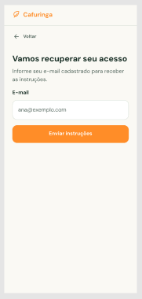

# HU09 — Autenticar usuário

## 1. Identificação

| Campo | Informação |
|---|---|
| **ID da História** | HU09 |
| **Requisito Funcional** | [RF09 — Autenticar usuário](../requisitos_software.md#71-requisitos-funcionais) |
| **Requisito Não Funcional** | [RNF03, RNF08, RNF10, RNF11](../requisitos_software.md#72-requisitos-nao-funcionais) |
| **Regra de Negócio** | [RN01, RN05](../requisitos_software.md#74-lista-de-regras-de-negocio) |
| **Característica de Produto** | [CP1](../solucao.md#23-caracteristicas-do-produto) |
| **Objetivos Específicos** | [OE1](../solucao.md#22-objetivos-especificos-oe-do-produto) |
| **Prioridade** | Alta |

---

## 2. História de Usuário

*Como usuário cadastrado, quero autenticar-me na plataforma, para acessar as funcionalidades disponíveis ao meu perfil.*

---

## 3. Critérios de Aceitação

**CA01 — Acesso à funcionalidade de autenticação**

- **Dado** que sou um usuário cadastrado, **quando** acessar a plataforma, **então** o sistema deve disponibilizar a funcionalidade de autenticação.

**CA02 — Preenchimento das credenciais**

- **Dado** que estou na tela de autenticação, **quando** informar minhas credenciais, **então** o sistema deve permitir o envio dos dados para validação.

**CA03 — Autenticação com credenciais válidas**

- **Dado** que informei credenciais válidas, **quando** solicitar a autenticação, **então** o sistema deve permitir meu acesso à plataforma.

**CA04 — Autenticação com credenciais inválidas**

- **Dado** que informei credenciais inválidas, **quando** tentar realizar a autenticação, **então** o sistema deve impedir o acesso e apresentar uma mensagem informando que não foi possível autenticar.

**CA05 — Acesso conforme o perfil**

- **Dado** que realizei a autenticação com sucesso, **quando** acessar as funcionalidades da plataforma, **então** o sistema deve disponibilizar somente aquelas compatíveis com meu perfil de usuário.

**CA06 — Proteção das credenciais**

- **Dado** que estou realizando a autenticação, **quando** enviar minhas credenciais à plataforma, **então** o sistema deve protegê-las durante a comunicação.

---

## 4. Relação com os Requisitos Não Funcionais

**RNF03 — Prevenção e Recuperação de Erros**

- Relação com a HU: Garante que o usuário receba mensagens claras quando informar credenciais inválidas ou ocorrer alguma falha durante a autenticação, permitindo compreender o problema e tentar novamente.

**RNF08 — Controle de Acesso por Perfil**

- Relação com a HU: Garante que, após a autenticação, o usuário tenha acesso somente às funcionalidades e informações compatíveis com seu perfil, impedindo a execução de operações não autorizadas.

**RNF10 — Proteção da Comunicação**

- Relação com a HU: Garante que as credenciais e demais dados transmitidos durante a autenticação sejam protegidos por meio de HTTPS em ambiente de produção.

**RNF11 — Proteção de Dados Pessoais**

- Relação com a HU: Garante que os dados pessoais associados à conta sejam tratados conforme sua finalidade e não sejam expostos indevidamente durante o processo de autenticação.

---

## 5. Relação com as Regras de Negócio

**RN01 — Perfis e permissões**

- Relação com a HU: Determina a existência de perfis distintos na plataforma e estabelece que cada usuário deve acessar somente as funcionalidades compatíveis com seu perfil após a autenticação.

**RN05 — Autenticação e recuperação de acesso**

- Relação com a HU: Estabelece as condições para autenticação e recuperação de acesso às contas cadastradas, orientando a validação das credenciais utilizadas pelo usuário.

---

## 6. Relação com as Características de Produto

**CP1 — Gestão de usuários e perfis**

- Relação com a HU: A autenticação permite identificar os usuários cadastrados e disponibilizar as funcionalidades correspondentes aos seus perfis, viabilizando a utilização das áreas restritas da plataforma.

---

## 7. Relação com os Objetivos Específicos

**OE1 — Inclusão e acessibilidade digital**

- Relação com a HU: A autenticação permite que os usuários cadastrados acessem os recursos da plataforma de acordo com seu perfil, contribuindo para a utilização dos serviços digitais disponibilizados pela Rede Cafuringa.

---

## 8. Protótipo

---

## 9. Atividades Relacionadas

| ID | Atividade | Descrição |
|---|---|---|
| AT01 | Disponibilizar a funcionalidade de autenticação | Implementar a interface de acesso à conta dos usuários cadastrados. |
| AT02 | Implementar entrada de credenciais | Permitir que o usuário informe os dados necessários para autenticação. |
| AT03 | Implementar validação de credenciais | Desenvolver a verificação das credenciais informadas em relação à conta cadastrada. |
| AT04 | Implementar controle de acesso por perfil | Direcionar o usuário às funcionalidades compatíveis com seu perfil após a autenticação. |
| AT05 | Implementar mensagens de retorno | Informar o usuário sobre autenticações concluídas ou tentativas não autorizadas. |
| AT06 | Aplicar proteção da comunicação | Garantir a transmissão segura das credenciais e dos dados relacionados à autenticação. |
| AT07 | Executar testes de autenticação | Verificar o comportamento da funcionalidade com credenciais válidas e inválidas. |
| AT08 | Executar testes de autorização | Verificar se cada perfil acessa somente as funcionalidades permitidas. |
| AT09 | Documentar e revisar a funcionalidade | Registrar o comportamento implementado e os resultados dos testes para revisão pela equipe. |

---

## 10. Checklist do Definition of Ready (DoR)

Marque os itens conforme a história atender a cada condição.

- [x] A HU possui definição clara e informação necessária para ser trabalhada?
- [x] O requisito está representado por uma história de usuário?
- [x] A HU está rastreada aos requisitos de origem?
- [x] A HU faz parte do escopo do MVP?
- [x] A HU está coberta por critérios de aceite?
- [x] Os RNFs e as restrições legais aplicáveis estão identificados?
- [x] A HU está mapeada para uma interface, quando necessário?
- [x] A HU cabe em uma iteração?
- [x] As dependências estão mapeadas?
- [x] Os responsáveis estão definidos?
- [x] O requisito está implementado no protótipo e validado?

---

## 11. Checklist do Definition of Done (DoD)

Marque os itens após a verificação da entrega.

- [ ] Entrega um incremento do produto?
- [ ] Contempla os critérios de aceite estabelecidos?
- [ ] O desenvolvimento foi concluído integralmente?
- [ ] Os testes foram executados e aprovados?
- [ ] Está aderente aos padrões de codificação?
- [ ] A funcionalidade foi revisada pela equipe?
- [ ] Mantém os índices de performance do produto?
- [ ] Atende aos requisitos de acessibilidade e responsividade?
- [ ] Preserva a segurança e a privacidade dos dados?
- [ ] Trata os erros do usuário?
- [ ] Está livre de defeitos críticos?
- [ ] Está documentado?

